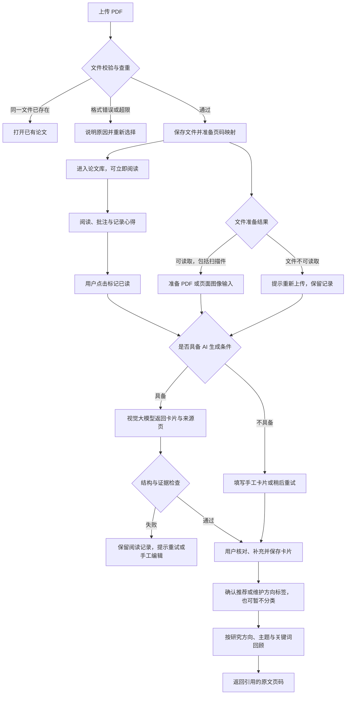

# 论文看板：产品需求文档

版本：0.6｜日期：2026-10-14｜性质：完整产品需求，第一至第四阶段本机功能已实现

【本次更新｜0.4.1】用户要求翻译内容放到右侧栏并可调整大小。阅读器以完整可用高度展示译文，支持拖动宽度、恢复默认和记住偏好；原文可折叠，长译文可滚动。译文与记录在同一侧栏切换，收起或滚轮跨页保留当前译文，关闭整篇论文后不持久保存译文。只在明确点击选区翻译时调用模型，其他输入范围与隐私规则不变。实现见[翻译侧栏开发与验收](翻译侧栏开发与验收.md)。

【开发状态】应用 0.4.0 已实现 M1 管理基础、M2 阅读与记录、M3 读后简介卡片及 M4 论文讨论与聊天生成卡片。沿用现有 DeepSeek，可多轮追问并根据已完成讨论生成独立卡片草稿；见[第四阶段实施方案](第四阶段实施方案.md)及[开发与验收](第四阶段开发与验收.md)。完整备份恢复、卡片／笔记内容检索、跨论文创新思路及课题组功能仍属后续目标。

【本次更新｜0.4.0】按用户要求优先开发聊天界面，原下一阶段检索、导出和应用内备份恢复后移。讨论记录本机持久保存，回答有原文来源，聊天推测和用户想法与论文事实分别标记；个人笔记、个人用途不自动发送。卡片生成后可编辑确认，保留已有版本和个人用途。

【本次实现更新】M3 沿用本机 SQLite 与单进程后台工作循环，无需独立 OCR 或 Redis；模型服务通过可替换适配器接入。个人记录默认不发送，显式选择后纳入；自动已读生成默认关闭。已有卡片更新产生新草稿，确认后才成为当前版本；新方向需要用户采纳才进入检索分类。本文件其余功能清单仍描述完整产品范围，不代表所有远期功能都已交付。

【本次更新】新增明确的研究方向标签需求：一篇论文可有多个方向；支持手动添加、批量维护、名称与别名管理，以及随卡片生成的 AI 推荐。已采纳的方向用于卡片展示和组合检索，未确认推荐不进入正式分类。同步更新功能清单、流程、字段、搜索和验收。

【0.2 更新】按用户提出的视觉大模型路线，取消独立 OCR 和复杂本地解析的必选依赖。首版支持文本 PDF 与清晰扫描 PDF，通过原生 PDF 输入或页面图片生成卡片。同步更新文件范围、流程、状态、卡片证据、模型能力、文案与验收要求；其他已确定功能继续保留。

## 1. 产品定位与设计依据

【本次更新｜0.3.2】用户要求论文信息由 AI 填写。详情新增显式识别入口，覆盖标题、作者、年份、DOI、研究方向、主题和普通标签；不生成阅读状态。未识别字段保持原值，结果可核对与修改，保存时创建所选新分类并写入论文；支持来源、等待时编辑保护、失败与取消保留原信息、结果复用和请求回执。已实现与真实样例验证见[论文信息 AI 填写开发与验收](论文信息AI填写开发与验收.md)。

给个人科研用户使用的网页工具，把论文上传、阅读、记录和回顾连接起来，让每篇读过的论文留下可编辑、可追溯的简介卡片，逐步积累支持研究思考的个人论文库。

### 1.1 已确认范围与设计假设

| 项目 | 当前决定 | 依据或后续验证 |
|---|---|---|
| 第一阶段用户 | 个人科研用户，后续支持课题组 | 用户已确认 |
| AI 处理 | 可以使用云端 API，必须能替换模型服务；优先视觉大模型直接理解论文 | 用户已确认；【0.2 更新】采用用户提出的视觉路线 |
| 核心能力 | 上传论文、阅读论文、读后简介卡片 | 用户明确提出 |
| 研究方向分类 | 给论文添加可检索的研究方向标签 | 【本次更新】用户明确提出；与主题、普通标签分别展示 |
| 后续能力 | 基于已读论文提供创新思路 | 用户提出，安排在后续阶段 |
| 产品形态 | 桌面浏览器优先的网页应用 | 设计建议；论文阅读需要大屏与多区域操作 |
| 部署方式 | 第一版单用户，可本机或私人服务器部署 | 设计假设；两种方式共用代码 |
| 文件范围 | 文本 PDF 与清晰扫描 PDF；不要求先完成 OCR | 【0.2 更新】原生 PDF 输入优先，不支持时将页面渲染为图片 |
| 使用语言 | 中文界面、中文简介，保留论文原始标题和必要术语 | 项目语言要求；支持中文、英文论文 |
| 商业策略 | 先验证科研效率价值，不在第一版设计收费系统 | 设计假设；尚无付费意愿或市场规模证据 |

### 1.2 三个视角的判断

- **用户价值**：上传只是起点，主要价值是解决“读过却忘了讲什么”和“笔记与原文分离”的回顾问题。尚未进行用户访谈，不能将痛点强度视为已验证。
- **持续运营**：先自用，记录每篇处理用量和存储增长；能持续降低回顾成本，再决定是否支持课题组或付费服务。第一版不假设规模化收入。
- **开发可行性**：【0.2 更新】PDF 阅读、视觉大模型理解和异步处理有可用组件。实际难点是图表和细小文字的识读、长文覆盖、卡片事实准确性和证据定位，需要先用真实论文验证。Gemini 的文档理解 API 支持 PDF 原生视觉处理，可作为接入候选。[官方文档](https://ai.google.dev/gemini-api/docs/document-processing?hl=zh-cn)

Zotero 已支持 PDF 批注、笔记及返回原文页码。因此，本产品的设计重点是统一的读后卡片、个人理解积累和后续跨论文研究分析；这些价值是否足够吸引用户，需要实际试用验证。[Zotero 官方文档](https://www.zotero.org/support/pdf_reader)

### 1.3 产品边界

第一版专注个人论文管理与阅读闭环。多人协作、移动端专用应用、公开分享、订阅付费、自动追踪新论文和创新思路生成均安排在后续阶段；减少首版依赖，也便于判断核心体验是否有效。

系统可以提出研究假设，但不得将生成内容包装成“已证明的新颖成果”。解析或生成失败时，用户仍能阅读、做笔记、填写手工卡片。

## 2. 用户与场景

| 场景 | 用户动作 | 期望结果 |
|---|---|---|
| 日常读论文 | 上传 PDF，归入研究主题，在阅读器中阅读并记笔记 | 文件、进度、批注和心得不会丢失 |
| 读完整理 | 点击“标记已读”，查看 AI 卡片，补充个人理解并保存 | 一张能回答“解决什么、怎么做、得到什么、对我有什么用”的卡片 |
| 数周后回顾 | 按主题、关键词和阅读状态找论文，先看简介再进入原文 | 快速找到论文与关键证据，不必重读全文 |
| 后续研究思考 | 选取同一研究问题下的多篇已读论文 | 得到有来源、有适用条件、有验证路线的候选研究假设 |

## 3. 核心流程与状态【0.2 更新】



### 3.1 三组状态必须分别存储

| 状态对象 | 状态与规则 |
|---|---|
| 阅读状态 | 待读 → 阅读中 → 已读；支持改回阅读中或待读。首次打开进入阅读中；只有用户主动标记才进入已读 |
| 文件准备状态 | 排队中 → 处理中 → 就绪／失败；扫描件可就绪，可选文本提取失败不阻断视觉生成 |
| 卡片状态 | 未生成 → 生成中 → 草稿 → 已确认；可生成失败。已有卡片更新时继续显示旧版本并标注更新中 |

“已读”表示用户确认已完成本次阅读，不表示掌握全文。跳到最后一页、阅读时长达到某个值、上传成功，都不自动判定已读。

首次标记已读时，默认创建一张 AI 草稿；缺少生成条件则提供手工卡片。打开论文不自动调用 AI。已读论文再次打开或再次标记，不重复生成；明确点击“更新卡片”才创建新版本。

## 4. 功能与版本范围【0.2 更新】

```text
论文看板
├── 🔴 第一版核心
│   ├── F01 单用户访问与个人空间
│   ├── F02 PDF 上传、查重、输入准备与信息修正
│   ├── F03 论文库、阅读看板、研究方向标签、主题与普通标签
│   ├── F04 PDF 阅读与进度保存
│   ├── F05 高亮、页码笔记与个人心得
│   ├── F06 读后简介卡片、证据回跳与版本管理
│   ├── F07 关键词检索、研究方向组合筛选与排序
│   ├── F08 Markdown 导出、完整备份与恢复
│   └── F09 模型配置、云端处理开关与用量记录
├── 🔴 已交付增量
│   └── F10 当前论文讨论、多轮追问与聊天生成卡片
├── 🟡 后续增强
│   ├── 复杂图表、公式与低清页面的视觉理解增强
│   ├── 讨论上下文覆盖与回答质量增强
│   ├── 跨论文对比与语义检索
│   └── Zotero／DOI／arXiv 导入
└── ⚪ 后续规划
    ├── 基于已读论文生成研究假设与验证计划
    ├── 课题组空间、共享卡片与权限
    └── 新论文监测与移动端体验增强
```

### 4.1 页面结构

| 页面 | 主要内容与操作 |
|---|---|
| 论文库／看板 | 上传入口、全局搜索、独立研究方向筛选、主题与普通标签、状态列、卡片与列表切换 |
| 阅读工作台 | 原文、目录或缩略图、笔记、简介卡片、标记已读 |
| 卡片详情 | 基本信息、结构化简介、证据链接、个人心得、编辑与版本 |
| 论文讨论 | 默认论文模型、多段讨论、消息与来源、补充原文页、发送／停止、生成卡片与草稿跳转 |
| 任务中心 | 文件准备和生成状态、失败原因、重试与取消 |
| 设置与数据 | 模型连接、处理开关、用量、导出、备份与恢复 |

阅读工作台是核心页面；原文占据最大面积，右侧可以切换笔记和卡片。侧栏可收起，宽度可调整。

```text
┌─────────────────────────────────────────────────────────────────────┐
│ 返回论文库  论文标题                         阅读状态  [标记已读]    │
├───────────┬───────────────────────────────────┬─────────────────────┤
│ 目录      │ 页码  8 / 16   缩放  搜索  高亮   │ [笔记] [简介卡片]   │
│ 缩略图    ├───────────────────────────────────┤                     │
│           │                                   │ 一句话简介          │
│ 第 1 页   │          PDF 原文                 │ 问题与方法          │
│ 第 2 页   │       视觉重点与阅读主区域         │ 关键结论 [原文 p8]  │
│ ……        │                                   │ 局限与个人心得      │
│           │                                   │ [保存] [更新卡片]   │
├───────────┴───────────────────────────────────┴─────────────────────┤
│ 进度已保存 / 笔记保存中 / 保存失败，重试                              │
└─────────────────────────────────────────────────────────────────────┘
```

上传用抽屉逐项显示进度；批注选区出现操作浮层；删除、恢复备份使用确认弹窗。手机窄屏切换为“原文／笔记／卡片”单区域展示，不要求首版实现三栏。

## 5. 核心功能详细要求

本节规定的容量和性能数值均为首版设计目标，需要开发验证。字符长度按 Unicode 字符计算；时间在存储层使用 UTC，界面按用户时区显示，默认北京时间。

### F10 论文讨论与聊天生成卡片【本次更新｜0.4.0】

**动线**：论文详情“论文讨论”或阅读工具栏“讨论” → 新建或选择本篇讨论 → 输入问题、可选补充原文页 → 查看回答与来源并追问 → 根据讨论生成卡片 → 查看指定草稿、编辑保存并确认。讨论页采用全页面，阅读入口按需打开；来源页回跳保留聊天记录。

**输入**：问题必填，1～2,000 字符；补充页默认为上次阅读页，可清空，最多 3 个有效原 PDF 页码。使用已有启用且视觉测试通过的模型，当前默认 DeepSeek。每次文字提取总计最多 40,000 字符、单页最多 6,000，选定页优先；扫描页用视觉输入，无独立 OCR。回答使用最近最多 12 条已完成消息，整理卡片使用本段全部已完成问答。界面展示实际覆盖和截断，不声称读过未输入的页。

**状态与保存**：问题先持久保存，生成状态独立记录；完成后原子保存回答、来源与任务结果。排队、准备、生成、格式核对、保存、失败和停止均有中文提示。停止或失败保留问题及旧回答；响应不确定时重试同一请求，不重复创建任务。未发送的问题离开前提示，关闭不会自动调用模型。

**卡片**：至少一次成功回答且无活动任务时可生成。新内容产生独立未确认版本，已有当前卡片继续保留；个人用途沿用人工内容，用户确认后才切换当前卡片。记录关联讨论及输入消息，可返回聊天核对。“局限与疑问”必须保留“讨论小结：”，记录本段问题、解释或待验证建议；讨论设想不能进入作者贡献和主要结果。原文事实、作者主张、讨论推测和用户想法分别标记，不把 AI 建议归为用户提出；只接受本次实际覆盖页的来源，合法来源仍需人工核对。

**边界**：每篇最多 100 段讨论，每段最多 50 条消息、60,000 字符，达到上限后新建讨论。每篇同时一个 AI 任务，复用预算和有限重试。个人笔记及个人用途不自动发送；聊天输入按用户发送动作纳入模型。模型未启用／未测试、文件缺失、过期版本、错误页码、权限或预算不足均拒绝生成并保留输入。聊天固定关联用户、论文和原文哈希，不能跨用户读取；论文彻底删除时关联清理。首版不包含跨论文聊天、联网检索或自动判定创新性。

**验收**：现有 DeepSeek 完成多轮问答，来源能回到正确页；刷新后已发送记录仍在；重复提交、取消晚到结果和权限检查有效；聊天草稿可查看、编辑确认，生成本身不会替换旧卡片。

所有写操作需显示保存结果；版本冲突返回冲突提示，不覆盖未保存文本。空状态、失败状态和禁用原因要有明确文案。

### F01 单用户访问与个人空间

**目的与触发**：首次启动建立个人空间和唯一账号，后续登录后进入论文库。第一版无公开注册与成员邀请。

**交互**：本机首次设置用户名与密码；密码不以明文存储。私人服务器部署必须登录，退出后清除会话。已有会话登录过期时保留当前未保存草稿，重新登录后重试。

| 状态 | 界面与可执行操作 |
|---|---|
| 默认 | 显示登录表单或已登录的个人空间 |
| 加载中 | 登录按钮显示“正在登录”，防止重复提交 |
| 成功 | 跳转论文库，恢复原访问页面 |
| 失败 | 显示“登录失败，请检查用户名和密码” |
| 禁用 | 连续失败限流，说明稍后重试 |
| 空状态 | 首次设置账号，说明这是个人论文空间 |

**边界**：账号密码为空不提交；用户名最多 64 字符，密码 12～128 字符；网络异常允许重试；无会话不能访问文件或任务；重复初始化由数据库唯一约束拒绝；非合法表单返回字段级提示。

| 字段 | 类型 | 必填／默认 | 校验 |
|---|---|---|---|
| username | 字符串 | 必填 | 3～64 字符，空间内唯一 |
| password | 字符串 | 设置时必填 | 12～128 字符，只保存不可逆密码摘要 |
| workspace_name | 字符串 | 默认“我的论文库” | 1～50 字符 |

### F02 论文上传、查重与输入准备【0.2 更新】

**目的与触发**：点击“上传论文”或拖入 PDF，形成可阅读、可管理的论文记录。支持一次选择最多 20 个文件，逐个处理与重试。

**交互**：每个文件显示上传进度；保存完成即进入论文库。后台读取页数、建立页码映射，必要时准备页面图片，不阻塞阅读，也不自动触发收费的模型调用。元数据可从文件信息或现有文本层获取，并显示来源；缺失项在用户触发卡片生成时由视觉模型补充，用户可以修正。不将文件名推测的作者或年份当作事实。

【本次更新】上传抽屉提供可选的研究方向多选框，允许搜索现有方向或新建方向；未选择也可上传，显示“未分类”。批量上传时，明确选择“应用到本批文件”才将所选方向关联到全部文件，不发起额外 AI 调用。

| 状态 | 界面与可执行操作 |
|---|---|
| 默认 | 显示上传按钮与可接受格式 |
| 加载中 | 分别显示上传进度和文件准备阶段，可取消待处理项 |
| 成功 | 显示“已加入论文库”，可打开阅读 |
| 失败 | 显示具体文件的失败原因，可单项重试 |
| 禁用 | 文件超限或空间不足，说明条件与处理办法 |
| 空状态 | 显示“上传第一篇论文，开始建立你的阅读记录” |

**边界**：0 字节拒绝；单文件最大 50 MiB、最多 300 页；网络中断只重传失败文件；无权限拒绝访问；同空间相同 SHA-256 返回已有记录，并发上传只创建一份；验证 PDF 文件头和实际可解析性，不仅检查扩展名。加密 PDF 提示用户先提供可读取副本，首版不保存解密密码。

同 DOI／标题但文件哈希不同，只提示可能是不同版本，允许分别保留；不得静默覆盖原文或迁移旧批注。扫描件走视觉输入路径，不出现“需要 OCR”状态。页面模糊、裁切缺失或模型无法识读时，说明受影响页码，允许上传更清晰副本、重试或手工补充。

应用上传限制与模型请求限制分别管理：允许保存 50 MiB／300 页的文件，不代表可以一次发送给任意模型。超出当前服务的字节、页数、图像数或上下文限制时，自动按页拆分并保存原页映射；无法在预算内完成则说明原因并等待用户选择。

| 字段 | 类型 | 必填／默认 | 限制与规则 |
|---|---|---|---|
| original_filename | 字符串 | 必填 | 最多 255 字符，仅作展示；存储名使用系统标识 |
| title | 字符串 | 必填 | 最多 500 字符；未提取到时暂用文件名并标记待修正 |
| authors | 字符串数组 | 默认空数组 | 最多 100 人，每个名字最多 100 字符 |
| year | 整数或空值 | 默认空值 | 1500～当前年份加 1；不能确认时留空 |
| doi | 字符串或空值 | 默认空值 | 最多 200 字符，去除 DOI 链接前缀后规范存储 |
| file_hash | 字符串 | 系统生成 | SHA-256，空间内唯一 |
| file_size / page_count | 整数 | 系统生成 | 分别按字节与 PDF 实际页数记录 |
| preparation_status | 枚举 | 默认排队中 | 采用第 3.1 节的文件准备状态 |

**验收**：同一 PDF 并发上传不产生重复论文；可选文本提取失败仍可使用视觉模型生成卡片；元数据可修正且不影响文件内容；文本 PDF 和清晰扫描 PDF 都能进入生成流程。

### F03 论文库、看板与研究方向分类【本次更新】

**目的与触发**：进入首页管理论文，按“待读／阅读中／已读”安排阅读；按研究方向找相关论文，并保留主题与普通标签整理能力。

**交互**：列表和状态看板共用数据；拖动列改变阅读状态，也提供菜单操作以便键盘使用。拖入已读按 F06 规则创建首次草稿。论文可关联多个研究方向、主题和普通标签；首页展示最近阅读、状态计数与待处理任务数量。

#### 5.3.1 三类分类的用途

| 分类 | 用途 | 示例 |
|---|---|---|
| 研究方向标签 | 描述论文研究领域或问题，作为主要分类检索入口 | 大语言模型、智能体、检索增强生成、多模态学习 |
| 主题 | 用户的课题、项目或阅读集合 | 毕业课题、论文复现计划 |
| 普通标签 | 补充用户自己的组织标记 | 重点复读、适合组会、待复现 |

研究方向由用户维护，系统不限制为某一学科。首版采用平级多标签，层级学科目录可后续扩展。以上仅为示例，不自动给用户论文套用这些方向。

#### 5.3.2 研究方向标签规则

- 每篇最多 10 个研究方向，允许为空；与普通标签合计最多 20 个。未分类论文可通过独立筛选入口找回。
- 在上传抽屉、论文详情和卡片区手动选择、添加或移除方向；论文库支持对选中论文批量添加／移除，并展示影响数量。超出上限的论文逐项提示，不静默截断。
- 方向管理支持创建、重命名、设置别名、合并和删除。正式显示名使用一个规范名称，例如“检索增强生成”；用户可将“RAG”设为别名，检索两者均命中同一方向。
- 去除首尾空白，统一全半角和拉丁字母大小写后校验同类名称唯一。别名只由用户明确维护，不能根据缩写相似就自动合并不同概念。
- 重命名更新全部关联论文的显示，不重新生成卡片。合并方向前展示受影响数量，确认后迁移关联并去重；删除方向只解除关联，不删除论文、笔记或卡片。
- 已采纳方向和 AI 推荐分别展示。用户添加或移除的方向不被重新生成卡片覆盖；AI 推荐可以逐项接受、修改或忽略。

| 状态 | 界面与可执行操作 |
|---|---|
| 默认 | 展示论文卡片、状态列、研究方向筛选及维护入口 |
| 加载中 | 展示骨架占位，状态或方向写入时标注保存中；合并时禁用重复提交 |
| 成功 | 更新所属列、方向显示、计数与筛选结果 |
| 失败 | 状态更新回退；方向输入保留，说明冲突或失败原因并可重试 |
| 禁用 | 非本人空间或记录已删除时禁用编辑；上限已满说明需要先移除方向 |
| 空状态 | 无论文引导上传；无方向引导新建；未分类提供添加方向入口；无筛选结果提供清除筛选 |

**边界**：空主题名或方向名不能保存；主题最多 50 字符、标签名称和单个别名最多 30 字符，每个方向最多 10 个别名；每篇方向和普通标签合计最多 20 个，其中方向最多 10 个，主题最多 10 个；断网时显示未同步状态；权限不符拒绝写入；多标签页同时更新使用版本检查；错误状态值或不属于当前空间的标签标识拒绝写入。重名或别名冲突提示选择已有方向，合并和删除必须确认影响范围。长标题省略但可查看完整标题。

删除论文先移入回收站，保留 30 天，可恢复；彻底删除单独确认。删除主题只解除分类，不删除论文。回收站论文退出搜索与 AI 输入，正在执行的任务不得重新发布其卡片。

| 字段 | 类型 | 必填／默认 | 校验 |
|---|---|---|---|
| reading_status | 枚举 | 默认待读 | 待读、阅读中、已读 |
| topic_ids / tag_ids | 标识数组 | 默认空数组 | 主题与普通标签必须属于当前空间，去重 |
| research_direction_ids | 标识数组 | 默认空数组 | 最多 10 项；仅接收当前空间的研究方向标签；与普通标签合计最多 20 项 |
| direction_name / aliases | 字符串／字符串数组 | 名称必填，别名默认空数组 | 名称和每个别名 1～30 字符；别名最多 10 项；同空间、同类型的规范名称与别名不冲突 |
| is_favorite | 布尔 | 默认否 | 与阅读状态独立 |
| revision | 正整数 | 默认 1 | 每次修改递增，用于冲突检测 |
| deleted_at | 时间或空值 | 默认空值 | 有值表示在回收站 |

**验收**：一篇论文可属于多个方向；创建、重命名、移除、合并只改变分类；通过名称或已维护别名可找到同一方向；批量操作逐项报告结果；未采纳 AI 推荐不影响正式分类和统计。

### F04 PDF 阅读与进度保存

**目的与触发**：打开论文，在应用内阅读原文，支持页码跳转、缩放、缩略图、文本搜索和继续上次阅读。

**交互**：原文逐页渲染，优先加载当前页和邻近页。页码变化后延迟 1 秒保存当前位置；缩放变化一并保存。返回论文库时尝试提交，未保存成功则提醒。阅读位置显示为“上次读到第 N 页”，不称为理解进度。

| 状态 | 界面与可执行操作 |
|---|---|
| 默认 | 恢复上次页码，首次从第 1 页开始 |
| 加载中 | 显示页占位与加载进度，其他已加载页可阅读 |
| 成功 | 展示原文，状态栏显示进度已保存 |
| 失败 | 分别显示加载失败或进度保存失败，并提供重试／下载原文 |
| 禁用 | 文件无文本层时禁用文字选择，说明可以添加页码笔记 |
| 空状态 | 文件缺失时提示重新上传副本；保留已有笔记可查看 |

**边界**：空文件在上传阶段拦截；超长论文按上传限制处理；断网后已加载页面仍可查看，未保存位置等待重试；无权限不返回 PDF；多标签页位置冲突提示用户选择继续位置，不覆盖批注；页码必须在 1～总页数，非法跳转提示有效范围。

| 字段 | 类型 | 必填／默认 | 校验 |
|---|---|---|---|
| last_page | 正整数 | 默认 1 | 不大于当前文件总页数 |
| zoom | 数值 | 默认适应宽度 | 自定义时 0.5～3.0 |
| last_opened_at | 时间 | 打开时更新 | 用于最近阅读排序 |
| completed_at | 时间或空值 | 默认空值 | 主动标记已读时写入，改回阅读中时清除 |

### F05 批注、笔记与个人心得

**目的与触发**：选中文字添加高亮与评论，或在右侧创建页码笔记；为读后卡片记录自己的理解、疑问与用途。

**交互**：文字选区浮层提供高亮与记笔记；笔记点击跳转到对应页。输入停止 1 秒后自动保存并显示结果。个人心得独立于 AI 字段存储，AI 更新不得覆盖它。首版不提供手绘批注。

| 状态 | 界面与可执行操作 |
|---|---|
| 默认 | 显示该论文已有批注和编辑区 |
| 加载中 | 显示保存中，允许继续输入 |
| 成功 | 显示已保存，可查看与跳回原文 |
| 失败 | 保留编辑文本，显示重试与复制内容 |
| 禁用 | 无文字层禁用文字高亮；页码笔记仍可用 |
| 空状态 | 显示“记录一个疑问或发现，方便下次接着读” |

**边界**：空笔记不创建；单条最多 10,000 字符，摘录最多 2,000 字符；保存失败不清空输入；无权限禁止写入；并发编辑返回冲突并保留两个版本供人工选择；坐标／页码不合法拒绝保存。删除单条笔记需确认，只删除该笔记，不影响论文和已经保存的卡片历史；删除整篇论文则将其笔记一起移入回收站。

| 字段 | 类型 | 必填／默认 | 校验 |
|---|---|---|---|
| note_type | 枚举 | 默认页码笔记 | 高亮评论、页码笔记、个人心得 |
| content | 字符串 | 笔记必填 | 1～10,000 字符 |
| page_number | 整数或空值 | 页码笔记必填 | 对应文件实际页码；个人心得可为空 |
| quote | 字符串或空值 | 高亮必填 | 原文摘录，最多 2,000 字符 |
| rects | 坐标数组 | 高亮必填 | PDF 页面坐标系，可对应多行选区 |
| file_id / revision | 标识／整数 | 系统维护 | 批注固定关联文件版本，防止换文件后错位 |

### F06 读后简介卡片【0.2 更新】

**目的与触发**：首次标记已读后创建 AI 草稿，也支持阅读前手动生成“预览卡片”。预览不改变阅读状态；所有论文均可手工填写。

**交互**：生成期间可继续阅读；生成结束显示草稿，用户核对后点击“保存并确认”。更新生成新版本，保留旧版本和个人心得；不直接覆盖人工修改。修改笔记后提示“个人记录有更新，可更新卡片”，不自动产生新调用。

| 状态 | 界面与可执行操作 |
|---|---|
| 默认 | 展示已有卡片；无卡片时提供生成与手工填写 |
| 加载中 | 展示排队／文件或图片提交／视觉理解／生成阶段；已有版本继续可读 |
| 成功 | 展示草稿、引用和核对入口，保存后显示已确认 |
| 失败 | 显示可操作原因，允许重试或手工建卡片 |
| 禁用 | 文件不可读取、模型缺少所需视觉能力、云端关闭或预算不足时说明原因；手工模式仍可用 |
| 空状态 | 显示“留下这篇论文的核心内容，方便下次快速回顾” |

**边界**：缺失信息写“原文未说明”或“当前识读无法确认”，不能补造；字段超长提示缩短，模型输出超限先受控修复；云端超时后保留任务与旧卡片；无权限拒绝生成和查看；同一输入与同一生成配置的重复请求返回已有任务；模型输出格式不符或证据指向其他论文时不得发布为可确认的事实卡片。模型识读的摘录标为待核对，不自动认定其为已验证的原文文字。

#### 5.6.1 卡片呈现

| 层次 | 内容 | 目标 |
|---|---|---|
| 看板短卡 | 原始标题、年份、研究方向标签、主题、阅读状态、150 字内简介、80 字内个人用途、卡片状态 | 快速识别与回忆 |
| 详情卡 | 研究问题、方法、贡献、结论、局限、来源与个人心得 | 决定是否深入阅读或复用 |

短卡正文总计不超过 350 字符，不计标题、标签与状态；详情 AI 正文总计不超过 2,000 字符，不计证据摘录和单独保存的个人心得。字段上限与总量上限同时校验。

【本次更新】短卡优先显示已采纳的研究方向，最多直接显示 3 个，其余用“＋N”展开。点击方向标签增加该方向筛选并保留已有阅读状态等条件。详情另设“AI 推荐方向”区，不与正式标签混排。

#### 5.6.2 标准卡片字段

| 字段 | 类型／上限 | 必填与缺失处理 | 来源要求 |
|---|---|---|---|
| summary | 字符串，150 字符 | 必填；手工草稿可暂留空，确认前填写 | 用通俗中文说明论文做什么 |
| research_question | 字符串，200 字符 | 必填；无依据时标记无法确认 | 对应摘要／引言证据 |
| method | 字符串，400 字符 | 必填；无法确认时说明原因 | 方法章节证据；综述可写组织方式 |
| contributions | 最多 3 项，每项 200 字符 | 可为空，展示原文未说明 | 表述为作者主张，避免自动视为已验证事实 |
| findings | 最多 3 项，每项 250 字符 | 可为空 | 实验、证明或综述结论的证据 |
| limitations | 最多 3 项，每项 200 字符 | 可为空 | 区分作者明确提出与系统推测 |
| personal_value | 字符串，80 字符 | 可为空 | 仅由用户填写，AI 不替用户判断价值 |
| paper_type | 枚举 | 默认未确定 | 实证、理论、综述、其他、未确定 |
| evidence_refs | 证据数组 | 每条事实结论需有对应证据 | 文件标识、系统页面标识、原 PDF 页序、可选摘录／图表说明、摘录来源与核对状态；文本块及区域坐标可选 |
| origin | 枚举，逐字段记录 | 必填 | 原文事实／作者主张／系统推测／用户记录 |
| schema_version | 字符串 | 必填 | 固定卡片结构版本，用于后续迁移 |
| research_direction_suggestions | 推荐对象数组，最多 5 项 | 可为空；不属于必填事实字段 | 【本次更新】随卡片生成；推荐对象为已有方向标识或候选新名称、100 字符内理由及来源页，用户采纳后才关联到论文 |

【本次更新】已采纳方向保存在论文与标签的关系中，作为分类的事实来源；卡片只展示当前关联，不把 AI 推荐数组当作正式分类。推荐优先使用用户已有方向，信息不足时不强行推荐；接受新名称时需“新建并添加”，已有别名能匹配时直接关联已有方向。

实验型论文的结果保留数据集、指标、数值、基线与实验条件；不能确认的项目留空。理论论文可以记录定理与假设；综述记录分类与覆盖范围。不要让所有论文都被迫填写实验成绩。

首版每条来源引用点击后打开对应 PDF 页，不要求模型返回精确区域坐标。服务端校验页面确实属于本篇论文，并通过输入页码映射还原原 PDF 实际页序；这只能验证引用合法性，不能证明结论得到该页支持。只有经过额外核对的坐标才用于区域定位。实际页序从 1 开始，正文印刷页码作为单独标签；拆分 PDF 的局部页码也必须映射回原页。

人工改写 AI 字段后标记“用户修改，引用待核对”，不沿用自动校验结论。用户确认仅表示已审阅，不代表系统证明事实正确。系统推测必须单独显示，不能混入原文结论。

**验收**：读完一篇论文形成一张当前卡片，旧版本可追溯；再次打开不重复生成；每个自动生成事实能打开其有效来源；更新不能覆盖个人心得；没有依据的数值不出现在卡片中。

### F07 搜索、研究方向筛选与回顾【本次更新】

**目的与触发**：在论文库输入关键词、选择研究方向或阅读状态，找到相关论文与记录。

**交互**：第一版搜索标题、作者、已采纳研究方向的名称及别名、普通标签、主题、卡片正文和个人笔记，组合筛选阅读状态／年份／收藏；默认按最近更新，支持最近阅读、年份、上传时间排序。输入停止 300 毫秒再搜索，旧请求结果不得覆盖新请求。命中显示片段与来源类型，点击笔记或证据可跳页。

研究方向支持多选，默认“匹配任一方向”，可切换为“同时包含全部方向”。方向筛选与关键词、阅读状态、主题、年份等条件之间采用同时满足规则。例如：“智能体＋检索增强生成，全部匹配，已读”只返回同时属于这两个方向的已读论文。

提供“未分类”选项，只匹配没有已采纳方向的有效论文；它与指定方向筛选互斥，界面选择一方时清除另一方，接口收到两者同时启用则提示条件冲突。方向旁的计数基于当前其他筛选条件下的有效论文，按论文去重，排除回收站与未采纳推荐。

| 状态 | 界面与可执行操作 |
|---|---|
| 默认 | 未输入时展示全部有效论文 |
| 加载中 | 保留上一组结果并显示正在搜索 |
| 成功 | 显示匹配数量、片段与当前筛选 |
| 失败 | 保留查询条件，提供重试 |
| 禁用 | 无权限的空间和回收站内容不进入结果 |
| 空状态 | 无匹配时提示尝试其他关键词或清除筛选 |

**边界**：空查询回到全部列表；查询最多 200 字符，分页每页 20、最多 100；网络失败可重试；所有搜索先按空间过滤；并发搜索以最新请求为准；非法年份或排序值返回字段提示。第一版按关键词匹配，不将其描述为理解自然语言的语义检索；全文检索与语义检索属于增强阶段。

| 字段 | 类型 | 默认 | 校验 |
|---|---|---|---|
| q | 字符串 | 空字符串 | 最多 200 字符，去首尾空白 |
| filters | 结构对象 | 空 | 状态、年份、主题、标签、收藏 |
| research_direction_ids | 标识数组 | 空数组 | 多选研究方向；必须属于当前空间且类型正确 |
| direction_match | 枚举 | any | any 表示任一方向，all 表示全部方向；没有方向时不额外筛选 |
| unclassified_only | 布尔 | 否 | 与非空 research_direction_ids 互斥 |
| sort | 枚举 | 最近更新 | 仅接受支持的排序方式 |
| page / page_size | 正整数 | 1 / 20 | 页大小不超过 100 |

**验收**：任一／全部方向的匹配结果正确；与“已读”等条件组合仍正确；方向别名可检索；一篇多标签论文只出现一次，数量与分页一致；仅有 AI 推荐的论文仍属于未分类。

### F08 导出、完整备份与恢复

**目的与触发**：用户希望在其他笔记工具中使用卡片，或迁移／恢复完整论文库。

**交互**：单篇或选中论文导出 Markdown，包含简介、个人心得与证据描述。完整备份包含论文文件、元数据、笔记、批注、卡片版本、配置说明和校验清单。恢复前预检并展示数量和冲突；首版仅支持恢复到空空间，避免不明确的合并规则。

| 状态 | 界面与可执行操作 |
|---|---|
| 默认 | 提供选中导出、完整备份和恢复入口 |
| 加载中 | 显示打包／校验／恢复阶段，防止重复启动 |
| 成功 | 下载文件或进入恢复后的论文库 |
| 失败 | 显示失败阶段，源数据保留，恢复临时数据回滚 |
| 禁用 | 无权限、空间非空或容量不足时说明原因 |
| 空状态 | 无选中论文禁用选中导出；空库仍可导出备份清单 |

**边界**：无文件或清单缺失不恢复；首版备份包和解压数据的上限各为 20 GiB，流式处理，并检查恢复数据是否满足目标实例的空间配额；中断后不提交半完成恢复；仅空间所有者可操作；备份使用一致性快照，恢复期间禁止写入；未知备份版本、哈希不符和目录穿越拒绝处理。API 密钥、密码摘要和登录会话不进入用户导出包，恢复后重新设置访问凭证。

完整备份采用应用级逻辑数据快照，明确排除访问凭证，不能直接将包含密码摘要和密钥的完整数据库转储放入用户备份包。恢复时保留论文、笔记、卡片与引用的内部标识，将空间归属映射到新设置的所有者。

| 字段 | 类型 | 必填／默认 | 校验 |
|---|---|---|---|
| export_type | 枚举 | 必填 | Markdown 或完整备份 |
| paper_ids | 标识数组 | 选中导出必填 | 必须属于当前空间 |
| backup_version | 字符串 | 系统生成 | 恢复时检查支持范围 |
| manifest | 结构对象 | 完整备份必填 | 数量、文件路径、大小、哈希、逻辑数据快照版本 |

Markdown 页码引用在外部工具中至少保留“文件名＋页码＋摘录”，不承诺本机应用链接在其他设备可用。备份中的原文保留应用内精确定位所需标识。

### F09 模型配置与用量【0.2 更新】

**目的与触发**：配置云端模型、连接测试、关闭云端处理、查看生成任务消耗。

**交互**：配置服务地址、模型名称和密钥；连接测试先发不含论文的最小请求，再用系统测试文档验证 PDF／图像能力。密钥保存后只显示遮蔽内容。页面说明生成会发送 PDF 文件或选取的页面图片，以及用户选择纳入的笔记。全局关闭云端后，取消未开始的调用；已发送请求可能仍在服务商执行，说明其结果处理方式。

| 状态 | 界面与可执行操作 |
|---|---|
| 默认 | 展示当前服务配置与云端处理开关 |
| 加载中 | 显示测试连接中，禁用重复测试 |
| 成功 | 显示已连接及可用能力，允许生成 |
| 失败 | 区分地址不可达、鉴权失败、限流、格式不支持 |
| 禁用 | 密钥缺失、云端关闭或用量达到上限时不能发起云端生成 |
| 空状态 | 引导配置模型，仍可上传、阅读和手工建卡片 |

**边界**：地址或模型为空不能保存启用配置；地址最多 2,048 字符、模型名最多 200 字符；测试超时保留配置供修改；只有所有者可查看设置；运行中任务固定使用启动时的配置快照，更新只影响新任务；协议与返回格式不兼容时拒绝启用对应能力。图像输入能力不等于原生 PDF 输入能力：优先使用通过测试的 PDF 视觉接口，否则按页转图；纯文本模型不能作为扫描件生成的自动替代。启用云端服务要求 HTTPS；未来本地模型允许显式配置本机地址。

| 字段 | 类型 | 必填／默认 | 校验 |
|---|---|---|---|
| cloud_enabled | 布尔 | 默认关闭 | 配置测试通过后由用户开启 |
| provider / base_url / model | 字符串 | 启用时必填 | 通过服务适配器校验 |
| api_key | 密钥 | 按服务要求 | 服务端安全保存，响应不返回明文 |
| include_notes | 布尔 | 默认否 | 当前任务由用户选择是否发送个人笔记 |
| monthly_token_limit | 正整数 | 首次配置必填 | 用户配置预算，不预设未验证的人民币费用 |
| input_tokens / output_tokens | 非负整数或空值 | 任务完成后记录 | 服务未返回用量时标记未知，不记为零 |

服务商数据保留策略在选定模型后核实并记录；关闭或删除本地数据不能代表撤回已经发送到服务商的内容。

## 6. 产品文案【0.2 更新】

采用专业、简洁的中文。提示先说发生了什么，再提供可执行动作。技术字段说明面向开发者；下表文案直接面向用户。

| 场景 | 示例文案 |
|---|---|
| 空论文库 | “上传第一篇论文，开始建立你的阅读记录。”按钮“上传论文” |
| 无卡片 | “为这篇论文留下简介，方便下次快速回顾。” |
| 文件准备中 | “正在准备论文，你可以先开始阅读。” |
| 视觉理解中 | “正在分析论文页面与图表，完成后会生成简介草稿。” |
| 页面模糊 | “第 N 页内容不够清晰，相关结论暂未确认。请查看原文或上传更清晰的副本。” |
| 大小超限 | “文件超过 50 MiB，请压缩后重新上传。” |
| 生成失败 | “卡片生成暂未完成，阅读记录已保留。请重试或填写手工卡片。” |
| 无依据 | “当前识读无法确认，请查看原文。” |
| 草稿提示 | “AI 草稿，请核对关键结论与引用。” |
| 方向推荐 | 【本次更新】“AI 推荐的研究方向尚未加入分类。”按钮“添加方向”／“忽略推荐” |
| 未分类 | 【本次更新】“这篇论文还没有研究方向标签。”按钮“添加研究方向” |
| 删除论文 | “将这篇论文移入回收站？30 天内可以恢复，原文、笔记和卡片将一起移动。” |
| 彻底删除 | “彻底删除后无法在应用中恢复，请先确认已备份。” |
| 版本冲突 | “其他页面已更新这条记录。你的编辑已保留，请比较后再保存。” |

## 7. 非功能要求【0.2 更新】

| 类别 | 第一版要求与验证条件 |
|---|---|
| 性能 | 在 1,000 篇论文、5 个并发页面操作下，普通列表／筛选 API 的第 95 百分位响应小于 500 毫秒；AI 与文件处理另计 |
| 阅读体验 | 20 MiB 内文本 PDF，在约定测试设备与本机网络下，首次显示第一页目标小于 3 秒；冷启动和下载时间单独记录 |
| 任务体验 | 接受生成后 1 秒内显示任务状态；默认每 2 秒查询，页面离开后停止轮询；不承诺模型一定在固定时间内完成 |
| 数据容量 | 首版验证目标为 1,000 篇；默认文件容量 10 GiB，可配置。容量满前提示，不能靠删除用户论文解决 |
| 权限 | 文件、笔记、卡片、任务和搜索都由服务端按当前空间检查；文件链接不能绕过登录 |
| 兼容性 | Windows／macOS 的 Chrome、Edge 最新两个主版本；桌面至少 1,280 像素宽优先。其他浏览器纳入后续验证 |
| 安全 | 私人服务器使用 HTTPS；密码不可逆摘要；密钥服务端保存；输出内容转义；PDF 读取与渲染进程设置资源限制；服务端管理云端文件引用与清理 |
| 可靠性 | 重启后恢复或明确终结任务；重试不能生成重复当前卡片；阅读与笔记不依赖 AI 服务在线 |
| 数据保留 | 正常论文长期保留至用户删除；回收站 30 天；任务技术日志默认 30 天；卡片历史长期保留 |
| 备份 | 提供手动完整备份与恢复；私人服务器建议每天备份、保留至少 7 份。备份后必须能恢复验证 |
| 可访问性 | 常用操作可用键盘完成，焦点可见；阅读状态不只依靠颜色区分 |

## 8. 第一版验收与价值验证【0.2 更新】

### 8.1 发布前必须通过

1. 单篇／批量上传、同文件查重、损坏文件提示可用；元数据可编辑。
2. PDF 可阅读，刷新后恢复页码；长文不会一次渲染所有页。
3. 高亮与页码笔记在刷新和缩放后位置正确；扫描件提供页码笔记替代路径，并能通过视觉模型生成卡片。
4. 标记已读触发首次卡片草稿，重复点击不会重复创建任务；生成失败不撤销已读状态。
5. 卡片来源可回跳到正确文件与实际页；拆分文档或页面图片仍定位到原 PDF 页；模型摘录与人工核对状态明确；个人心得不被重新生成覆盖。
6. 可按标题／卡片／笔记关键词检索，筛选与分页结果一致。
7. 论文删除后任务不能重新发布内容；恢复后原文、笔记和卡片关联正确。
8. 完整备份恢复到空空间后，论文文件哈希、记录数量、批注位置与卡片历史一致。
9. 无会话不能获取 PDF；API 密钥不出现在浏览器响应、导出包或普通日志中。
10. API 限流、超时、断网和进程重启时，用户能看到准确任务状态并继续阅读。
11. 【本次更新】多研究方向、名称与别名检索、任一／全部匹配、未分类及组合筛选正确；批量维护与合并不删除论文，重新生成卡片不覆盖用户分类。

### 8.2 小范围试用

建议首批由本人和 3～5 位科研用户试用两周；这是试验安排建议，尚非已落实样本。

衡量：上传后成功开始阅读比例、已读论文留有卡片的比例、卡片被再次打开次数、返回原文证据次数、明显事实错误率和单篇处理用量。用户自愿反馈即可，首版不必建设复杂行为追踪系统。

用“读过论文的回忆与找回任务”比较有卡片和无卡片时的用时及回答准确性。卡片创建数量只是使用指标，不能代替效率验证。

## 9. 后续创新思路模块

### 9.1 输入与流程

用户选择研究问题、已读论文范围、可用时间／数据／计算资源。默认只纳入已读且已确认的卡片；用户可显式加入其他论文。以卡片定位线索，再检索原文证据与用户选择授权使用的笔记。

【本次更新】论文范围可按一个或多个已采纳研究方向选择，沿用任一／全部匹配规则；方向标签用于限定检索范围，具体研究关联仍需原文证据支持。

提取“研究问题—方法—假设条件—结果—作者局限—用户疑问”，发现可比较的差异、互补方法和未充分验证条件。按问题聚合，而不是把任意两篇论文的标题拼接。

### 9.2 输出为候选研究假设卡

| 内容 | 要求 |
|---|---|
| 研究问题 | 明确目标、对象和适用条件 |
| 已有证据 | 标出支持或反对该思路的论文、页码、原文片段 |
| 候选改进 | 描述拟改变的具体因素和推理链，标记为系统假设 |
| 可能价值 | 在什么条件下可能改善什么，避免空泛的“提升效果” |
| 验证方案 | 最小试验、对照方法、评价指标、资源需求与停止条件；非实验论文改为证明／论证路线 |
| 失败原因 | 方法兼容性、数据条件、资源、混杂因素或已知反例 |
| 新颖性边界 | “在选定论文范围内未发现”，不能直接写“全球首创” |
| 用户动作 | 收藏、修改、驳回、转为试验计划并记录结果 |

新颖性核查分两级：库内比较；用户启用后的公开文献补充检索。后者保存检索日期、关键词、来源与覆盖范围，也不能保证穷尽全部文献。展示事实、作者判断、用户理解和系统假设的来源差别。

### 9.3 上线条件

先具备稳定的卡片结构、证据引用与跨论文检索，再实现创新模块。对检索遗漏、无依据推理和试验不可执行进行人工评估；优先判断“是否值得验证”，不输出未经校准的创新概率或新颖性分数。

## 10. 尚待验证的决定【0.2 更新】

以下项目不阻塞本文档交付，开发时需要按原型和用户反馈收敛：

- 具体模型服务与预算上限：用相同论文集比较事实错误、中文质量、延迟和实际用量后选择。
- 本机还是私人服务器作为第一批运行环境：影响运维与备份方式，不影响核心功能定义。
- 学科与典型论文类型：先用用户常读论文取样，避免只针对机器学习论文优化卡片。
- 扫描件、多栏、数学公式的实际占比与清晰度：用于评估视觉模型质量、分批策略、图片分辨率和预算；独立 OCR 不作为首版依赖。
- 多人阶段的共享边界：个人笔记默认私有，共享卡片与原文需要独立授权；正式实现前明确课题组规则。

技术结构、数据关系、任务可靠性、开发顺序和排期详见同目录的《开发方案》。
