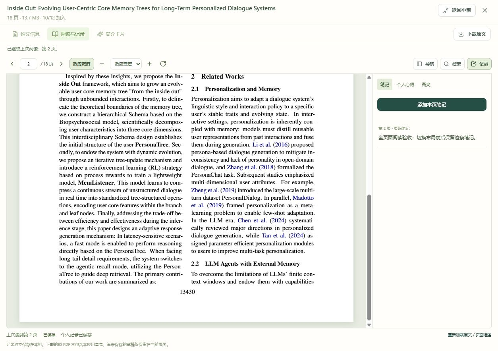

# 全页面阅读开发与验收

2026-10-13｜应用 0.3.4｜Git 标签 `v0.3.4`

## 使用方式

打开论文的“阅读与记录”，点击右上角“全页面阅读”，阅读界面铺满浏览器内容区域。点击“返回小窗”可恢复原布局，右上角关闭按钮返回论文库。

应用在当前浏览器记住选择，下次打开论文自动沿用。切换到论文信息或简介卡片时使用原详情布局，返回阅读时恢复所选模式。浏览器存储不可用时仍可切换当前阅读界面。

截图使用独立验收环境中的实际 PDF；其中的验收笔记只保存在测试数据目录。

## 实现方式

- `frontend/src/components.tsx`：增加可选的全页面容器与标题栏操作，继续复用原来的焦点管理、退出键与关闭回调。
- `frontend/src/PaperDetail.tsx`：提供阅读布局切换，使用 `paperboard-reader-layout` 保存浏览器偏好。切换时仅修改布局，不重建阅读器；保留其页码、缩放、笔记及保存队列。
- `frontend/src/ReaderLayout.css`：全页面容器使用浏览器可见高度；PDF 阅读区占用工具栏和状态栏之外的剩余空间。手机上的导航、PDF 和记录区在可用高度内分配空间，各自滚动。

关闭全页面仍执行原有保存流程。若笔记或其他编辑未保存成功，会显示“处理未保存的内容”，可以继续编辑、重试保存或复制内容。布局偏好无需新增 API 或数据库迁移。

## 验证结果

- 前端 69 项检查通过，TypeScript 检查与生产构建通过。
- 新增检查覆盖切换时的阅读器实例及草稿保留、重新打开后的偏好恢复、信息页切换、存储异常和关闭时保存失败的处理。
- 实际十八页 PDF：在 1280 × 720 浏览器内容区域，全页面容器边界为 `(0,0,1280,720)`；阅读区高度从小窗的 405 像素增加到约 478 像素。
- 跳转到第 2 页并创建验收笔记后，切换大小窗保留页码和内容；重新打开继续第 2 页，笔记已自动保存，沿用全页面布局。
- 390 × 844 窄屏检查：容器宽度与可滚动宽度均为 390 像素；同时打开导航、PDF 和笔记时，三个区域均在可用高度内显示，没有页面横向溢出。

## 发布与版本关联

应用版本同步为 0.3.4，发布提交关联 `v0.3.4`。使用 `git show v0.3.4 --stat` 查看源码、样式和验收记录的对应提交。

正式页面运行在 `http://127.0.0.1:8000`，刷新后显示入口；保留旧前端资源供已经打开的阅读页继续加载。正式库备份位于 `.test-data/full-page-before`，本轮不修改数据库结构。
