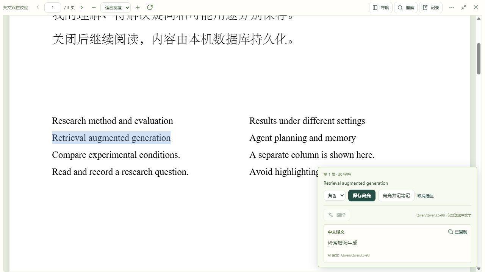

# 划词翻译开发与验收

【后续更新｜0.4.1】译文已从选区浮层移到可调整宽度的阅读右侧栏，支持收起、记录切换和跨页保留。见[翻译侧栏开发与验收](翻译侧栏开发与验收.md)。下文保留 0.3.7 的原始实现与验收记录。

2026-10-13｜应用 0.3.7｜Git 标签 `v0.3.7`

## 使用方式

在原文的文字层中拖选单词、术语或段落，选区浮层出现“翻译”。点击后显示简体中文译文，可以取消、重试或复制。复制权限不足时提供可手动复制的文本框；按退出键先关闭选区浮层。译文保留在当前浮层，不自动写入笔记或卡片。

翻译使用用户指定的独立免密钥服务，开箱可用：

- 基础地址：`http://47.100.90.123:8008/v1`
- 接口：`POST /chat/completions`，兼容 OpenAI Chat Completions 协议。
- 模型：`Qwen/Qwen3.5-9B`
- 不发送 API 密钥或任何鉴权头。

仅点击翻译时发送选中的文字；进入阅读、选词和读取配置不会调用模型。请求不带整份 PDF、图片、论文标题或个人笔记。翻译配置独立于卡片模型，不要求打开原有云端开关，也不读取或修改其加密密钥。

截图中的论文是独立验收库的合成双栏 PDF，译文来自上述真实模型服务。

## 实现

`backend/app/translation.py` 提供免密钥适配、取消与超时、错误映射、有界响应、会话内缓存和翻译接口。API 仍检查登录、请求来源、论文所属空间、页码和原文版本。网络请求在数据库读事务结束后执行，不占用阅读记录的写入锁。

HTTP 例外只允许用户指定的完整服务地址，其余地址继续要求 HTTPS 和公网解析；浏览器不能提交或覆盖模型地址。关闭自动重定向，不继承环境代理。原有卡片模型地址校验和密钥规则不变。

`GET /api/v1/settings/translation` 返回当前翻译配置；`POST /api/v1/papers/{paper_id}/translation` 接收 `quote`、`page_number`、`file_hash`，返回译文、模型、缓存标记和服务商返回的 token 用量。选区上限为 2,000 字符，总超时默认 60 秒。

缓存按用户、论文、原文版本、页码、服务、模型和选中文字区分，最多 200 条、有效期 30 分钟，仅存在当前服务进程内。每人同时一个请求，整个应用最多四个请求，每人每分钟最多 20 次非缓存调用；失败和取消结果不缓存。取消关闭本机请求连接；远端已经开始的推理是否终止由远端服务决定。本轮翻译调用不计入卡片模型的月度预算，也不保存到卡片调用表。

`frontend/src/reader/SelectionTranslation.tsx` 在既有选区浮层中显示翻译状态和译文。取消、关闭、切换选区或前端超时会中断旧请求并忽略晚到结果。`SelectionToolbar.tsx` 保留高亮和笔记入口；`PdfPage.tsx` 将可翻译文字与可保存高亮坐标分开，坐标尚未准备好或只读时仍可以翻译。

无文字层的扫描页暂不支持划词翻译；有隐藏文字层的图片 PDF 可以选词翻译。跨页摘录仍需分开选择。本轮不增加 OCR 或数据库迁移。

## 服务端配置

默认直接使用上述服务。需要替换时在启动前配置环境变量：

| 变量 | 默认值 | 用途 |
| --- | --- | --- |
| `PAPERBOARD_TRANSLATION_ENABLED` | `1` | `0` 停用翻译 |
| `PAPERBOARD_TRANSLATION_BASE_URL` | 用户指定地址 | 支持安全校验通过的 HTTPS 免密钥兼容服务 |
| `PAPERBOARD_TRANSLATION_MODEL` | `Qwen/Qwen3.5-9B` | 服务端模型标识 |
| `PAPERBOARD_TRANSLATION_TIMEOUT` | `60` | 总超时秒数，执行时限制在 5～120 秒 |

请求使用 `chat_template_kwargs.enable_thinking=false` 直接返回译文，并兼容剔除响应中的思考标签；参数依据 [Qwen 官方模型说明](https://huggingface.co/Qwen/Qwen3.5-9B#instruct-or-non-thinking-mode) 核对，并在用户指定服务上实际验证。

## 验证与发布

- 后端 **138 项**完整回归通过，前端 **92 项**回归通过，TypeScript 和独立、正式生产构建通过。
- 后端覆盖免密钥请求、只发送文字、校验先于调用、缓存隔离、跨空间缓存权限、接口停用、服务失败与空响应、输出截断、思考内容、超时、断连取消和限流。修正 ASGI 断连探测吞掉任务取消时的退出处理，避免请求连接一直等待。
- 前端覆盖显式调用、取消后晚到结果、切换选区、错误重试、正常复制与复制回退、关闭请求、只读浮层和前端超时。
- 实际 `GET /v1/models` 返回 `Qwen/Qwen3.5-9B`；免密钥合成例句翻译返回 HTTP 200，输出 12 token；浏览器实际将 `Retrieval augmented generation` 翻译为“检索增强生成”，并复制成功。
- 390 × 844 窄屏中，页面可滚动宽度为 390，翻译浮层宽 348、左侧 21、右侧 369，未产生横向溢出；临时尺寸已恢复。
- 发布前完整备份位于 `.test-data/translation-before`。正式库继续使用 `0005_task_order`；运行数据、原文、密钥和备份不提交到 Git。

正式服务发布为 0.3.7，刷新页面后可见新入口；发布提交关联中文说明的 `v0.3.7` 标签，既有前端资源继续保留供已打开的页面加载。
