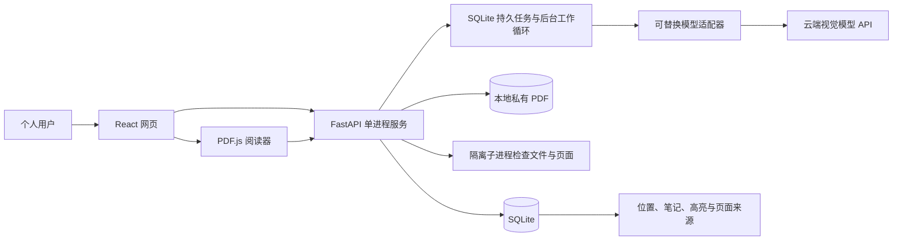
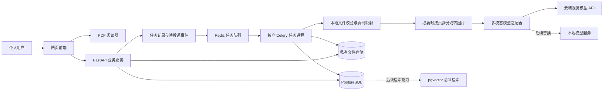
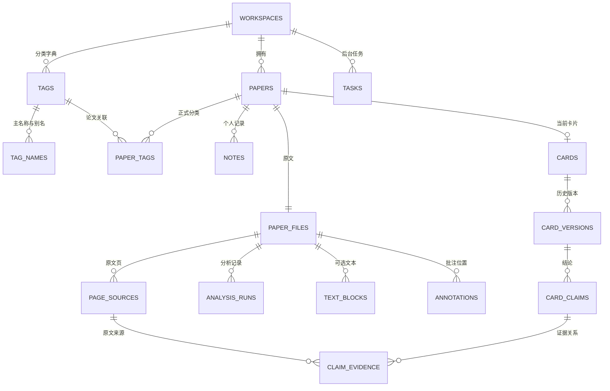
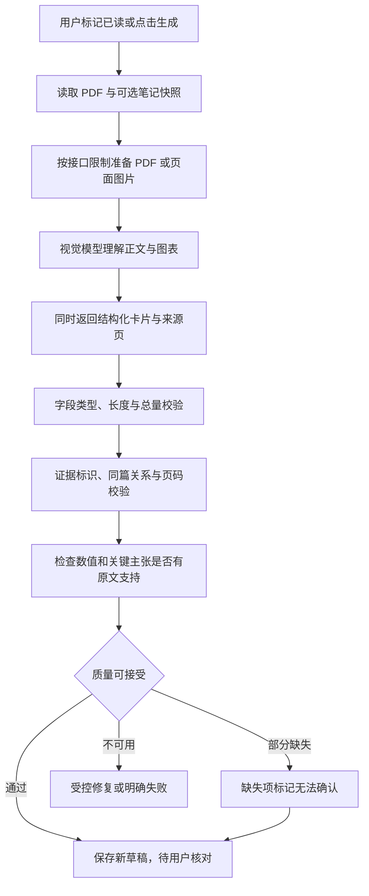

# 论文看板：开发方案

版本：0.8｜日期：2026-10-14｜对应《产品需求文档》0.6｜性质：总方案与分阶段实施索引，M1～M4 本机功能已实现

【本次更新｜0.4.1】阅读器增加共享右侧栏，译文与笔记分别保持状态，切换或收起不卸载组件；翻译目标选区与当前高亮选区独立，跨页滚动不清空译文。宽度可拖动、键盘调整和恢复默认，并记录浏览器偏好。现有免密钥翻译接口不变，无新迁移，见[翻译侧栏开发与验收](翻译侧栏开发与验收.md)。

【开发状态】应用 0.4.0 已完成 M1“管理基础”、M2“阅读与记录”、M3“读后简介卡片”及 M4“论文讨论与聊天生成卡片”。正式库升级到 `0006_discussions`，原有记录和原文保留。第四阶段规格见[实施方案](第四阶段实施方案.md)，实现与验收见[开发与验收](第四阶段开发与验收.md)。真实 DeepSeek 多轮问答与聊天生成卡片已跑通；论文事实准确性仍需逐项核对。

【本次更新｜0.4.0】用户明确将下一阶段改为论文讨论，原 M4 回顾与交付中的内容检索、导出、应用内备份恢复后移。新增讨论与消息两张表，复用现有模型配置、持久任务、预算与卡片版本；默认沿用已部署 DeepSeek。聊天使用有限全文文字与最多三页视觉补充，无独立 OCR；根据完整讨论生成独立草稿，人工确认后切换当前卡片。后端 151 项、前端 101 项及构建检查通过。

【0.4 更新】补充 M2 实施索引，明确 SQLite 本机架构与后续架构的关系，统一 M0～M5 开发编号，细化阅读范围和估算。

【0.3 更新】新增研究方向标签的数据与检索方案。复用标签表，增加标签类型、名称／别名与论文关联；实现人工分类、批量维护、AI 推荐采纳，以及任一／全部方向筛选。保留原有视觉模型路线，标签推荐与卡片同次生成，不增加上传后的自动模型调用。

【0.2 更新】采用视觉大模型直接理解论文，移除独立 OCR 和 Docling 的必选依赖。原生 PDF 视觉输入优先，页面图片为兼容路径；本地只保留文件校验、页码映射、必要渲染与可选文本提取。同步调整架构、数据关系、生成链路、模型接口、用量策略和验收样本。

## 1. 总体方案【0.2 更新】

【本次更新｜0.3.2】新增论文信息视觉识别，使用最多五页与分类字典，不发送个人笔记。复用任务快照、队列、预算与来源映射；候选存入任务结果，显式保存采用论文版本、原文哈希、请求回执和单事务分类创建。无需新表或迁移；具体接口、文件及验收见[论文信息 AI 填写开发与验收](论文信息AI填写开发与验收.md)。最新回归为后端 113 项、前端 58 项。

【本次更新】当前使用 React＋TypeScript 网页、FastAPI、SQLite 与本地私有文件存储。M3 在同一服务中增加后台工作循环，从 SQLite 持久队列领取任务，隔离子进程准备原文页段，再由服务端模型适配器调用云端；PostgreSQL、向量检索、分布式任务与课题组权限按后续需求引入。



下面保留的是后续私人服务器和多人扩展的目标架构，M3 本机版无需引入 Redis、Celery 或 PostgreSQL。

AI 模型服务通过统一适配器接入，优先向支持 PDF 视觉理解的接口直接发送论文；接口仅支持图片时，将页面渲染成图片后发送。一次多模态生成可同时返回卡片与来源页；业务逻辑不依赖某一厂商的专用格式。PDF 阅读、页码映射与个人数据由本系统管理，可选文本提取不作为生成前置条件。



后续扩展仍可使用一个后端代码库，将 API 与任务进程分开；Redis 仅承担任务传递，数据库保留任务与版本事实。当前单用户版已采用 SQLite 实现持久队列，不为个人使用增加部署依赖；首版只运行一个 API 进程。

## 2. 技术选型与依据【0.2 更新】

下表是基于需求的设计判断，不是组件对全部业务质量的保证。实现前选定兼容的稳定版本并锁定依赖，不在方案中固定未经环境验证的版本号。

| 层次 | 推荐组件 | 作用与取舍 |
|---|---|---|
| 前端 | React＋TypeScript＋Vite | 页面、状态与类型约束；个人工具首版无搜索引擎收录需求，可使用普通单页应用。Vite 官方提供 React／TypeScript 模板。[官方指南](https://vite.dev/guide/) |
| PDF 阅读 | PDF.js | 浏览器渲染与阅读器基础，在其上实现进度、选区、批注与证据回跳。[官方入门](https://mozilla.github.io/pdf.js/getting_started/) |
| 服务端 | FastAPI＋Pydantic | API、鉴权、参数及生成结果的结构校验 |
| 数据访问 | SQLAlchemy＋Alembic | 数据访问与可追溯的数据库迁移 |
| 数据库 | 当前 SQLite；后续按部署需要使用 PostgreSQL | 当前个人版已用 SQLite 验收，SQLAlchemy 保留 PostgreSQL 连接能力；后者尚未实机验收。M2 使用迁移扩展当前库 |
| 后续向量检索 | pgvector | 向量与权限、元数据留在同一数据库；支持相似性搜索，可与关键词检索组合。[项目文档](https://github.com/pgvector/pgvector) |
| 文件存储 | 首版本地持久化目录；私人服务器可换为兼容 S3 API 的私有对象存储 | 数据库只保存文件标识与路径；接口隔离存储实现，备份必须覆盖原文 |
| 论文理解 | 支持原生 PDF 视觉处理或图像输入的大模型 API | 直接理解文本、扫描页、图表并输出卡片；选择具体接口时验证能力和限制。[Gemini 文档理解](https://ai.google.dev/gemini-api/docs/document-processing?hl=zh-cn)、[Claude PDF 支持](https://platform.claude.com/docs/zh-CN/build-with-claude/pdf-support) |
| 轻量 PDF 操作 | pypdf | 文件页数、分拆及可选文本层提取；不是 OCR。[文本提取说明](https://pypdf.readthedocs.io/en/stable/user/extract-text.html) |
| 页面图片准备 | pypdfium2，按需使用 | 接口不接受原生 PDF 时渲染页面，保留页序和旋转映射。[项目文档](https://github.com/pypdfium2-team/pypdfium2) |
| 异步任务 | 当前 SQLite 持久队列与异步工作循环；多人阶段再评估独立队列 | 已实现任务租约、运行代次、取消、有限重试和未知用量恢复；页面渲染使用隔离子进程；当前只运行一个 API 进程 |
| 部署 | 当前 Windows 启动脚本；后续 Docker Compose | 当前本机运行已验收；引入数据库、队列与独立工作进程时再固定容器环境和持久化卷 |

PDF.js 提供阅读器渲染基础；业务批注和页码回跳仍由本系统实现。“支持图片”与“接口接受 PDF”分别测试；接收 PDF 的接口也要确认能处理页面图像，而非仅提取文本。首版来源定位到页，不依赖模型返回精确边界框。

### 2.1 Windows 开发安排

【本次更新】当前工作区在 Windows，M1 已验证 Python 3.12、Node.js 24、项目虚拟环境与 `start.ps1`，未安装 Docker。M2 使用现有本机运行方式；不启动 Celery。后续若采用 Celery，任务进程、数据库与队列建议在 Linux 容器或私人 Linux 服务器运行。Celery 官方明确不支持 Windows，不能把原生 Windows 任务运行作为可靠部署路线。[Celery 官方说明](https://docs.celeryq.dev/en/stable/getting-started/introduction.html)

M3 本机队列与隔离渲染已完成验证；容器与独立任务进程属于后续部署范围，真实云端质量仍待用户配置模型后评估。阅读、批注、本地笔记和手工卡片可以独立使用。

### 2.2 个人版与多人版的连接点

首版建立唯一用户、唯一空间，所有业务记录都带 `workspace_id`。服务端从会话解析当前空间，不接受前端任意指定所有者。未来增加成员关系和角色，不修改论文与卡片的归属方式。

首版不实现公共注册、团队管理界面或复杂角色系统。单用户鉴权用于保护原文与模型密钥，也使私人服务器部署具有明确边界。

## 3. 模块与目录建议

【本次更新】下面是完整产品的目标模块划分，当前实际代码仍为 `models.py`、`services.py` 等文件。M2 采用增量模块，不为匹配此目录先重构第一阶段；具体修改与新增文件见《第二阶段实施方案》第 2 节。

```text
论文看板/
├── docs/                  产品与开发文档
├── frontend/              网页界面
│   └── src/
│       ├── library/       论文库与看板
│       ├── reader/        阅读器与坐标转换
│       ├── notes/         笔记与保存状态
│       ├── cards/         卡片与版本
│       └── settings/      模型与备份设置
├── backend/
│   └── app/
│       ├── api/           参数校验、鉴权与响应
│       ├── domain/        阅读状态、卡片规则与权限
│       ├── services/      上传、解析、生成与导出
│       ├── providers/     模型与文件存储适配器
│       ├── workers/       异步任务与重试
│       └── models/        数据表与迁移
├── tests/                 核心链路、权限及故障验证
└── deploy/                容器配置、备份与运行说明
```

模型调用、页面渲染不写在 API 路由内部；前端不直接访问模型 API。卡片业务规则集中管理，避免上传、看板拖动和阅读完成产生不同的生成行为。

## 4. 数据设计【0.2 更新】

【本次更新】本节描述完整产品目标实体。当前 `papers` 直接保存原文件信息，主题作为 `tags.kind=topic` 与研究方向、普通标签共用基础表，并未创建独立 `paper_files` 或 `topics` 表。M2 新增 `page_sources`、`reading_positions`、`annotations`、`notes` 和 `reading_mutation_receipts`；以不可变 `file_hash` 承担文件版本标识。M4 新增 `discussion_sessions` 与 `discussion_messages`，保留用户归属、文件哈希、消息序号、来源与任务关联；旧任务清理后保留已完成聊天。准确字段与迁移见对应阶段实施方案。

### 4.1 主要实体

| 实体 | 关键字段 | 用途 |
|---|---|---|
| users | id、用户名、密码摘要、创建时间 | 首版唯一用户；不保存明文密码 |
| workspaces | id、owner_id、名称、容量限制 | 个人数据边界，预留课题组空间 |
| papers | id、workspace_id、标题、作者、年份、DOI、阅读状态、收藏、revision、deleted_at | 一份可管理的论文条目 |
| paper_files | id、workspace_id、paper_id、文件哈希、存储键、大小、页数、原文件名 | 不可变原文；空间与哈希联合唯一；首版一条论文对应一个原文件 |
| page_sources | id、file_id、原 PDF 页序、页面尺寸、旋转、可选预览路径 | 系统建立的真实页面来源，不依赖模型识读 |
| analysis_runs | id、file_id、输入模式、模型与配置版本、输入页清单、质量提示、产物路径 | 不可变视觉分析记录，保留模型输出与覆盖范围 |
| text_blocks | id、file_id、可选 analysis_run_id、文本、来源类型、来源位置列表 | 可选文本索引；区分直接提取的文本层与模型识读，不是生成必需数据 |
| reading_positions | user_id、paper_id、file_id、上次页码、缩放、revision、更新时间 | 可恢复阅读位置 |
| annotations | id、paper_id、file_id、页码、选区坐标、摘录、颜色、revision | 文字高亮位置固定关联原文件 |
| notes | id、paper_id、user_id、类型、内容、可选页码、revision | 页码笔记与个人心得独立保存 |
| topics | id、workspace_id、名称 | 用户课题／项目集合，与研究方向分别展示 |
| tags | id、workspace_id、kind、规范名称、revision、可选 merged_into_id、deleted_at | 【本次更新】kind 为 research_direction 或 general；接口分别展示研究方向与普通标签；合并后保留旧标识到目标的映射 |
| tag_names | id、tag_id、workspace_id、kind、名称、规范化名称、是否主名称 | 【本次更新】主名称与别名共用名称注册表；同空间、同类型的规范化名称唯一，避免主名称与别名相互冲突 |
| paper_tags | paper_id、tag_id、来源、操作人、添加时间 | 【本次更新】正式分类关系；来源为手动或用户采纳的 AI 推荐，关联联合唯一 |
| cards | id、paper_id、current_version_id、状态 | 一篇论文一张当前卡片，指向不可变版本 |
| card_versions | id、card_id、可选 analysis_run_id、结构版本、字段内容、输入快照、生成配置、创建者、确认时间 | 保留 AI 草稿与人工编辑版本，关联视觉分析记录 |
| card_claims | id、card_version_id、字段路径、内容、来源类型、校验状态 | 对每条事实、作者主张或系统推测单独引用 |
| claim_evidence | claim_id、page_source_id、可选 text_block_id、摘录或图表说明、摘录来源、核对状态 | 来源页必须存在；模型生成的摘录不自动视为已验证原文 |
| tasks | id、workspace_id、类型、输入指纹、状态、阶段、尝试次数、租约、错误码、用量 | 后台任务状态与恢复依据 |
| task_events | id、task_id、投递状态、创建时间 | 在事务内记录待投递事件，防止提交后任务丢失 |
| model_configs | id、workspace_id、服务、模型、能力、密钥引用、版本 | 可替换配置；密钥与普通配置分开保存 |

`page_sources` 是首版证据的基础：文件标识与实际页序由服务端建立。输入清单将拆分 PDF 的局部页序、页面图片标识映射到这些真实页面。实际页序统一从 1 开始；印刷页码单独记录，不使用模型自由生成的页码或阅读器的零基数组下标直接定位。

`text_blocks` 可在数字 PDF 文本提取或后续索引建设时产生；扫描页也可按需用视觉模型提取，但必须记录为模型识读。第一版卡片不要求先建立全文文本块，更不要求先完成逐字转录。

首版可以把卡片正文按结构化 JSON 存储，但引用关系、版本和状态使用明确字段或关联表，方便校验与迁移。未来的向量字段或向量表只在语义检索阶段新增。

### 4.2 关系与一致性



- 相同空间、相同文件哈希只建立一个有效论文记录；回收站重复上传提示恢复原记录。
- 每篇论文最多一张卡片根记录；每次生成或编辑建立新版本，确认时原子更新当前版本指针。
- 引用指向不可变文件与系统页面来源；重新分析建立新记录，不修改旧卡片的来源。可选文本块被引用后也保持对应版本。
- 人工编辑采用 `revision` 或 `If-Match` 乐观锁；版本不匹配返回 409，不采用静默覆盖。
- 删除论文先软删除，任务开始、调用前和发布前检查论文仍有效；永久清理时处理文件、引用和共享资源计数。
- 待投递事件与任务在同一数据库事务创建；投递成功后标记，重复投递由任务幂等规则处理。

### 4.3 研究方向标签与检索【本次更新】

1. **数据归属**：研究方向作为 `tags.kind=research_direction` 保存；普通标签为 `general`。API 中的 `research_direction_ids` 与普通 `tag_ids` 分开校验，但写入同一关联表。每篇研究方向最多 10 个，与普通标签合计最多 20 个。
2. **名称唯一**：主名称和别名都登记到 `tag_names`，执行去首尾空白、Unicode 规范化、拉丁字母大小写归一。建立 `(workspace_id, kind, normalized_name)` 唯一约束；仅用户明确设置的别名视为同一概念，AI 不自动合并缩写。
3. **关联与并发**：`paper_tags` 的 `(paper_id, tag_id)` 唯一。写入时锁定论文或使用版本条件，检查总量、空间与类型；用户采纳推荐与手动添加走同一写入规则。批量操作按论文事务提交，逐项返回成功、冲突与超限，不静默截断。
4. **重命名、合并与删除**：显示以标签稳定标识为依据，主名称与名称注册表在同一事务更新。合并在事务中迁移关联并去重、处理别名冲突和历史推荐标识映射；确认前展示影响数量，旧候选再次采纳时解析到当前有效目标，禁止形成循环映射。删除解除关联并归档方向，保留卡片内容与论文；不得级联删除论文。已归档名称不参与匹配和可选字典，重新使用名称需显式恢复或复用，不静默创建冲突记录。
5. **查询与计数**：任一方向使用存在任一有效关联的条件；全部方向按去重后的所选数量匹配。先限定空间和未删除论文，再与其他筛选条件相交；使用存在性子查询或按论文聚合，避免关联展开导致重复分页。
6. **未分类**：以不存在研究方向关联为准，普通标签不影响判断。未采纳 AI 推荐不写入关联表，不影响分类计数、筛选或未来研究思路的默认论文范围。
7. **索引与返回**：关联表建立论文到标签及标签到论文的索引；主名称／别名唯一索引用于匹配字典。方向计数按当前其他筛选条件下的论文标识去重，并排除回收站。返回稳定标识、显示名和数量，改名后不依赖旧显示文本做过滤。

首版采用平级方向标签；层级学科体系可在实际分类需求明确后增加，不先引入复杂分类树。

## 5. 上传与多模态输入准备【0.2 更新】

### 5.1 上传路径

1. 登录校验，检查空间剩余容量与文件上限；流式接收至临时目录，同时计算哈希。
2. 校验文件头、格式、可读取性、加密状态和总页数；为解析操作设置时间与内存限制。
3. 同空间查重；已存在则删除本次临时副本并返回原论文，避免跨空间泄露重复信息。
4. 将文件以系统标识移入私有持久化存储；事务保存论文、原文件与文件准备任务事件，建立真实页码来源。
5. 返回论文标识和任务标识；原文可通过带鉴权、支持分段读取的文件 API 获取。
6. 对数据库提交失败留下的孤立文件设定清理流程，不能因异常永久占用空间。

文件名仅作显示，不参与拼接存储路径。上传文件、页面图片与分析结果不放在公开网页静态目录。

### 5.2 输入路径

首版不部署独立 OCR 或复杂版面解析服务。按当前模型服务能力选择：

1. **原生 PDF 视觉接口**：直接提交文件或通过服务端文件引用提交，附结构约束与页码规则；不先转成全文文字。Claude 官方说明其 PDF 路径会结合页面文本和图像处理，并存在请求大小、页数与上下文限制。[官方说明](https://platform.claude.com/docs/zh-CN/build-with-claude/pdf-support)
2. **图像接口**：按页渲染，向模型提供图片及本系统页面标识；按图片数量、尺寸、请求字节与上下文限制分批处理。页码映射在旋转、缩放与拆分后保持不变。
3. **可选文本优化**：有文本层时可直接提取文字，用于关键词索引、摘录核对或经评测验证的低成本生成；图表和扫描页仍可走视觉路径，文本提取失败不阻断卡片生成。

应用上传上限与服务商输入限制独立管理。原生 PDF 不等于任意文件都能一次处理；适配器按实际接口限制拆分文件并维护局部页序到原页的清单。长论文按连续页段覆盖正文，跨段保留必要重叠，汇总时去重；参考文献是否跳过要记录，不能默默忽略未处理章节。

先测试例如 150～200 DPI 的页面图片是否足够清晰，再根据小字、公式和图表适当提高分辨率；这是原型参数，不是准确率保证。处理状态区分文件损坏、加密、图片渲染失败、模型能力不匹配、输入超限和页面无法识读。扫描件本身不属于错误状态。

文件上传后只做本地准备；真正发送云端发生在用户触发生成或明确启用后续分析时。提供商文件标识由后端保存并管理有效期，不作为应用永久原文。删除时发起支持的远程文件清理并记录结果；服务商保留政策单独核实。

## 6. AI 卡片生成【0.2 更新】

### 6.1 处理链路



### 6.2 输入和生成规则

- 覆盖摘要、引言、方法、主要结果、讨论／结论与作者局限；优先直接理解正文和图表，不能只看摘要生成完整方法或实验成绩。
- 单篇在接口限制内时，一次视觉请求同时返回卡片与对应来源页，首版不强制先做全文转录或额外证据抽取调用。长文按页段分析，每段返回带页标识的结构化要点，汇总保留证据链。
- 请求要求返回符合本系统结构的 JSON，服务支持原生结构化输出时使用；否则由校验器检查并进行最多一次格式修复。
- 图片路径要求引用系统页面标识；PDF 路径优先使用可用的原生引用，否则返回对应输入文档的页序，服务端通过清单映射并校验。两种方式都不能证明该页必然支持结论；首版先保证来源可回看。
- 个人笔记默认不发送；用户选择纳入时也标为用户记录，不当作论文证明。
- 原文是待分析内容，其中出现的指令不得改变系统行为；首版生成流程不给模型执行外部工具的权限。
- 原文事实、作者主张、系统推测、用户记录分别标记。无支持的事实字段置为无法确认，禁止编造结果、代码链接、数据集或领先结论。
- 【本次更新】卡片请求携带当前空间的方向字典快照，视觉模型同次返回最多 5 项方向推荐，优先使用已有方向标识，未知方向使用候选名称，并附简短理由与来源页。字典快照版本计入相关生成输入指纹；空推荐合法，推荐失败不阻断正文卡片保存。
- 【本次更新】方向推荐保存为草稿中的独立字段，不直接写入 `paper_tags`。用户采纳时再次检查方向仍有效、归属正确和关联上限；新名称需显式“新建并添加”，别名能匹配时复用已有方向。重新生成不覆盖人工维护的方向，忽略同一规范化候选后不强行重新加入。

### 6.3 证据校验的实际边界

结构与引用检查能保证来源页存在且指向本篇论文，不能自动保证推理正确或模型摘录逐字准确。对数值保留对应页面、实验条件与可选摘录／图表说明；模型识读标为待核对，直接文本层匹配和人工核对分别记录。必要时针对关键页追加视觉复核，但该复核同样可能出错，也要计入预算。

首版的最终判断依靠真实样本文档评估和用户核对。禁止将“引用存在”作为“事实已证明”的替代指标。

### 6.4 模型适配接口

| 能力 | 输入／输出 | 首版要求 |
|---|---|---|
| generate_card | PDF／页面图片、输入页清单、可选文本／笔记、结构版本 → 卡片及来源页 | 必须 |
| describe_capabilities | 服务配置 → PDF 视觉／图像输入、输入限制、引用与结构化输出能力 | 必须；用无私人内容的样本验证 |
| validate_connection | 不含论文的测试输入 → 服务状态、能力 | 必须 |
| report_usage | 请求标识 → 输入与输出用量 | 尽量支持，缺失时明确标记未知 |
| embed_texts | 文本块 → 向量、模型标识、维度 | 后续检索能力，不属于 M2 |

统一超时、限流、鉴权与错误码，不假设所有服务都兼容同一种 API。模型名称、上下文限制、是否支持结构化输出以配置与实际测试为准。

切换生成模型不删除已生成卡片；切换向量模型时建立新版本索引，完成后切换，不能混用不同模型或不同维度的向量。

### 6.5 用量与成本控制

记录模型、请求标识、输入／输出 token、调用次数、处理页数、图像尺寸、输入模式和用量是否确定。首次开启填写月度 token 上限，生成前使用服务可用的计数接口或保守估计预占预算；输出设置上限，任务重试、格式修复和视觉复核计入同一预算。不能只按提取文字长度估算 PDF／图像调用。

卡片缓存依据原文件哈希、输入模式、输入页清单、图像渲染配置、输入笔记快照、结构版本、提示词版本、模型与参数；用户显式更新时创建新版本。不要因为打开一篇已读论文重复扣费。服务商文件引用只减少重复上传，是否节省模型计费取决于实际缓存机制，不能将两者混为一谈。

若要展示货币费用，必须配置服务商当前费率、币种、生效日期和具体计费项。金额只能标为估算，实际账单由服务商确认；服务未返回用量时保留未知并限制后续批量任务，不能当作零消耗。

## 7. 异步任务可靠性【0.2 更新】

### 7.1 任务模型

任务状态：排队中、运行中、等待重试、成功、失败、取消。阶段独立记录，例如输入准备、文件提交、视觉理解、校验、写入。

任务幂等键由空间、论文、任务类型、输入指纹与配置版本构成。同一活动任务重复提交返回同一任务标识；已完成的相同输入返回既有结果。用户明确重新生成使用新运行标识并受预算控制。

### 7.2 失败与恢复策略

| 故障 | 处理 |
|---|---|
| 云端 429／暂时性网络错误／服务端错误 | 最多 3 次总尝试，指数退避并加入随机间隔，遵守服务端重试时间 |
| 鉴权失败／余额不足／不支持的模型 | 直接失败，提示修改配置，不反复调用 |
| 输出格式错误 | 同任务最多一次格式修复，仍失败则停止；修复计入总调用上限 |
| 文件损坏／加密／渲染失败 | 明确业务状态，不盲目重试；无文字层继续走视觉路径 |
| API 进程重启 | 数据库任务与待投递事件保留，投递器恢复处理 |
| 任务进程异常退出 | 心跳／租约到期后回收；重新执行前确认幂等与当前状态 |
| 已有卡片更新失败 | 保留当前卡片，失败只影响新版本 |
| 用户删除论文／取消任务 | 未开始任务取消；运行任务在阶段检查点终止，晚到结果不得发布 |

单次云端调用默认 120 秒超时；单个生成任务含重试的总运行上限默认 10 分钟，文件准备任务默认上限 10 分钟，实际限值根据样本与资源调优。排队时间单独记录，界面区分排队与处理。

远程服务可能在本地超时后仍完成并计费。对支持请求幂等标识或结果查询的服务使用这些能力；对不支持的服务显示用量不确定，不宣称能保证只收费一次。

工作进程定期心跳，失败恢复只针对已过租约任务。旧进程恢复后写结果时必须携带运行代次，过期代次不得更新当前任务或发布卡片。

## 8. API 草案【0.2 更新】

【本次更新】本节保留完整产品接口草案。已实现契约以阶段规格和代码为准：上传直接返回校验后的论文，分类通过 `/tags` 与 `kind` 管理；显式启用后首次已读可触发无卡片论文的生成任务。M2 阅读接口见《第二阶段实施方案》第 5 节，M3 设置、任务、卡片、确认及推荐接口见《第三阶段实施方案》第 6 节。

使用 `/api/v1` 前缀。所有论文相关操作服务端检查空间归属；异步启动返回 202 与任务标识。写操作接受版本号；幂等创建接受请求标识。

| 方法与路径 | 功能 | 关键约定 |
|---|---|---|
| POST /setup | 初始化个人账号 | 仅未初始化时可用，完成后关闭 |
| POST /session | 登录 | 建立安全会话，不在响应返回密码摘要 |
| DELETE /session | 退出 | 撤销会话 |
| POST /papers | 上传 PDF | 返回论文／文件准备任务，重复文件返回已有论文；不自动提交云端 |
| GET /papers | 论文列表与关键词检索 | 支持研究方向、任一／全部匹配、未分类、状态、主题、普通标签、分页、排序 |
| PATCH /papers/{id} | 信息／阅读状态更新 | 版本校验；首次已读可返回卡片任务 |
| DELETE /papers/{id} | 移入回收站 | 取消待处理任务 |
| POST /papers/{id}/restore | 从回收站恢复 | 保留原标识与关联 |
| DELETE /papers/{id}/permanent | 彻底删除 | 用户界面二次确认；异步清理关联数据 |
| GET /papers/{id}/file | 获取原文 | 鉴权、分段读取，不暴露真实存储路径 |
| PUT /papers/{id}/position | 保存阅读位置 | 校验页码与 revision |
| GET／POST /papers/{id}/notes | 查看／创建笔记 | 个人心得与 AI 内容分开 |
| PATCH／DELETE /notes/{id} | 修改／删除笔记 | 校验归属与版本 |
| GET／POST /papers/{id}/annotations | 查看／创建高亮 | 固定文件标识与 PDF 坐标 |
| PATCH／DELETE /annotations/{id} | 修改／删除高亮 | 不改变关联文件版本 |
| GET /papers/{id}/card | 当前卡片 | 返回草稿／确认状态与来源 |
| POST /papers/{id}/card-generations | 生成或更新草稿 | 输入快照、是否纳入笔记、幂等键 |
| POST /papers/{id}/card-versions | 保存人工编辑版本 | 不覆盖 AI 旧版本 |
| POST /card-versions/{id}/confirm | 确认当前卡片 | 原子切换当前指针 |
| GET /papers/{id}/card-versions | 卡片历史 | 带来源与配置版本 |
| GET /tasks/{id} | 任务状态 | 阶段、重试时间、错误提示 |
| POST /tasks/{id}/cancel | 请求取消 | 明确正在执行的远程请求可能不能撤回 |
| GET／POST／PATCH／DELETE /topics、/tags | 分类管理 | tags 按 kind 区分研究方向和普通标签；主名称／别名校验；删除分类不删除论文 |
| PUT /papers/{id}/research-directions | 更新论文研究方向 | 【本次更新】提交完整方向标识集合和论文版本；只更新方向，不覆盖普通标签 |
| POST /papers/research-direction-batches | 批量添加／移除方向 | 【本次更新】论文标识集合、方向标识集合及 add／remove 操作；逐项返回结果 |
| POST /tags/{id}/merge-preview | 合并方向预检 | 【本次更新】目标标识、影响数量与名称冲突；仅同空间同类型 |
| POST /tags/{id}/merge | 确认合并方向 | 【本次更新】版本检查、事务迁移关联与别名，不删除论文 |
| POST /card-versions/{id}/direction-suggestions/{index}/accept | 采纳方向推荐 | 【本次更新】按当前论文版本关联，已有方向或显式新建；重复采纳幂等，不把卡片生成当作采纳 |
| PUT /settings/model | 更新模型配置 | 保存新配置版本，密钥不回传 |
| POST /settings/model-test | 测试连接 | 不发送论文，调用仍可能有最小费用 |
| GET /usage | 查看用量 | 确定用量与未知用量分别显示 |
| POST /exports | Markdown 导出 | 校验论文归属，返回任务 |
| POST /backups | 完整备份 | 应用级一致性逻辑快照，不包含密钥、密码摘要与会话 |
| POST /backup-previews | 恢复预检 | 校验版本、容量、路径与文件哈希 |
| POST /backup-restores | 恢复到空空间 | 先完成预检，恢复期间锁定写操作 |

错误响应提供业务错误码、中文提示和是否可重试。例如：文件超限、图像渲染失败、模型缺少 PDF／视觉能力、预算不足、版本冲突；日志保留关联标识，不输出完整密钥或论文正文。

【本次更新】论文查询参数：`research_direction_ids` 为多选标识；`direction_match` 默认为 `any`，可选 `all`；`unclassified_only` 默认为否，与非空方向标识互斥。已有关键词与状态等条件同时满足。名称和别名作为查询匹配字段；正式方向筛选始终基于稳定标识，未采纳推荐不参与匹配。

## 9. 阅读器与保存实现【0.2 更新】

【本次更新】本节为总体原则；可执行实现见《第二阶段实施方案》第 6～8 节。M2 使用锁定版本的 PDF.js 文字层，可信页面边界、多行 PDF 坐标与按资源串行保存；以 1 秒延迟、独立 revision 和写入回执处理失败与重试。单页阅读主视图支持目录、缩略图与当前 PDF 文内文字搜索；扫描页保留页码笔记。

- PDF.js 使用与主库一致的 worker 版本；静态依赖随应用提供，避免阅读时必须连接外部内容分发服务。
- 页面按可视范围渲染；分段读取需要文件服务支持 Range 请求，否则大文件首屏可能受完整下载影响。
- 高亮坐标存 PDF 页面坐标，不保存屏幕像素；处理缩放、旋转及多行选区，加载时再转换为视口坐标。
- 视觉生成的证据首版定位到原页；拆分文件、转图和旋转的页码映射必须验收。高亮仍使用阅读器文字选区坐标，未来如增加模型区域定位，需额外验证坐标转换与内容对应，不能直接使用自由生成的坐标。
- 首版不将业务批注直接写入原 PDF；导出原文与应用批注分别说明。后续再增加带批注 PDF 导出。
- 自动保存带 revision，响应显示已保存／保存失败；短期草稿只在当前会话保留并可复制，不默认把私人笔记长期写入浏览器明文存储。

## 10. 后续检索与创新模块【0.2 更新】

### 10.1 后续能力 A：检索与对比【本次更新】

在已确认卡片、可选原文文本块及带来源页的视觉分析要点上建立索引。数字 PDF 可直接提取文本层；扫描件可以按需生成逐页文本或结构化要点，不引入独立 OCR 也能建立可检索数据，但要保留模型识读来源。只索引简介会遗漏正文细节，因此论文问答上线前需要补足目标论文的页级检索覆盖。

关键词与向量检索按空间、选定论文范围和有效状态预先过滤，随后组合排序；小规模先采用精确向量检索，只有测量显示需要时再增加近似索引。回答前可重新向视觉模型提供检索命中的原文页核对，而不是仅依赖二手摘要。

中文与英文词法检索分别验证分词策略。第一版的标题／卡片／笔记关键词匹配可用数据库字符串检索，不能宣称其具有中文词法全文检索能力。

论文问答回答带有效来源，证据不足时说明无法回答。跨论文对比按研究问题、方法、条件、结果和局限展开，实验设定不同的成绩不直接排序成“谁更强”。

### 10.2 后续能力 B：研究假设生成【本次更新】

1. 用户定义问题、论文集合与现实约束，固定输入快照。
2. 检索相关原文与可选个人笔记，提取结构化研究要素。
3. 找到可比较的条件差异、方法互补、反例和作者局限；记录每步证据。
4. 生成少量候选假设，逐条写清改动因素、适用条件和最小验证路线。
5. 检查证据支持、方法是否兼容、是否已有库内反例，必要时补充公开文献检索。
6. 用户筛选、修改并转为试验／论证计划，结果回写到假设卡。

先使用可观察的固定处理链路；只有任务复杂度和试用收益明确时，再考虑多智能体编排。首版不因未来创新模块提前引入图数据库或独立向量数据库。

## 11. 部署、数据保护与运维【0.2 更新】

### 11.1 本机单用户

【本次更新】当前网页入口默认绑定本机地址，SQLite 数据库与原文保存在配置的数据目录，未启动 Redis。初始化账号后关闭初始化入口。M2 保持现有方式，新增表通过 Alembic 升级；手动备份需停止服务后复制整个数据目录。后续引入容器时配置持久化数据卷，服务重建不能丢原文和数据库。

云端模型需要联网，原文存储、文件校验与按需渲染默认本地执行，论文内容理解在用户启用的云端服务完成。密钥由后端环境或独立密钥存储管理；如果支持界面更新，密文密钥的解密主密钥放在数据库与导出包之外。

### 11.2 私人服务器

通过反向代理提供 HTTPS；使用安全会话 Cookie、登录限流及必要的请求来源校验。运维备份数据库和原文到独立受保护的位置；如果其中包含访问凭证，按敏感数据保护。用户下载的完整备份则使用排除凭证的应用级逻辑快照，两种备份都需要验证恢复能力。

至少记录任务耗时、失败类型、队列等待、文件容量和模型用量。默认不记录论文正文、笔记全文、API 密钥与密码。重点告警是任务持续堆积、备份失败、存储容量不足和模型异常费用。

### 11.3 多人扩展

增加空间成员与管理员／编辑者／查看者角色，定义原文共享、卡片共享与个人笔记私有的独立权限。所有后台任务与检索继承空间权限；未经授权的私有笔记不能进入共享总结或创新建议。

私人服务器能登录多设备与“课题组多人协作”是两件不同的能力，团队权限必须单独完成验收。

## 12. 开发顺序与工作量【0.2 更新】

以下为一名熟悉 React 与 Python 的全栈开发者、使用现有组件、正常投入情况下的估算；不是已验证工期。具体模型接入、解析质量与环境问题可能扩大范围。

| 阶段 | 原始／更新估算 | 交付及完成标准与当前状态 |
|---|---|---|
| M0 技术验证 | 3～5 个工作日 | 本机、PDF 页面准备与三种模型协议已用模拟服务验证；真实云端质量与后续容器部署另行评估 |
| M1 管理基础 | 6～9 个工作日 | 已交付单用户鉴权、上传查重、论文库、研究方向／别名／批量维护、主题与普通标签、状态看板及基础预览；见阶段验收记录 |
| M2 阅读与记录 | 原估算 7～10 个工作日 | 已交付；位置恢复、目录／缩略图／文内搜索、高亮、页码笔记、心得、可靠保存与生命周期；见阶段验收记录 |
| M3 读后卡片 | 原估算 6～9 个工作日 | 本机实现已交付；任务、三种适配、PDF／图片输入、方向采纳、引用与版本、确认及用量；真实模型质量尚未验收 |
| M4 论文讨论与聊天生成卡片 | 按本轮用户调整，不沿用旧工期 | 0.4.0 已交付聊天、多轮上下文、来源回跳、持久记录、独立卡片草稿与人工确认；旧内容检索、导出与应用内备份恢复后移 |
| M5 小范围试用与修整 | 3～5 个工作日开发投入 | 用真实论文修正质量问题，完成体验与发布验收 |

【本次更新】M2 细化后由原 5～7 个工作日调整为 7～10 个工作日，增加文本搜索、可信几何准备、写入回执与故障验收投入。按上表整套初始估算合计约 30～45 个工作日，约 6～9 周；这不是当前剩余工期，M1 及部分检索工作已完成。两周试用可以与修整阶段部分重叠；日历周期取决于投入与反馈速度。首版包含视觉模型处理扫描 PDF，不包含独立 OCR；研究思路模块与课题组权限仍不计入首版估算。进入 M3 后根据模型原型重新评估剩余工作。

不建议只展示能生成摘要的演示就当作第一版完成：需要同时验证原文、笔记、卡片版本、搜索和数据恢复这条完整路径。

### 12.1 首次技术验证的论文集

建议准备 20 份用户有权使用的代表性样本：12 份不同版式的英文文本 PDF、4 份中文文本 PDF、2 份扫描件、1 份加密 PDF、1 份损坏 PDF。文本样本覆盖多栏、长文、公式、表格、跨页章节和不同论文类型。

16 份文本 PDF 与 2 份清晰扫描 PDF 都进入首版视觉卡片质量评估。加密／损坏样本用于验证异常处理，不进入有效文档成功率的分母。若用户领域以中文或理论论文为主，应调整样本比例。

完成标准：18 份有效 PDF 均可阅读并进入视觉生成；逐篇记录信息覆盖、图表／公式错误、卡片事实错误与费用；加密和损坏样本给出正确提示；至少 30 条关键证据逐一人工核对文件、页码与内容，其中包含扫描页和拆分后文档。未达到标准先修处理链路，不立即增加功能。

## 13. 测试与质量门槛【0.2 更新】

| 验证对象 | 必要检查 |
|---|---|
| 业务规则 | 首次已读触发草稿、重复请求幂等、卡片版本切换、笔记不被覆盖、删除阻止晚到结果 |
| 上传与权限 | 并发同文件、超限、文件头伪装、目录穿越、无会话下载、跨空间标识访问 |
| 阅读与批注 | 刷新、不同缩放、旋转页、多行选区、跨页证据、原文缺失 |
| 任务故障 | 429、鉴权失败、超时、队列不可用、API／任务进程重启、过期进程写回 |
| AI 质量 | 文本／扫描页、图表与公式、数值与条件、作者主张与事实区分、无证据结论、拆分后页码、原文中的指令诱导 |
| 检索 | 中文／英文关键词、方向名称与别名、任一／全部匹配、未分类、组合筛选、去重计数与分页、回收站排除、权限过滤 |
| 研究方向维护 | 【本次更新】规范名／别名冲突、跨空间关联拒绝、上限与并发、批量逐项结果、合并去重、删除不影响论文、AI 推荐采纳幂等及人工分类保留 |
| 备份恢复 | 文件哈希、记录数量、关联、卡片历史、密钥排除、异常包回滚 |

建议在固定论文集上保存人工确认的关键事实与证据，而不是比对模型输出的整段措辞。重点评估遗漏与编造；确定存在明显捏造的数值或错误文件引用时阻止发布该版本。

自动测试覆盖高风险的数据、权限和状态规则；页面细节用集中人工验收。卡片自动引用的标识合法率需达到 100%，但这只是结构门槛；事实正确性另行人工评估。

对样本记录事实支持率、信息缺失率、视觉生成可用率、单篇用量与耗时，并按文本 PDF／扫描 PDF 分组。模型、接口或图像配置重大变化时复测固定集；通过后不无依据重复扩大测试范围。

## 14. 关键风险与处理决定【0.2 更新】

| 风险 | 具体影响 | 处理决定 |
|---|---|---|
| 小字、表格或公式识读错误 | 生成结果混淆数值、符号和条件 | 先验证视觉样本，按需提高页面清晰度，保留来源页，缺失项明确标记 |
| 接口支持图像但不支持 PDF 视觉输入 | 直接文件请求失败或图表丢失 | 验证具体模型与接口；必要时按页转图；输入限制与应用上传限制分开 |
| 模型编造或错误归因 | 卡片误导复读与研究判断 | 先取证再生成，引用校验，用户核对，固定事实集评估 |
| 任务重复或超时 | 重复费用、卡片覆盖、状态不明 | 持久任务、幂等键、输入快照、运行代次、预算预占 |
| 原文替换后批注错位 | 笔记跳到错误内容 | 原文件不可变，不同文件版本分别保存 |
| 首版功能过多 | 阅读闭环迟迟不能交付 | 首版按 F01～F09 验收，复杂视觉增强、问答、创新与协作分阶段 |
| 云端服务选择不合适 | 费用、响应格式与隐私预期不一致 | 适配器隔离，样本比较，费用记录，核实服务商数据策略 |
| 只有数据库备份 | 恢复后找不到 PDF | 原文与数据库一致备份，恢复验证作为发布门槛 |

## 15. 下一批开发任务【本次更新】

1. 用用户配置的真实模型核对代表性论文：文本、图表、公式、扫描页与长文，记录事实错误、遗漏及实际用量。
2. 继续按用户反馈修整论文讨论与聊天卡片；后续再实现卡片／笔记内容检索，明确当前卡片和历史草稿的检索范围。
3. 增加 Markdown 导出，保留来源页、版本与研究方向，避免丢失个人用途和核对状态。
4. 实现应用内完整备份恢复，覆盖数据库、原文与加密资料，先验证恢复到独立目录再替换正式数据。
5. 完成部署和故障交付，继续保持个人工具易启动；跨论文创新思路和课题组权限安排在后续阶段。

当前交付包含 M1～M4 可运行本机实现与文档。M4 按本轮用户要求交付论文讨论；检索、导出、应用内备份恢复仍为后续任务，下一轮范围以用户选择为准。真实模型流程通过与论文事实准确性分别核对。
