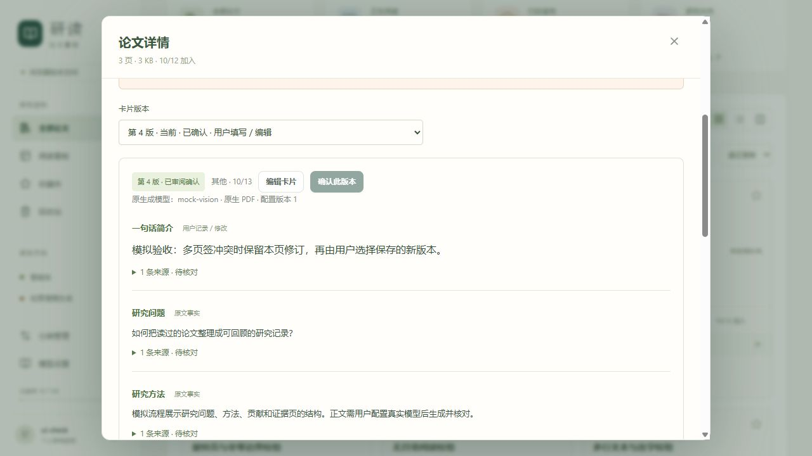
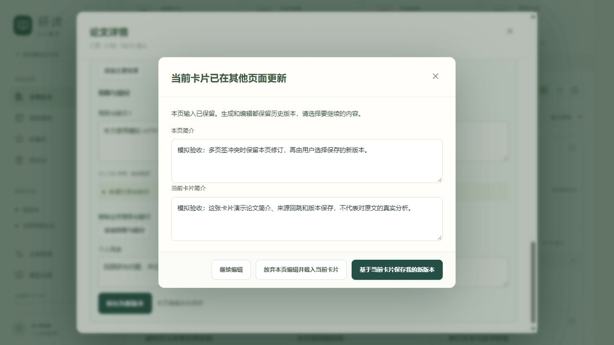
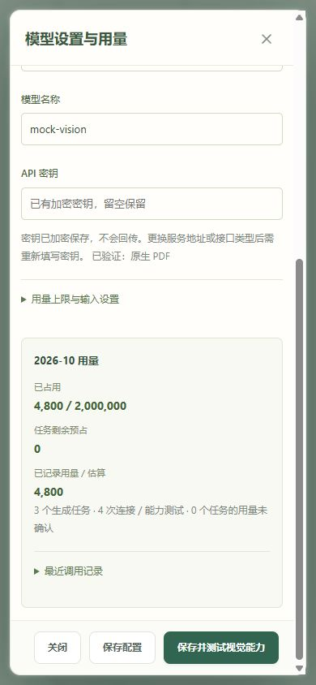

# 第三阶段开发与验收

版本 1.4｜2026-10-13｜应用 0.3.4｜M3：读后简介卡片、信息填写与速览

本阶段已经完成本机实现及模拟模型验收。管理、阅读和个人记录继续独立使用；云端默认关闭，需要用户自行填写模型密钥并通过视觉输入测试。0.3.0 首次交付使用模拟模型、没有云端调用；0.3.1 修复后增加了真实 DeepSeek 合成输入验证，详见第 8 节。模拟卡片和合成测试不代表实际论文分析质量。

## 1. 实际交付

【0.3.4 更新】阅读界面支持全页面与小窗切换，记住浏览器偏好，切换时保留当前页码、笔记和保存流程。见[全页面阅读开发与验收](全页面阅读开发与验收.md)。本轮前端 69 项检查、TypeScript 与生产构建通过。

【0.3.3 更新】论文库卡片增加中文短标题及研究问题、核心做法、主要价值三段速览；旧确认卡片的重述结果独立保存，打开页面不自动调用模型。见[论文卡片速览开发与验收](论文卡片速览开发与验收.md)。最新回归为后端 119 项、前端 65 项通过。

【0.3.2 更新】新增论文信息的 AI 填写，复用持久任务并在显式保存时创建所选新分类；见[论文信息 AI 填写开发与验收](论文信息AI填写开发与验收.md)。最新回归为后端 113 项、前端 58 项通过。用户截图中的十八页论文已真实识别，结果保留供填表核对。

| 功能 | 已实现行为 |
|---|---|
| 模型配置 | Responses、Claude Messages、兼容视觉接口；配置版本检查、密钥加密、服务地址限制和输入测试 |
| 视觉输入 | 原生 PDF 或逐页 JPEG，无独立 OCR；长文分批覆盖全部页序，超限继续拆批，局部页码映射回原文 |
| 生成任务 | 手动生成、可选首次已读触发；SQLite 持久队列、进度、取消、租约、运行代次、有限重试和输入去重 |
| 简介卡片 | 一句话简介、研究问题、方法、贡献、结果、局限、论文类型和人工个人用途 |
| 来源与核对 | 区分事实、作者主张、系统推测与用户记录；来源页跳转、人工核对；修改正文后引用重新待核对 |
| 版本 | 草稿、手工卡片、不可变历史、确认当前版本；重新生成及失败保留原卡片；多页签冲突比较 |
| 研究方向 | 推荐最多五项，显式采纳或忽略；名称、别名与合并关系复用，新方向需要显式创建，采纳后加入检索分类 |
| 用量 | 单任务／月度 token 预占、逐次调用记录、未知用量标识；删除论文不返还已发调用的当月预算 |
| 界面 | 模型设置入口、详情“简介卡片”页签、看板当前简介与状态、未保存内容离开检查 |

个人记录默认不发送；用户勾选才纳入本次输入快照。普通上传、打开详情、阅读、保存笔记与刷新不会调用模型。已读自动生成默认关闭，在启用且无卡片时触发，入队失败仍保存阅读状态。

## 2. 实现位置与开发方式

- `backend/app/ai_schemas.py`：配置、卡片字段、证据、长度和请求参数约束。
- `ai_secrets.py`：Fernet 加密；Windows 主密钥使用当前账号的系统保护；API 只返回是否已保存密钥。
- `ai_provider.py`：三种接口、PDF／图片请求、结构化输出、响应上限、总请求超时、安全地址和固定解析后的公网连接地址。
- `ai_render.py`：隔离子进程准备页段与图片；最长边、像素和临时文件限制。
- `ai_service.py`：输入快照、页序校验、预算、卡片版本、方向推荐与人工修改规则。
- `ai_worker.py`：任务领取、心跳、取消检查、重试、恢复、调用记账、全文分批及汇总。
- `ai_api.py`：受会话和空间权限保护的配置、任务、卡片、确认与推荐操作。
- `models.py` 与迁移：模型配置、任务、调用、卡片版本、当前指针和推荐决策六张表；`0005_task_order` 维护稳定队列顺序。
- `frontend/src/ai/`：模型设置、卡片与任务界面、类型、样式和回归测试；详情和阅读器接入来源页回跳。
- `start.ps1`：新增依赖检测与前端版本检查，升级后自动构建；`copy-pdf-assets.mjs` 生成 `version.json`。

新增或替换模型协议应扩展服务端适配器，保留统一生成结果与用量字段；不要直接在浏览器使用密钥。新增卡片字段应同时修改结构、服务校验、版本展示和测试，并提高结构或提示版本，避免错误复用旧输入指纹。

个人版采用一个 API 进程与其中的后台工作循环，不依赖 Redis；不要通过增加多个服务进程扩展吞吐。多人部署、PostgreSQL、独立工作进程及分布式任务恢复尚未实机验收。

## 3. 自动验证结果

以下记录 0.3.0 首次交付，在 Windows、Python 3.12、Node.js 24 上完成；0.3.1 最新结果见第 8 节：

| 验证 | 结果 |
|---|---|
| 后端全部测试 | **95 项通过**，包含原有 61 项与本阶段 34 项 |
| 前端全部测试 | **50 项通过**，包含原有 44 项与卡片新增 6 项 |
| TypeScript 与生产构建 | 通过；先构建独立 `.test-data/stage3-dist` 验收，再通过正式启动脚本构建 `frontend/dist` |
| Python 依赖检查 | `pip check` 通过 |
| 启动脚本 | PowerShell 语法通过，保留 UTF-8 BOM；实际自动检测版本、构建并启动 8000 新版通过 |
| 正式库与恢复克隆升级 | `0005_task_order`，原有记录及原文哈希一致 |

后端验证涵盖三种 HTTP 协议、真实 PDF 分批、实际 JPEG 渲染、无文字层的两页视觉探针、页序与跨空间限制、默认不发送笔记、预算、去重、有限修复、取消晚到结果、重启后的未知调用、人工版本及确认冲突、方向别名与合并、删除后的费用保留、稳定队列迁移、带标记临时目录清理。五页长文按 2／2／1 页处理再汇总，验证局部引用回到原文页序。

前端新增验证涵盖保存响应不确定时复用原请求标识、后续编辑保留、会话失效停止保存、生成重试与默认笔记为空、隐藏页签停止轮询、密钥字段清空、测试已保存配置，以及任务成功后完整加载卡片。发现并修复了结束轮询过早取消卡片加载的问题。

后端测试有一条 Starlette 的测试客户端依赖弃用提示；95 项全部通过，该提示未影响应用运行。为避免与功能无关的依赖变更，本次未引入 `httpx2`。

复现命令见项目 README。测试用模拟 HTTP 响应，不需要真实密钥。`backend/scripts/stage3_mock.py` 只供开发验收，可以模拟格式错误、延迟、鉴权失败、缺失用量及限流；不得将模拟结果用于科研判断。

## 4. 浏览器验收证据

独立验收服务使用 8011 端口、`.test-data/stage3-browser` 数据和独立构建；模拟模型使用 8012 端口。开发过程中没有停止原有正式服务或刷新用户标签；最后检查发现 8000 旧服务已停止，随后通过正式启动脚本构建并启动新版。测试密钥、配置、卡片及推荐没有写入正式库。

已完成以下操作并核对界面结果：

1. 保存模型配置，测试连接和视觉输入；最后的能力测试输入为两页无文字层的图片 PDF。
2. 生成首个草稿，查看模型及输入方式；明确标记“模拟验收”。
3. 查看来源、原页回跳，阅读器实际回到第 1 页；个人记录保留。
4. 采纳一个已有方向与一个显式新建的测试方向；论文信息同步显示，分类可参与检索。
5. 编辑个人用途、保存和确认，切换历史，再次生成保留当前版本。
6. 模拟连续无效 JSON，任务失败；已确认卡片和个人用途仍完整保留。
7. 两个页签同时操作：另一页确认旧版本，本页保存收到版本冲突；显示两份简介，保留本页修订，再保存新版本并确认。
8. 在 390×844 窄屏检查卡片和模型设置；页面宽度仍为 390，无横向溢出；验收后恢复正常视口。

图中的模拟模型名称与文案仅用于流程验证。最近失败任务仍显示在卡片上方，以便查看故障，已确认版本并未被替换。

## 5. 数据升级与恢复

正式迁移前，使用 SQLite 在线备份保存数据库，并复制原文件到 `.test-data/stage3-backups/formal-before-migration`。先在 `.test-data/stage3-upgrade-restore` 克隆中升级并核对，再升级正式库到 `0005_task_order`。

核对结果：原有 13 张业务表的记录全部一致，正式原文文件一份且 SHA-256 一致；新增结构不改写旧论文、账户、分类与阅读记录。验证记录保存在 `.test-data/stage3-upgrade-result.json`。开工前的另一个快照在 `.test-data/stage3-backups/formal-before-stage3`。

本次为开发过程的手动备份与恢复验证，尚未提供应用内完整备份恢复界面。后续手工备份应先停止服务，再复制整个 `data` 目录；不要在运行中只复制 SQLite 主文件。恢复时：

1. 停止服务，将当前数据目录另存为新备份，防止覆盖之后的阅读记录。
2. 用完整备份恢复数据库、原文及 `.model-key`；配置了环境主密钥时同时恢复该密钥。
3. 运行新版启动脚本，旧备份会自动升级；检查登录、原文、笔记及卡片。

Windows 主密钥绑定当前系统账号。跨机器或账号迁移应单独规划主密钥，或在新环境重新填写模型密钥；备份含私人数据与密钥密文，按私有资料保管。

## 6. 启用新版

本次交付已启动 `http://127.0.0.1:8000/` 的 0.3.0 正式服务。用户原标签没有被主动刷新；等待当前编辑保存后刷新即可使用新入口。后续重新运行或升级时：

1. 等待当前笔记或表单保存；若服务仍在运行，在服务终端按 Ctrl+C。
2. 在项目根目录运行 `powershell -ExecutionPolicy Bypass -File .\start.ps1`。脚本检测版本差异后自动重新构建。
3. 刷新 `http://127.0.0.1:8000/`，进入模型设置，填写真实服务地址、模型和密钥，开启云端并测试视觉能力。
4. 打开一篇论文的简介卡片生成，检查实际来源和内容后确认。

若主动修改源码而版本不变，使用 `-Rebuild`；全新机器或依赖需重装时使用 `-Install`。配置只读取进程环境变量，`.env.example` 不会自动加载。

## 7. 当前边界与后续

真实模型的扫描件、小字、公式、图表、事实归因、长文质量及实际账单尚未验收。建议用用户选定模型对代表性论文集逐条核对；能力探针通过只证明该接口在当次测试中读到了两页标记。

来源页校验只确认引用属于本篇输入，不能证明摘录与结论正确；用户确认表示已审阅，各条引用核对状态单独保留。预占按视觉用量估算，可能低于实际服务商计费，应结合服务商控制台预算。取消不会撤销已经发出的远端请求。

任务正文与输入快照保留 30 天；当月无关联调用仍保留用量占用，历史月份过期调用清理；卡片历史持续保留。刷新前未保存的输入仅存在页面中，没有实现浏览器本地草稿长期恢复。

下一阶段为 M4：卡片与笔记内容检索、Markdown 导出、包含原文与加密资料的完整备份恢复，以及部署与故障交付。跨论文创新思路和课题组权限继续安排在后续阶段。

## 8. 0.3.1 调用修复与真实验收

用户截图配置为 `https://api.deepseek.com/responses` 与 `DeepSeek-V4.1-Flash`。原适配器再次追加 `/responses`，导致路径重复；展示名称也需要转换为 API 模型标识 `deepseek-flash`。DeepSeek Responses 支持图片而不接收 PDF 文件，原生 PDF 模式不能用于该接口。[官方 Responses 说明](https://api-docs.deepseek.com/guides/responses_api/)

本次修复：

- 三种协议均接受基础地址或匹配的完整接口地址，规范化后只追加一次路径；协议与完整路径不匹配时在保存前提示。
- 同一服务同一协议的地址格式修正保留加密密钥；更换目标服务或协议仍隔离密钥。
- 加入 DeepSeek 配置按钮、实际请求地址预览和模型标识说明；切换协议保留自定义服务地址。
- DeepSeek 自动模式直接准备图片，显式 PDF 模式在发送前提示改为图片；不新增 OCR。
- 短连接探针关闭 DeepSeek 默认思考，避免 512 token 预算耗尽后没有返回检测 JSON；正常卡片生成保留服务默认思考行为。[官方思考模式说明](https://api-docs.deepseek.com/guides/thinking_mode/)
- 地址错误显示 HTTP 状态及具体修正建议，不回显远端原始错误或密钥。

使用已保存的密钥修正为配置第 4 版，保留历史版本；开启状态和预算不变。真实验证只发送两页公开合成图片，未发送用户论文，也未写入测试卡片：

| 验证 | 结果 | 输入／输出 token |
|---|---|---|
| 最小 JSON 连接测试 | 通过 | 81／5 |
| 两页图片可见标记 | 通过，模式 images | 823／29 |
| 结构化卡片与来源校验 | 通过，完整 JSON、来源有效、零警告 | 1,780／899 |

三次真实调用合计 3,617 token，已写入应用调用与用量记录；货币费用以服务商账单为准。真实连接记录位于 `.test-data/deepseek-real-connection.json`，结构化卡片记录位于 `.test-data/deepseek-real-card.json`，均不含密钥。修复前数据库与主密钥备份在 `.test-data/deepseek-fix-before`。

最终回归为后端 **104 项**、前端 **52 项**通过，独立和正式生产构建通过；正式服务已重新启动为 0.3.1。刷新原网页即可加载修正后的配置，无需再次填写同一服务密钥。实际论文的事实准确性仍未由这些合成测试验证。
