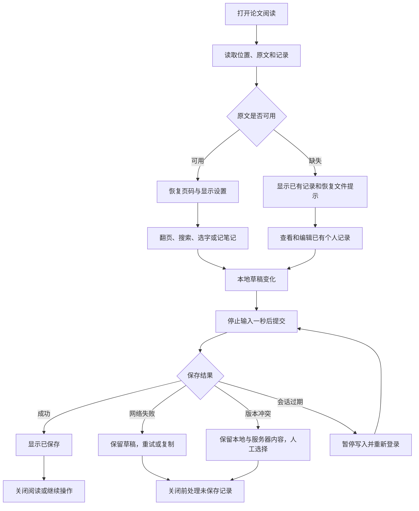

# 论文看板：第二阶段实施方案

版本：1.1｜日期：2026-10-12｜对应产品需求：0.3 的 F04、F05 及 F07 最近阅读排序｜阶段：M2 阅读与记录，已实现

【本次更新】M2 已按本文完成增量实现，实际交付、验证与数据升级见[第二阶段开发与验收](第二阶段开发与验收.md)。本文保留开发规格和任务顺序，作为维护依据；T01～T11 已完成，后续能力仍按各阶段实施。

关联文档：[产品需求文档](产品需求文档.md)、[开发方案](开发方案.md)、[第一阶段开发与验收](第一阶段开发与验收.md)。执行时先按第 11 节任务顺序推进，字段与接口以第 4、5 节为准，交付对照第 12、13 节验收。

## 1. 阶段目标与交付边界

用户打开一篇论文，继续上次阅读，选取文字添加高亮，记录页码笔记与个人心得；关闭应用并重新打开后，可以恢复已保存的位置与记录，点击记录回到对应原文页。

本阶段继续服务本机单用户，沿用 React、TypeScript、PDF.js、FastAPI、SQLAlchemy、Alembic、SQLite 和私有原文目录。阅读与记笔记不需要模型密钥，也不调用云端 API。

| 编号 | 必须交付的能力 | 完成标准 |
|---|---|---|
| R01 | 阅读位置 | 恢复页码、缩放模式、自定义比例和用户旋转；论文库展示上次页码，支持最近阅读排序 |
| R02 | 文内导航 | 页码输入、上一页／下一页、PDF 自带目录、懒加载缩略图；目录缺失时仍可导航 |
| R03 | 文内文字搜索 | 在当前 PDF 的可提取文本中搜索中文和英文，显示页码、片段与扫描进度，点击定位 |
| R04 | 文字高亮 | 文字选区、多行矩形、颜色、摘录；刷新、缩放和旋转后保持原文对应关系 |
| R05 | 页码笔记与高亮评论 | 创建、编辑、删除、分页浏览；评论绑定高亮，页码笔记在扫描页也能使用 |
| R06 | 个人心得 | 分别记录理解、疑问、用途，独立保存；后续 AI 卡片只能按授权读取快照 |
| R07 | 可靠保存 | 停止输入 1 秒后保存，状态可见，失败可重试，冲突可比较，重试不重复创建 |
| R08 | 数据生命周期 | 回收站只读、恢复保留关联、彻底删除及到期清理处理全部阅读记录；已有库可安全升级 |

本阶段采用单页阅读主视图，预取邻近页的数据；缩略图提供连续导航。恢复精度为页级，不保存滚动到段落的精确位置。高亮支持同页多行选区；跨页选区、手绘、原 PDF 写入批注、笔记附件和富文本编辑留待后续。

扫描页显示原文并支持页码笔记。没有可用文本层的页面不能进行文字选择或文字搜索；混合 PDF 按页判断。继续采用用户已确认的视觉模型路线，M3 再处理扫描页的 AI 简介卡片，本阶段不增加 OCR。

完整论文库的笔记关键词检索、Markdown 导出与应用级备份恢复仍在 M4；本阶段的“文内搜索”只搜索当前打开的 PDF 文本层。语义检索、论文问答和创新思路使用后续能力名称，不与 M2、M3 开发编号混用。

## 2. 实际代码基线与改动位置

开发起点的数据库最高迁移为 `0002_author_search`，本阶段已新增 `0003_reading_records`。原文信息直接保存在 `papers`，包括 `file_hash`、`page_count` 和 `file_size`；当前没有 `paper_files` 表。一个论文条目对应一个不可变 PDF，文件按哈希存放在 `data/files`。

| 当前文件 | 当前作用 | 本阶段改动 |
|---|---|---|
| `backend/app/models.py` | 账号、空间、论文与分类实体 | 增加页面来源、阅读位置、笔记、高亮、写入回执实体 |
| `backend/app/schemas.py` | 参数校验 | 增加阅读、笔记、高亮的输入／响应模型与有限数值校验 |
| `backend/app/main.py` | 鉴权、路由、写入锁、回收站清理 | 接入阅读路由；同步永久删除、定期清理和最近阅读参数 |
| `backend/app/services.py` | 分类规则、论文查询与展示 | 批量查询阅读位置；增加 `recent_read` 排序，保留现有去重筛选 |
| `backend/app/pdf_inspect.py` | 隔离检查页数与元数据 | 扩展页面边界、原生旋转与单位提取；保持子进程超时 |
| `backend/migrations/versions/` | 已有两次迁移 | 新增 `0003_reading_records.py`，仅扩展表，不重建正式库 |
| `frontend/src/PdfPreview.tsx`（原组件） | 单画布翻页与缩放 | 已由 `reader/ReaderWorkspace.tsx` 替换并移除，复用原文件接口与本地字体资源 |
| `frontend/src/PaperDetail.tsx` | 信息／预览页签 | 将预览升级为阅读工作区；统一关闭与草稿检查 |
| `frontend/src/App.tsx` | 论文库、会话过期保留界面 | 最近阅读与继续阅读入口；退出前检查未保存记录 |
| `frontend/src/api.ts` | API 请求、错误、401 通知 | 增加类型，保留错误码、冲突当前版本与请求标识 |
| `frontend/src/components.tsx` | 弹窗及焦点管理 | 支持阅读工作区尺寸；关闭按钮、遮罩、Esc 共用关闭入口 |
| `frontend/src/pdf.css` | 基础阅读样式 | 页面叠层、文字层、高亮层、工具栏和窄屏布局 |

新增 `backend/app/reading_service.py` 承载阅读业务，新增 `backend/app/reading_api.py` 生成并返回路由；由 `main.py` 注入现有数据库依赖、鉴权依赖与同一把写入锁。避免将读取会话、参数校验、事务和 PDF 解析全部堆入新路由。

新增前端目录如下。文件名为实施约定，不要求为了整理而移动全部第一阶段代码。

```text
frontend/src/reader/
├── ReaderWorkspace.tsx       阅读主界面和各面板协调
├── PdfPage.tsx               画布、文字层、叠加层及渲染取消
├── ReaderNavigation.tsx      页码、目录与缩略图
├── ReaderSearch.tsx          搜索框、索引进度和结果
├── NotesPanel.tsx            页码笔记、评论与个人心得
├── SelectionToolbar.tsx      选区操作浮层
├── SaveStatus.tsx            保存状态与恢复操作
├── geometry.ts              页面坐标校验和双向转换
├── textIndex.ts             页内文字与选区偏移映射
├── useAutosave.ts           串行保存、重试与冲突暂停
└── types.ts                 阅读模块类型
```

## 3. 用户流程与页面结构



桌面阅读区利用详情弹窗的宽屏模式，占可用视口；论文信息编辑区保持现有入口。

```text
┌─────────────────────────────────────────────────────────────────────┐
│ 论文标题                  [论文信息] [下载原文] [关闭阅读]          │
├─────────────────────────────────────────────────────────────────────┤
│ [上一页] [ 8 / 18 ] [下一页] [适应宽度] [125%] [旋转] [搜索]       │
├──────────────┬─────────────────────────────────┬────────────────────┤
│ 目录／缩略图 │ 原文页面                        │ 笔记／个人心得    │
│              │                                 │                    │
│ 按需展开     │ 画布＋透明文字层＋高亮叠加层    │ [添加本页笔记]    │
│ 当前页标记   │                                 │ 高亮摘录与评论    │
│              │ 选中文字后出现操作浮层          │ 点击记录跳回原文  │
├──────────────┴─────────────────────────────────┴────────────────────┤
│ 上次读到第 8 页      阅读位置已保存      个人记录已保存              │
└─────────────────────────────────────────────────────────────────────┘
```

窄屏默认显示原文，目录、搜索和笔记通过可关闭面板展开，禁止三个固定栏挤压页面。工具栏可换行；原文放大时允许阅读容器内部滚动，整个页面不得横向溢出。面板开关按钮有中文可访问名称；浮层与冲突对话框沿用焦点管理。

## 4. 数据结构、约束与迁移

### 4.1 共用数据规则

- 标识沿用论文的 32 位十六进制 UUID；哈希为 64 位 SHA-256。用户和空间取服务端会话，不接受客户端指定。
- 时间沿用现有后端：服务端生成的 Unix 秒，数据库使用大整数，展示使用本地中文时间格式。
- 页码为原 PDF 的实际页序，从 1 开始；印刷页码或目录页标签只用于显示。
- 每条新记录保存 `workspace_id`；笔记、位置和高亮还保存 `user_id`，为后续个人记录私有保留边界。所有读取先检查空间和作者归属。
- `file_hash` 是本阶段的原文件版本标识；不得原地替换文件或把旧坐标迁移到另一哈希。总方案中的 `file_id` 在 M2 由该不可变标识承担。
- 新资源有独立 `revision`。阅读位置和笔记写入不递增 `papers.revision`，不修改论文元数据的 `updated_at`，避免与标题、方向编辑互相冲突。
- 字符上限按 Unicode 码点计算，前后端保持一致；前端用 `Array.from(text).length` 等方式计数，不能仅以 JavaScript 的 UTF-16 长度代替。输入内容不进行会改变用户表达的规范化。去首尾空白只用于判断空内容。

### 4.2 页面来源 `page_sources`

| 字段 | 类型／必填 | 默认与约束 |
|---|---|---|
| `id` | 字符串／是 | 服务端 UUID，主键 |
| `workspace_id`、`paper_id` | 关联标识／是 | 论文归属；论文外键永久删除级联 |
| `file_hash` | 字符串／是 | 必须与论文不可变哈希相等 |
| `page_number` | 整数／是 | 1～论文总页数；与 `paper_id` 联合唯一 |
| `view_box` | JSON 数组／是 | `[x_min,y_min,x_max,y_max]`，四个有限数，宽高为正 |
| `intrinsic_rotation` | 整数／是 | 文件原生旋转，规范化为 0、90、180、270 |
| `user_unit` | 浮点数／是 | 页面单位，默认 1，有限且大于 0 |

页面来源由服务端从原文建立，不信任前端提交的页面尺寸。提取使用与 PDF.js 页面可视边界相容的 CropBox／MediaBox 有效范围，保留非零或负的坐标原点；使用固定样本核对 `PDFPageProxy.view`、`rotate` 与 `userUnit`。异常页不生成可信坐标来源，但仍可在浏览器可显示时阅读和记页码笔记。

新上传在现有隔离检查中顺带提取几何信息，与论文一起写入。已有文件在首次打开阅读时按需补齐：子进程读取，默认 20 秒超时，在写入锁外解析，提交前重新核对论文存在、哈希和删除状态；以联合唯一约束处理重复准备。超时或边界异常返回 `page_map_status=unavailable`，不阻断已保存笔记查看；用户可点击“重试页面准备”。

本阶段不在数据库迁移中批量解析全部 PDF，不创建全文文本块；页面来源后续可复用为 M3 卡片引用的页级依据。

### 4.3 阅读位置 `reading_positions`

| 字段 | 类型／必填 | 默认与约束 |
|---|---|---|
| `user_id`、`paper_id` | 联合主键／是 | 一位用户每篇一条位置；论文删除级联 |
| `workspace_id`、`file_hash` | 标识／是 | 服务端填入并核对 |
| `page_number` | 整数／是 | 默认 1，范围 1～总页数 |
| `zoom_mode` | 枚举／是 | 默认 `fit_width`，另一个值为 `custom` |
| `zoom` | 浮点数或空／条件必填 | 适应宽度时为空；自定义时 0.5～3.0 |
| `view_rotation` | 整数／是 | 用户额外旋转，默认 0，取 0、90、180、270 |
| `revision` | 正整数／是 | 默认 1，仅位置／缩放／用户旋转写入时递增 |
| `last_opened_at` | 时间／是 | 成功打开可用原文时更新；不因缩略图预取更新 |
| `updated_at` | 时间／是 | 位置最后一次持久化时间 |

增加 `(workspace_id,user_id,last_opened_at,paper_id)` 索引用于最近阅读。`last_opened_at` 的打开记录与位置版本分开处理；重复打开可以更新时间，不增加位置版本。首次打开建立默认位置，避免前端处理不存在记录时的创建竞争。

`custom` 的比例表示 `getViewport({scale: zoom})` 的标准比例，100% 为 `scale=1`；适应宽度由容器尺寸计算。当前预览采用的“适应宽度再乘比例”属于旧实现，本阶段统一为这两种模式。首次使用从适应宽度开始。

### 4.4 高亮 `annotations`

| 字段 | 类型／必填 | 默认与约束 |
|---|---|---|
| `id` | 字符串／是 | 服务端 UUID，主键 |
| `workspace_id`、`user_id`、`paper_id` | 关联标识／是 | 服务端填入，论文删除级联 |
| `page_source_id`、`file_hash`、`page_number` | 来源标识／是 | 同篇、同文件、同页，创建后不可修改 |
| `quote` | 文本／是 | 非空，最多 2,000 字符，标记为用户选取的文本层摘录 |
| `rects` | JSON 数组／是 | 1～200 个矩形，每个为 `[x0,y0,x1,y1]`，有限数且宽高为正 |
| `color` | 枚举／是 | `yellow`、`green`、`blue`、`pink`，默认 `yellow` |
| `revision` | 正整数／是 | 默认 1；修改颜色时递增 |
| `created_at`、`updated_at` | 时间／是 | 服务端生成 |

增加 `(paper_id,user_id,page_number)` 索引。每篇每位用户最多 1,000 条高亮。矩形保存为原 PDF 页面坐标，不保存 CSS 像素或设备像素；允许页面有效边界原点非零。对边界使用 0.5 个页面坐标单位的容差，只修正容差内舍入误差，明显越界返回 422。

创建后不允许改变高亮来源与摘录；重新选择文字创建另一条高亮。页面文字无法提取或页面来源准备失败时禁用创建文字高亮，页码笔记保持可用。

### 4.5 笔记与个人心得 `notes`

| 字段 | 类型／必填 | 默认与约束 |
|---|---|---|
| `id` | 字符串／是 | 服务端 UUID，主键 |
| `workspace_id`、`user_id`、`paper_id` | 关联标识／是 | 服务端填入，论文删除级联 |
| `file_hash` | 字符串／是 | 关联不可变原文；创建后不可修改 |
| `note_type` | 枚举／是 | `page_note`、`annotation_comment`、`personal_insight`，创建后不可改类型 |
| `content` | 文本／是 | 非空，最多 10,000 字符，首版纯文本保存与转义显示 |
| `page_number` | 整数或空／条件必填 | 页码笔记与评论必填；个人心得为空 |
| `annotation_id` | 标识或空／条件必填 | 评论必填且与本用户同篇高亮一致，其余类型为空 |
| `insight_kind` | 枚举或空／条件必填 | 心得为 `understanding`、`question`、`application`；其他类型为空 |
| `revision` | 正整数／是 | 默认 1 |
| `created_at`、`updated_at` | 时间／是 | 服务端生成 |

增加 `(paper_id,user_id,created_at,id)` 索引；`(user_id,annotation_id)` 唯一，一条高亮最多一条评论，空关联不限制其他笔记。每篇每位用户最多 500 条笔记，包含评论和心得；心得允许同类别多条记录，不自动创建空白记录。

评论页码由高亮确定。页码笔记可调整到当前文件的另一有效页，心得可调整类别。高亮删除时其评论级联删除，在确认框中明确说明；单独删除评论保留高亮。保存为独立记录，未来 AI 卡片使用快照，不直接修改这张表。

### 4.6 写入回执 `reading_mutation_receipts`

为避免“服务端已经保存、响应中断、前端重试后重复创建”，所有本阶段位置、笔记、高亮写操作使用 `request_id`。

回执字段：服务端主键、`workspace_id`、`user_id`、`paper_id`、`request_id`、资源类型／标识、请求指纹、成功状态码、成功响应 JSON、创建时间。建立 `(user_id,request_id)` 唯一约束和创建时间索引；论文永久删除时级联删除回执。

请求指纹包含方法、资源路径与业务载荷，不包括 `request_id`；JSON 使用稳定序列化后计算 SHA-256。同用户、相同请求标识和指纹返回原成功响应；同标识但不同载荷返回 409 `request_id_reused`。业务写入与回执在同一事务提交，失败不写成功回执。回执保留 30 天，到期由现有清理循环处理。

回执在服务端私有数据库中，响应包含的笔记正文不得写入日志。返回回执前仍检查会话、空间、资源归属与论文可写状态。回执不作为版本历史界面；前端重试只使用当前会话保留的待确认请求。

### 4.7 迁移与删除规则

1. 新迁移 `0003_reading_records` 的前置版本为 `0002_author_search`，创建上述五张表、约束和索引；SQLite 与 PostgreSQL 均使用兼容类型，当前验收以 SQLite 为准。
2. 已有论文不修改标题、分类、状态、文件哈希和原文路径，不创建虚构阅读位置或笔记；页面来源首次使用时建立。
3. 升级前停止服务，备份整个数据目录，核对旧库记录数与原文哈希；验收在备份副本上进行。
4. 论文进入回收站不物理删除阅读记录。列表与原文允许当前所有者只读查看；新建、修改、删除阅读记录返回 409 `paper_trashed`。
5. 恢复论文后恢复编辑；位置、来源、高亮与笔记仍指向原文件。永久删除及 30 天到期清理使用同一业务清理函数，通过论文外键级联处理新增表。
6. 所有新写操作与论文删除共享现有写入锁，提交前核对父论文状态，防止删除后的晚到请求写入。版本更新同时使用数据库条件更新，不能只依赖内存锁。
7. 原文件清理前查询是否仍有论文引用相同哈希，只有最后一个引用移除后才删除物理文件；这是扩展清理函数时一并处理的存储一致性规则。
8. 降级会删除阅读表，交付说明必须提示先导出或备份。出现升级异常优先恢复停止服务时的完整备份，不自动执行破坏性降级。

## 5. API 契约与示例

统一前缀为 `/api/v1`。沿用会话 Cookie、写请求 `X-Paperboard-Request: 1` 和现有来源校验；新接口不接受 `workspace_id`、`user_id` 或存储路径。

### 5.1 接口清单

| 方法与路径 | 输入 | 响应与规则 |
|---|---|---|
| `POST /papers/{id}/reader-open` | 无业务载荷 | 200：文件状态、只读状态、页面准备状态、默认或既有位置、页面来源数组；无云端调用 |
| `GET /papers/{id}/position` | 无 | 200：位置或 `null`；回收站允许只读 |
| `PUT /papers/{id}/position` | 文件哈希、位置字段、revision、request_id | 200：持久化位置；不影响论文元数据版本 |
| `GET /papers/{id}/notes` | page、page_size、可选 note_type、page_number | 200：items、total、page、page_size；默认每页 50，上限 100 |
| `GET /notes/{id}` | 无 | 200：当前笔记，用于冲突比较和精确回跳；校验作者与父论文 |
| `POST /papers/{id}/notes` | 类型、内容、对应关联字段、文件哈希、request_id | 201：完整新笔记；不接受空内容 |
| `PATCH /notes/{id}` | 可变字段、revision、request_id | 200：完整笔记；不允许改变类型和原文件 |
| `DELETE /notes/{id}` | JSON：revision、request_id | 200：`{"ok":true}`；先确认，不删除论文或独立高亮 |
| `GET /papers/{id}/annotations` | 必填 page_number；page、page_size | 200：分页列表，默认 100，上限 200；只拉取目标页 |
| `GET /annotations/{id}` | 无 | 200：高亮及可选评论，用于精确回跳 |
| `POST /papers/{id}/annotations` | 页面来源、哈希、页码、摘录、矩形、颜色、request_id；可选 comment | 201：annotation 和 note；高亮与非空评论同事务创建 |
| `PATCH /annotations/{id}` | color、revision、request_id | 200：完整高亮；摘录和坐标不可改 |
| `DELETE /annotations/{id}` | JSON：revision、request_id | 200：`{"ok":true}`；关联评论同时删除 |
| `GET /papers?sort=recent_read` | 原有筛选与分页 | 200：原有论文列表，新增上次页码与最近阅读字段 |

列表按 `created_at ASC,id ASC` 稳定分页；修改内容不改变创建顺序。前端在创建／删除后刷新对应分页，已有编辑草稿以记录标识保留，不因列表重载清空。高亮列表将当前页的全部分页合并后绘制。

`reader-open` 对回收站只返回只读信息，不创建位置、不更新时间、不准备新的页面来源。有效论文但原文缺失时返回 `file_available=false`，仍允许读取既有笔记；不新建打开记录。页面来源准备失败与原文缺失分别展示，不把可阅读文件整体判为损坏。

### 5.2 阅读打开与保存

打开响应示例，标识和数值仅为接口示例：

```json
{
  "paper_id": "11111111111111111111111111111111",
  "file_hash": "aaaaaaaaaaaaaaaaaaaaaaaaaaaaaaaaaaaaaaaaaaaaaaaaaaaaaaaaaaaaaaaa",
  "page_count": 18,
  "file_available": true,
  "read_only": false,
  "page_map_status": "ready",
  "position": {
    "page_number": 8,
    "zoom_mode": "custom",
    "zoom": 1.25,
    "view_rotation": 0,
    "revision": 4,
    "last_opened_at": 1791763200,
    "updated_at": 1791763100
  },
  "page_sources": [
    {
      "id": "22222222222222222222222222222222",
      "page_number": 8,
      "view_box": [0, 0, 612, 792],
      "intrinsic_rotation": 0,
      "user_unit": 1
    }
  ]
}
```

实际 `page_sources` 返回所有准备成功的页；示例为简洁仅展示一页。`page_map_status` 为 `ready`、`partial` 或 `unavailable`；客户端只对有可信来源且与 PDF.js 几何一致的页面启用文字高亮。

保存位置的请求：

```json
{
  "request_id": "33333333333333333333333333333333",
  "revision": 4,
  "file_hash": "aaaaaaaaaaaaaaaaaaaaaaaaaaaaaaaaaaaaaaaaaaaaaaaaaaaaaaaaaaaaaaaa",
  "page_number": 9,
  "zoom_mode": "custom",
  "zoom": 1.25,
  "view_rotation": 90
}
```

成功返回完整位置，`revision=5`，时间由服务端生成。首次读取未打开过的论文，`GET position` 返回 `null`；正常编辑必须先成功调用 `reader-open` 建立默认位置，再使用其版本保存。初始读取完成前不启动自动保存，避免用第 1 页覆盖历史位置。

### 5.3 创建笔记与高亮

页码笔记请求：

```json
{
  "request_id": "44444444444444444444444444444444",
  "file_hash": "aaaaaaaaaaaaaaaaaaaaaaaaaaaaaaaaaaaaaaaaaaaaaaaaaaaaaaaaaaaaaaaa",
  "note_type": "page_note",
  "page_number": 9,
  "content": "这里的消融实验缺少不同检索规模的比较。"
}
```

个人心得改用 `note_type=personal_insight`，提交 `insight_kind`，不提交页码或高亮标识。高亮评论用 `annotation_comment`，提交 `annotation_id`，服务端确定对应页码。

“高亮并记笔记”请求：

```json
{
  "request_id": "55555555555555555555555555555555",
  "file_hash": "aaaaaaaaaaaaaaaaaaaaaaaaaaaaaaaaaaaaaaaaaaaaaaaaaaaaaaaaaaaaaaaa",
  "page_source_id": "22222222222222222222222222222222",
  "page_number": 8,
  "quote": "选中的原文摘录",
  "rects": [[72, 640, 310, 654], [72, 622, 240, 636]],
  "color": "yellow",
  "comment": "这项条件与我的研究任务不同，需要单独验证。"
}
```

成功返回 `{"annotation":{...},"note":{...}}`，无评论时 `note=null`。选区超过摘录或矩形上限时提示缩短选区，不静默截断。对于不可信文本编码，提示改用页码笔记；服务器的坐标合法校验不等于摘录内容已被事实核验。

### 5.4 错误与并发响应

保留既有错误中的字符串 `detail`，新增机器可读的 `code`；版本冲突附完整 `current` 对象，避免再发一次请求才能比较。

```json
{
  "detail": "其他页面已更新这条笔记。你的编辑已保留，请比较后再保存。",
  "code": "revision_conflict",
  "current": {
    "id": "66666666666666666666666666666666",
    "note_type": "page_note",
    "page_number": 9,
    "content": "服务器上的最新内容",
    "revision": 7
  }
}
```

| 状态码／业务错误 | 前端处理 |
|---|---|
| 401 | 暂停本阶段所有写入，保留编辑组件与队列，重新登录 |
| 404 `record_not_found` | 记录不存在或不属于当前用户；保留草稿，允许复制，不重建已删记录 |
| 409 `revision_conflict` | 暂停该记录自动保存，比较双方内容，等待用户选择 |
| 409 `paper_trashed` | 停止写入，保留草稿，提示从回收站恢复后重试 |
| 409 `file_version_mismatch` | 停止坐标相关操作，重新加载信息，不迁移旧高亮 |
| 409 `request_id_reused` | 客户端状态错误；保留草稿，提示重新尝试并记录不含正文的诊断 |
| 422 `invalid_page`／`invalid_rects`／`invalid_content` | 指明可修改项目；不清空输入，不自动重试 |
| 422 `invalid_input` | 输入结构、长度、有限数值或 Unicode 编码未通过参数校验；保留输入并提示检查 |
| 422 `record_limit_reached` | 显示当前数量及上限，用户整理记录后再创建 |
| 网络中断／超时／临时 5xx | 状态变为失败，保留待确认请求；按第 8 节安全重试 |

版本更新使用条件更新：限定用户、空间、记录标识与原 `revision`，更新受影响行数为 1 才成功。为 0 时重新查询，区分不存在与版本冲突。业务操作和回执提交完成后才返回成功；不使用“先响应成功再后台写入”。

## 6. 阅读器具体实现

### 6.1 打开、显示和位置恢复

1. `ReaderWorkspace` 先调用 `reader-open` 与笔记列表，加载原文；以本次论文标识和文件哈希创建加载代次。
2. 位置和 PDF 都就绪后，校验总页数，再应用恢复值；无位置为第 1 页适应宽度。禁用恢复期间的自动保存。
3. `PdfPage` 使用同一个 viewport 绘制画布、文字层和叠加层。显示旋转为 `(文件原生旋转＋view_rotation) % 360`。
4. 容器 ResizeObserver 仅触发适应宽度重新计算；不会修改用户比例或创建新的位置请求。用户主动翻页、缩放模式、比例和旋转才设置位置为未保存。
5. 页面显示成功才允许保存该页。搜索／笔记跳页走相同导航入口；不得先保存目标页，再发现页面根本无法显示。
6. 打开待读论文沿用现有入口转为阅读中；翻到最后一页不自动标为已读。完成时间仍由论文状态接口维护，卡片生成在 M3 接入。
7. 原文 401 接入现有登录过期流程。缺失或加载失败提供重试／下载入口，已加载记录继续可查看；加载失败不覆盖原位置。

重新加载原文只重建 PDF 加载与渲染会话，保留笔记草稿、位置待确认请求和保存队列。切换到论文信息页签时保持阅读工作区状态，或先完成统一离开检查；不得沿用当前预览页签的直接卸载方式导致记录丢失。

### 6.2 渲染、文字层与资源

沿用项目锁定的 `pdfjs-dist` 6.4.299，worker 与主库同版本，本地 CMap、字体与 wasm 资源继续由构建脚本提供。该版本导出 `TextLayer`，以 `textContentSource`、`container`、`viewport` 创建后 `render()`；不照搬旧版 `renderTextLayer` 调用。

页面 wrapper 的 CSS 尺寸等于 viewport 尺寸；透明文字层和高亮层绝对定位覆盖同一 wrapper。画布为清晰显示可以乘设备像素比，但 DOM 文字层、选区和高亮只使用 CSS 坐标。同步本地文字层所需样式与 `--total-scale-factor` 等尺度变量，避免只导入一个类名导致文字错位。

使用当前页和前后各一页的有限数据预取；不为 300 页同时创建大画布或文字节点。主视图只有当前页画布；页面文本缓存最多 10 页，缩略图缓存最多 30 张。缩略图面板未展开时不渲染，展开后只加载可见项与相邻项；缩略图宽度约 96 CSS 像素。

每次翻页、缩放或切换论文取消旧 render task 与 text layer；上一画布任务结束后再复用画布。使用加载代次丢弃晚到结果。关闭时断开 observer、清理文字层、取消预取、清空画布并销毁加载任务；服务端保存队列由工作区管理，不依赖子组件销毁时碰运气保存。

PDF.js 官方示例解释了 viewport 对缩放、旋转和坐标的处理，以及同画布渲染需要协调任务；本项目实现还应以本地锁定版本的类型为准。[官方示例](https://mozilla.github.io/pdf.js/examples/)

### 6.3 目录、缩略图与页码

- 目录通过 `getOutline()` 获取；字符串目的地用 `getDestination()` 解析，页引用用 `getPageIndex()` 转成索引后加 1。目录层级折叠，标题转义显示。
- 无目录显示“这份 PDF 没有内置目录，可以使用缩略图或页码跳转”。不能按标题识别结果伪造文档目录。
- 无法解析的目录项禁用并说明原因；外部链接本阶段只显示，用户主动点击支持的 HTTP／HTTPS 链接时在新页打开，不执行文档脚本或自动跳站。
- 页码输入允许暂时为空，按 Enter 或失焦校验；非法输入保留当前页，显示 1～总页数范围。未加载总页数前禁用跳页。
- 缩略图点击、前后页按钮、目录和记录回跳调用同一个 `goToPage`；同页高亮回跳还可滚动到矩形区域并短暂强调。

### 6.4 文内搜索

点击搜索后按页调用 `getTextContent()`，当前页优先，再扫描其余页；并发读取最多 2 页，每页完成后让出界面更新。显示“已扫描 X／Y 页”，可取消扫描；切换论文时中止并清空索引。

索引在当前打开的阅读会话内存中，不上传模型、不写浏览器长期存储，不成为论文库全文索引。用文本项构建页文本与原文字偏移映射；保留换行信息，检索时进行 NFKC、空白折叠和大小写归一，同时维护归一字符到原偏移的映射，不能用归一后偏移直接定位原文字。

查询最多 100 字符，停止输入 300 毫秒后匹配，支持中文与英文普通子串；不支持正则、语义或自动翻译。结果按页序与页内位置排序，最多展示 500 项并说明截断；显示摘录上下文和对应页码。扫描尚未完成时结果为已扫描范围，不能显示“全篇没有结果”。

点击结果后通过原偏移找到文字 DOM 范围，形成临时搜索标记并滚动定位；不写 `annotations`。文本偏移或编码无法可靠映射时只跳到对应页，并提示手动核对。双栏顺序、断字和连字可能影响匹配，样本验收需要记录这些限制。

每页无有效文本时记为不可检索页；混合 PDF 显示已扫描与可检索页数。全部页面均无文字则显示“原文没有可检索文字，可以按页阅读并添加笔记”。禁止把扫描页标为 0 关键词命中而不解释范围。

## 7. 高亮坐标与笔记回跳

### 7.1 从浏览器选区到原 PDF 坐标

1. 只接受起止节点均在当前页文字层内的非空 Range；选区长度不超过 2,000 字符。工具栏操作前保留 Range 副本，避免按钮焦点使选区消失。
2. 通过 `Range.getClientRects()` 获取多行片段；必要时按文字节点拆分 Range，防止包含父级区域的大矩形。过滤零面积、重复或明显覆盖整页的矩形，不把双栏之间的空白合并进去。[Range API 文档](https://developer.mozilla.org/en-US/docs/Web/API/Range/getClientRects)
3. 扣除页面 wrapper 的 `getBoundingClientRect()` 左上角得到 CSS 局部坐标，四个角分别调用当前 viewport 的 `convertToPdfPoint()`。
4. 对转换后的角点取 min／max，形成规范 `[x0,y0,x1,y1]`；与可信页面边界核对。因为使用 wrapper 的可视矩形，无需再次叠加滚动偏移；设备像素比只影响画布，不参与此计算。
5. 合并完全重复片段，最多 200 个矩形。选区类型或坐标不能可靠处理时显示说明，允许转为页码笔记；不得保存一个看似有效但定位错误的高亮。
6. 用户点击高亮时先乐观显示待保存色块，服务器成功后替换为正式标识。失败保留待保存状态与重试入口，不伪装为已保存记录。

### 7.2 回显和回跳

对存储矩形的四个角调用当前 viewport 的 `convertToViewportPoint()`，取新的 min／max 构建覆盖层；高亮容器默认不拦截文字拖选，记录交互通过选中模式或侧栏完成。[PDF.js 坐标转换源码](https://github.com/mozilla/pdf.js/blob/master/src/display/page_viewport.js)

项目当前版本的类型提供点转换；不要依赖未经核实的旧版 `convertToViewportRectangle()`。旋转、缩放或宽度变化只重算显示坐标，不重写数据库矩形。若来源哈希、页码或几何不一致，禁用坐标绘制并提示重新检查原文，保留摘录及笔记可读。

页码笔记回跳到整页；高亮评论回跳到关联矩形；个人心得不绑定页，点击只打开编辑内容。任何回跳前先检查当前编辑草稿，避免刷新记录列表把未保存内容替换掉。

## 8. 自动保存、重试与冲突

### 8.1 保存状态

每条笔记、待创建高亮和阅读位置各有保存队列及状态，不使用一个全局布尔值代表全部保存完成。

| 状态 | 触发条件 | 显示和动作 |
|---|---|---|
| 加载中 | 初始读取未完成 | 显示占位，不触发自动保存 |
| 空白草稿 | 新笔记没有非空内容 | 不创建数据库记录，提示输入 |
| 待保存 | 用户修改了本地内容 | 显示“尚未保存”，重新计时 |
| 保存中 | 请求正在执行 | 显示“正在保存…”，允许继续输入，序列化后续请求 |
| 已保存 | 最新本地版本已获服务端确认 | 显示保存时间，清除离开提示 |
| 失败 | 请求超时或网络异常 | 保留草稿，显示重试、复制；最新版本尚未确认 |
| 冲突 | 收到版本不匹配 | 暂停该条队列，显示比较入口 |
| 登录过期 | 401 或会话通知 | 暂停全部写入，保持已挂载工作区和草稿 |
| 只读 | 回收站或禁止写入 | 显示原因，允许查看／复制，禁用编辑动作 |

页面底部分别展示位置和个人记录的状态；只有全部最新修改得到确认才显示“个人记录已保存”。空内容、超限或格式错误在前端提示，服务器仍进行相同校验。

### 8.2 串行保存和请求标识

- 编辑停止 1 秒后提交。中文输入法组合期间不提交，`compositionend` 后再计时；失焦时可立即提交有效内容。
- 同一资源同时最多一个写请求；发出请求时冻结载荷、已知 revision 和本地修改序号，生成一个 `request_id`。
- 请求期间用户继续编辑，保持新的草稿和序号。响应只更新服务器 revision 与已确认快照，不覆盖较新的文本；有后续修改则在队列中继续提交。
- 响应不确定时保留原载荷与原 `request_id`，先重试确认该次写入，再提交新草稿；不得把新载荷塞入旧请求标识。
- 网络／超时／临时 5xx 自动重试最多 2 次，间隔为 2 秒和 5 秒，之后等待手动重试。422、409、401 不自动循环重试；网络恢复或手动重试可以继续同一个未确认请求。
- 单次保存超时默认 15 秒；超时不代表服务器未写入，按回执规则重试。队列不因组件重新渲染创建重复计时器。
- 新笔记先保存首个有效内容，获得正式标识后才 PATCH；创建结果不确定时不得生成第二个创建请求。删除前等待该记录当前保存结束，再用最新版本删除。
- 已保存内容被用户清空时保留空草稿并显示“内容为空，请输入内容或删除这条笔记”，不自动删除、不写空字符串。

### 8.3 版本冲突处理

笔记冲突对话框展示“我的未保存内容”与“服务器最新内容”，保留双方快照。用户可选择：

1. **采用服务器内容**：替换本地编辑区，使用服务器版本继续编辑；覆盖本地前明确提示。
2. **保存我的内容**：用户明确确认后，以最新服务器 revision 和新的 request_id 提交本地内容；再次冲突继续比较。
3. **另存为页码笔记／心得**：创建独立记录，保留服务器笔记；高亮评论另存时改为同页页码笔记，避免一条高亮出现两个评论。
4. **继续比较／复制内容**：关闭对话框不解除暂停，不能把关闭动作当成覆盖授权。

阅读位置冲突展示双方页码和显示设置，可选择“继续当前页”或“采用已保存位置”；继续当前页以最新 revision 明确保存。位置冲突不停止无冲突的笔记队列。

高亮颜色冲突采用同样的两方选择。目标笔记或高亮已被删除时提示事实，不自动恢复；保留本地文字，可另存为普通记录。跨标签页可用 BroadcastChannel 发送标识与版本变更提示，不传笔记正文；数据库 revision 仍是判断依据，不依赖广播保证一致性。

### 8.4 会话、关闭和草稿边界

沿用现有 `rememberedUser` 机制：401 隐藏而不卸载工作区，登录恢复后先确认待定请求，再继续保存。全局退出、详情关闭按钮、底部关闭按钮、遮罩、Esc、切换论文都通过同一离开检查。

应用内离开时取消延迟计时并尝试立即保存，等待最多 5 秒；成功再关闭。失败或仍未确认时保持工作区，提供“继续编辑”“重试保存”“复制未保存内容”“放弃未保存内容并离开”。最后一个动作需明确选择；位置未保存也提示，不因其是非文字数据而静默丢弃。

有未确认内容时注册 `beforeunload`，刷新／关闭浏览器使用原生离开提示；清空待保存队列后移除。页面隐藏时尝试提前提交小请求，但不能将此请求认定为已持久化。[浏览器离开事件说明](https://developer.mozilla.org/en-US/docs/Web/API/Window/beforeunload_event)

本阶段草稿保存在当前页面内存，不默认写入 localStorage 或 IndexedDB。服务端已确认的记录可在刷新和重启后恢复；断网、浏览器强制关闭或进程崩溃时尚未提交的文字可能丢失，界面必须如实显示“未保存”，提供复制出口。不能将关闭时的尽力提交写成零丢失保证；长期离线草稿作为独立后续需求。

## 9. 个人记录交互与文案

### 9.1 创建、浏览与删除

“添加本页笔记”创建当前页的内存草稿，输入非空后自动保存；在保存前翻页不会改变草稿绑定的原页。个人心得入口先选择“我的理解”“待解决疑问”“可能用途”，创建后独立保存。选中文字可以只高亮，或打开评论输入框；两者与当前页笔记列表保持关联。

列表显示记录类型、页码、内容片段、颜色及保存状态，点击进入编辑；翻页可以筛选本页记录，也可查看整篇分页列表。服务端列表刷新只更新未编辑记录，正在编辑记录按第 8 节处理，不用新列表直接覆盖草稿。

删除单条笔记确认文案为“删除这条笔记？删除后无法在应用内恢复。”高亮删除明确提示“删除这处高亮及其评论？”并展示是否有关联评论。删除失败保留原列表；成功再移除。输入正文按纯文本展示，禁止把用户输入直接当 HTML 渲染。

### 9.2 统一中文文案

| 场景 | 文案 |
|---|---|
| 首次没有记录 | 记录一个疑问或发现，方便下次接着读。 |
| 扫描页无法选字 | 这一页没有可选文字，可以添加本页笔记。 |
| 页面来源不可用 | 页面坐标尚未准备好，暂时无法保存文字高亮。可以重试准备或添加页码笔记。 |
| 位置已恢复 | 已继续上次阅读：第 N 页。 |
| 保存成功 | 已保存于 HH:mm:ss。 |
| 保存失败 | 保存未完成，内容已保留在当前页面。请重试，或复制后再离开。 |
| 笔记内容为空 | 内容为空，请输入内容或删除这条笔记。 |
| 选区过长 | 选中的文字过长，请缩短选区后再高亮。 |
| 版本冲突 | 其他页面已更新这条记录。你的编辑已保留，请比较后再保存。 |
| 原文缺失 | 原文文件缺失，已有笔记仍可查看。请检查数据目录或恢复备份。 |
| 回收站只读 | 这篇论文在回收站中，恢复后可以继续编辑记录。 |

## 10. 论文库联动与既有行为保持

论文列表与详情响应新增 `last_read_page`、`last_opened_at`，未读过时为 `null`。查询通过限定当前用户的阅读位置左连接或一次批量读取完成，不逐篇追加数据库请求。

`sort=recent_read` 按 `last_opened_at DESC`、`paper_id` 排序，空位置排在末尾；分页、方向计数、收藏、年份与回收站筛选仍使用原有论文去重规则。前端增加“最近阅读”排序项；继续阅读入口显示“上次读到第 N 页”，不显示未经依据的理解百分比。

阅读状态使用原有论文版本，阅读位置与笔记使用各自版本。打开原文导致待读转阅读中时，父组件更新论文 revision，不能让详情旧表单随后使用过期版本。元数据表单存在修改时也参加离开检查，避免升级阅读入口后出现新的丢稿路径。

当前作者／方向检索、上传、分类维护、收藏及回收站功能保留第一阶段的验收要求。搜索索引与批注不改变原 PDF；原文下载仍是未写入本应用批注的文件，下载入口说明这一点。

## 11. 可执行开发任务与顺序

所有任务在现有工作区增量开发。正式 `data` 与已有 `.test-data/browser` 不用于自动测试覆盖；浏览器验收在其复制出的新目录进行，原验收论文与文件保留。

| 顺序／任务 | 文件与具体工作 | 依赖 | 交付证据 |
|---|---|---|---|
| T01 规格与样本基线 | 固定本文契约；准备可核对几何的样本，记录第一阶段测试与已有库计数 | 无 | 样本清单、旧数据计数与备份位置 |
| T02 新表与迁移 | models、迁移、schemas；添加约束、级联和请求回执 | T01 | 空库／旧库升级、关联与约束测试通过 |
| T03 阅读服务与 API | reading_service、reading_api、main；权限、CAS、幂等、创建／删除、分页 | T02 | 核心 API 与并发／故障测试通过 |
| T04 页面来源准备 | pdf_inspect、新上传与 reader-open；已有文件懒准备和可信边界 | T02、T03 | 非零边界、原生旋转、解析失败样本验证 |
| T05 进度保存与继续阅读 | useAutosave、ReaderWorkspace、api、App；先打通页码／缩放恢复与独立版本 | T03 | 翻页、关闭、重开、重启后恢复 |
| T06 文字层与导航 | PdfPage、ReaderNavigation、textIndex、pdf.css；目录、缩略图、取消与资源释放 | T04、T05 | 中文／英文页可选字，无目录仍可跳页 |
| T07 高亮与页码记录 | geometry、SelectionToolbar、NotesPanel；多行选区、显示回跳、评论事务 | T03、T06 | 不同缩放和旋转下位置一致 |
| T08 个人心得与可靠保存 | NotesPanel、SaveStatus、useAutosave、PaperDetail、App；输入法、失败草稿、冲突比较、离开／登录 | T05、T07 | 失败与多标签页冲突验收通过 |
| T09 文内搜索 | textIndex、ReaderSearch；可取消扫描、规范化映射、结果定位、扫描页提示 | T06 | 中英文、跨文本项、无文本层样本验证 |
| T10 联动与生命周期 | services、main、App；最近阅读、永久清理、恢复、物理文件引用保护 | T03、T05、T08 | 原有筛选不回退，删除恢复关联正确 |
| T11 集中验收与文档 | tests、构建、浏览器验收，更新 README 和新增阶段验收报告 | 全部 | 命令结果、操作记录、截图、明确剩余限制 |

最先交付 T02→T03→T05 的最小闭环：服务端保存位置，退出后继续读；接着完成笔记与高亮，再补导航、搜索和全部故障验收。每个子任务完成并不代表 M2 全阶段完成，R01～R08 必须整体通过。

原总方案估算为 5～7 个工作日。细化后的单人开发估算为 7～10 个工作日，包含文本搜索、可信几何准备、写入回执与故障验收；具体时间以实现进展为准。本阶段不更换数据库、不引入 Redis／Celery，不为实现阅读功能先做团队协作重构。

## 12. 验收样本、用例与执行命令

### 12.1 样本清单

用固定的 8 份自制或有权使用的 PDF 作为阅读验收集，包含：中文文本、英文双栏、多行文本和连字、带内置目录、无目录、原生旋转页与非零 CropBox、纯扫描、文本与扫描混合；长文样本至少一份接近 300 页，可与前述类型重叠。损坏、加密和空文件沿用上传测试，不作为可阅读样本。

样本记录文件哈希、实际页数、可检索页、预期关键词、选区摘录、页面边界和参考截图。验证坐标使用已知矩形的自制 PDF；浏览器验收补充实际论文，不能仅以合成页代替双栏选择体验。不得修改或删除原验收空间中已上传的论文。

### 12.2 自动验证

| 编号 | 操作 | 必须断言 |
|---|---|---|
| A01 | 空库升级、已有 0002 库升级 | 新表创建，旧论文／分类／文件哈希不变，重复启动不重复建数据 |
| A02 | 未登录、跨空间、访问他人笔记／高亮 | 拒绝访问，不返回正文或存在性细节 |
| A03 | 保存越界页、NaN／无穷值、非法缩放与旋转 | 422，记录和版本不变 |
| A04 | 保存非零原点与旋转页矩形、明显越界矩形 | 合法保存，越界拒绝，不擅自平移原点 |
| A05 | 相同 request_id 重试创建／更新／删除 | 只执行一次，返回原成功结果；不同载荷复用被拒绝 |
| A06 | 同版本两次更新位置／笔记 | 一个成功一个冲突，冲突含最新对象，数据不静默覆盖 |
| A07 | 写入提交后模拟响应丢失并重试 | 无重复记录，无额外版本递增，可提交后续编辑 |
| A08 | 空白、超长、类型／关联错误、数量上限 | 明确拒绝，评论同篇同用户，文本上限按码点一致 |
| A09 | 高亮加评论中途失败 | 事务回滚，不留下半条关联；删除评论与高亮规则正确 |
| A10 | 论文软删、恢复、永久删及到期清理 | 软删只读，恢复关联不变；永久清理无残留外键，共享哈希仍被引用时文件保留 |
| A11 | 最近阅读排序及方向／年份等组合 | 空位置后置，分页不重复，方向数量与旧规则一致 |
| A12 | 页面准备重复请求、超时、原文缺失 | 不重复页面记录，不阻断既有笔记查看，无虚构坐标来源 |

前端对 `geometry.ts` 的坐标往返、旋转与非零原点，`textIndex.ts` 的归一偏移映射，`useAutosave` 的排队、响应丢失、输入期间返回与冲突暂停增加必要自动验证。可使用 Vitest 与组件测试工具，开发时锁定依赖；测试针对保存状态和数据风险，不逐项复制样式实现。

### 12.3 浏览器操作验收

| 编号 | 手工步骤 | 预期结果 |
|---|---|---|
| B01 | 打开第 8 页，125% 自定义比例并额外旋转 90°，等已保存；关闭重开和重启服务 | 恢复页码、比例与旋转；宽度模式重开按新容器适应 |
| B02 | 输入非法页码，使用目录、缩略图及上一页／下一页 | 正常导航，非法输入不改变位置，无目录有明确提示 |
| B03 | 中文／英文双栏各选择 3 处单行与多行文字并高亮 | 不跨栏涂满空白；摘录与原文一致，选区工具栏不会使范围丢失 |
| B04 | 50%、100%、200%、300% 和四个旋转角回显，再刷新 | 高亮仍覆盖原选区；坐标往返误差不超过 0.5 页面单位，可视边缘偏差不超过 2 CSS 像素 |
| B05 | 高亮评论、本页笔记、三类个人心得各创建／修改／删除 | 自动保存、正确回跳、删除规则与确认文案一致 |
| B06 | 纯扫描及混合 PDF 翻页、创建笔记和搜索 | 无文字页说明限制；文本页可搜索和选字；页码笔记始终可用 |
| B07 | 搜索跨文本项中英文关键词，扫描期间换查询、取消或切换论文 | 进度准确，旧结果不覆盖新查询，点击定位正确或明确降级到页 |
| B08 | 保存请求延迟，期间继续输入；中文输入法组合 | 旧响应不覆盖新内容；组合文字不被拆开提交，最终服务器为最新草稿 |
| B09 | 断网后编辑，重新联网，关闭阅读、Esc、遮罩、刷新 | 保留页面内草稿，重试无重复；应用内关闭检查一致，浏览器提供适用的原生提示 |
| B10 | 两标签页编辑同条笔记及同篇位置 | 冲突可比较，不自动覆盖；另存评论形成独立页码笔记 |
| B11 | 模拟会话过期后编辑，再登录 | 草稿和待确认请求保留；登录成功后恢复保存，无请求循环 |
| B12 | 阅读时另一页面将论文移入回收站，恢复后继续 | 晚到写入拒绝且草稿保留；恢复后记录与高亮仍可用 |
| B13 | 原文暂时缺失、文件准备失败、切换论文快速翻页 | 笔记仍可查看，失败可操作；旧页不会覆盖新页，无未处理渲染取消错误 |
| B14 | 1280 像素和 390 像素宽度，连续打开关闭阅读 20 次 | 布局无全页横向溢出；仅有限画布／文字层保留，无持续增长的任务和事件监听 |

长文性能记录当前设备、样本字节数、首屏耗时、页面切换与索引耗时。索引期间工具栏仍可操作；主动取消后不继续扫描新页。若搜索明显阻塞界面，修正分批扫描再交付，不能仅通过缩小样本掩盖问题。

### 12.4 执行命令与验收环境

后端在现有虚拟环境运行第一阶段与新增用例，测试临时目录使用新目录：

```powershell
New-Item -ItemType Directory -Path .test-data -Force | Out-Null
cd backend
..\.venv\Scripts\python.exe -m pytest tests -q --basetemp ../.test-data/pytest-stage2
```

前端新增 `test` 命令后，分别运行自动验证与现有构建：

```powershell
cd frontend
npm.cmd run test -- --run
npm.cmd run build
```

浏览器使用独立数据目录。完成前述备份／复制后，从项目根目录启动：

```powershell
powershell -ExecutionPolicy Bypass -File .\start.ps1 -DataDirectory .test-data/stage2-browser -Rebuild
```

上面的前端 `test` 命令现已增加。实际执行结果见《第二阶段开发与验收》；当前后端 61 项、前端 37 项通过，构建通过。

## 13. 完成判定与下一阶段接口

M2 完成要求：R01～R08 全部可用，第一阶段回归与新增高风险测试通过，前端类型检查和构建成功，浏览器 B01～B14 有记录，旧库升级与恢复备份均验证成功。交付更新 README，新增《第二阶段开发与验收》，列出实测结果、截图和剩余限制。

进入 M3 时可复用：不可变原文件哈希、可信实际页码来源、个人记录标识与 revision、已读状态，以及统一页码回跳入口。模型生成将个人记录复制为任务输入快照；是否发送由用户选择，修改笔记不会自动调用模型。

本阶段不提前实现模型配置、生成任务、卡片、语义索引或创新建议。第三阶段继续以原生 PDF 视觉输入优先，按接口能力必要时转图片；文字层只是阅读功能基础，不成为 AI 卡片生成的必选前置条件。

### M2 拖选交互补充

图片底图与隐藏文字层的 PDF 继续按文字选择处理。拖选途中不得插入会挤动原文的工具栏，松开指针后才显示浮动操作；键盘及触屏选区变化合并读取。起止端点离开文字层时，将有效范围裁剪到本页；保留跨行换行，不把其他界面内容纳入摘录。取消与卸载时清理指针状态和延迟任务。没有文字层的扫描页仍使用页码笔记，不在本次修复中引入 OCR。

本补充已实现，前端测试增加至 44 项，生产构建及独立浏览器验证通过。实际结果见《第二阶段开发与验收》的“文字拖选修复”部分。
