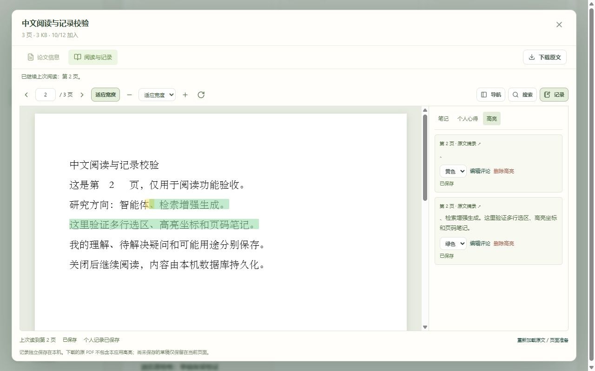
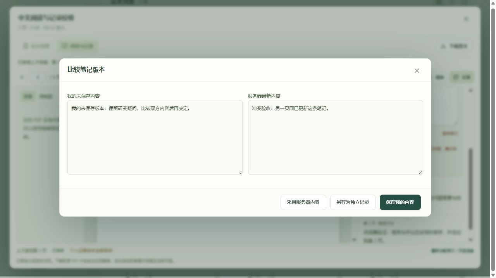
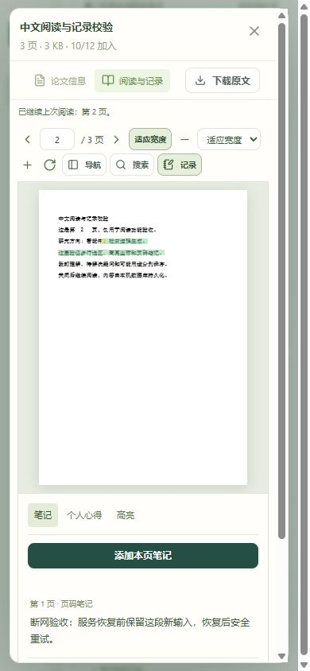
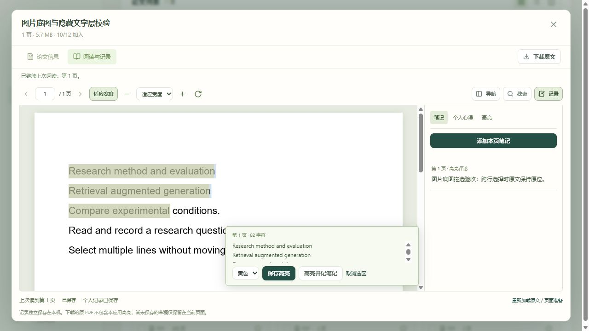

# 第二阶段开发与验收

交付日期：2026-10-12｜应用版本：0.2.0｜阶段：M2 阅读与记录｜依据：[第二阶段实施方案](第二阶段实施方案.md) 1.1

## 交付结果

第二阶段的阅读位置、文内导航与搜索、高亮、页码笔记、个人心得和可靠保存已接入现有应用。继续使用 Windows 本机、SQLite 和私有文件目录，不需要模型密钥，不调用云端 API，不增加独立 OCR。

| 能力 | 实现与交互 |
|---|---|
| 继续阅读 | 恢复实际页码、适应宽度／自定义 50%～300% 比例、用户额外旋转；论文库显示继续页码及最近阅读排序 |
| 原文导航 | 页码输入、前后页、内置目录目的地解析、按可见范围加载缩略图；缺少目录时给出替代导航提示 |
| 文内搜索 | 当前 PDF 文本层的中文／英文子串检索，显示扫描与可检索页数、结果片段；可停止扫描，点击结果跳页与临时标记 |
| 文字高亮 | 单页多行选区、四种颜色、摘录、原 PDF 页面坐标；可以同时创建高亮评论，回跳到对应区域 |
| 页码笔记 | 创建、修改、删除、分页列表和原文回跳；扫描页同样可以记录，保存前翻页不改变草稿原先绑定的页码 |
| 个人心得 | 我的理解、待解决疑问、可能用途独立记录；采用纯文本，后续 AI 更新不会修改这些记录 |
| 自动保存 | 停止输入 1 秒后保存、输入法组合保护、同记录串行请求、最新草稿保留、已保存／失败／冲突状态 |
| 重试与冲突 | 请求标识与成功回执同事务保存；响应丢失可重试，创建不重复；显示本地和服务器版本，明确选择后才覆盖 |
| 离开与会话 | 关闭按钮、遮罩、Esc 和退出登录共用离开检查；未保存时可继续编辑、重试、复制或明确放弃；登录过期保留工作区 |
| 生命周期 | 回收站只读、恢复保留阅读关联；永久删除与到期清理级联处理记录，原文件只有无剩余引用时才清理 |

## 数据与实现

新增五张表：`page_sources`、`reading_positions`、`annotations`、`notes`、`reading_mutation_receipts`。迁移版本为 `0003_reading_records`，前置版本为 `0002_author_search`。

原文件继续保存在 `papers` 与本地哈希目录中，不拆分第一阶段的论文记录。页面来源由隔离进程从原文件准备，保存实际边界、原生旋转和单位；旧论文首次打开时补齐。笔记、位置和高亮有独立版本，保存不会增加论文信息的版本或覆盖方向分类。

新增后端 `reading_service.py`、`reading_api.py`，统一权限、条件更新、请求回执、页面几何校验与事务。前端使用 `reader/` 工作区；原基础预览组件已被替换。全文文字缓存保留最多 10 页、缩略图缓存最多 30 张；关闭时取消任务、释放页面对象。画布限制为最多约 1,600 万像素，设备像素比只作用于画布清晰度。

输入校验失败使用中文提示和 `invalid_input`；业务页码、坐标、归属、版本及数量问题有独立错误码。源文件缺失或页面准备失败时，既有笔记仍可查看。不存在可信页面几何的页禁用高亮，保留页码笔记。

## 自动验证

最终结果：**后端 61 项通过；文字拖选修复后前端 44 项通过，TypeScript 检查与生产构建通过。Python 依赖检查通过。** 本次拖选修复未修改后端及数据库，后端结果沿用第二阶段交付时的验证。

后端包括原有 22 项回归，以及阅读相关验证：

- 空库及旧库迁移，重复启动和服务重启后的位置／笔记保留。
- 私有原文与记录访问、空间和作者隔离，父论文回收站写入拒绝。
- 页码、缩放、旋转、有限数值、非法 Unicode、正文类型和长度。
- 请求回执的创建／更新／删除重试，同请求并发只创建一次。
- 位置、笔记与删除版本冲突，返回服务器当前内容。
- 多行矩形、非零页面边界、文件原生旋转、越界拒绝。
- 高亮和评论同事务创建，失败回滚，关联评论删除与数量上限。
- 软删除、恢复、永久删除、到期清理及多个引用共用原文件的清理规则。
- 最近阅读排序与分页，原有方向筛选及计数保持一致。

前端验证针对：

- 1 秒延迟、请求中的继续输入、旧响应不覆盖新草稿。
- 响应丢失后用原请求标识确认，再提交后续修改。
- 冲突暂停与明确选择、输入法组合、会话暂停和恢复。
- 新建结果未确认时不重复创建；删除前确认已提交请求；空草稿不额外创建。
- 四个比例与四个角度的页面坐标往返、非零原点和非法矩形。
- 全半角、连字、组合字符、代理对、跨文字项及空白折叠的搜索偏移。
- 严格模式重挂载、文字缓存限额与失败重读。
- 中文网络提示、保存超时与结构化冲突响应。

测试框架仍有一条旧 HTTP 客户端适配层的弃用提示，当前验证成功；本次没有为消除提示更换服务端依赖。

## 浏览器验证

使用独立目录 `.test-data/stage2-browser`，保留第一阶段验收空间的两篇论文副本，另准备八份合成 PDF。浏览器确认：

1. 页码笔记输入后自动保存；翻页仍保留原笔记页码，关闭与重开后恢复第 2 页、125% 和额外 90° 旋转。
2. 个人心得单独创建与保存；实际选区形成单行和多行高亮，高亮与评论可以一起持久化。
3. 中文搜索命中三页；目录跳到第三章，缩略图实际显示；无目录有替代导航提示。
4. 纯扫描 PDF 显示无可检索文字，页码笔记正常保存；280 页混合样本完成索引，其中 278 页可检索，扫描期间仍可跳到第 280 页。
5. 用另一会话更新笔记后，当前编辑收到冲突；双方文字都显示，明确确认后保存本地内容成功。
6. 两个真实标签页同时打开一篇论文；第二页签保存第 3 页后，第一页签保存第 1 页收到位置冲突，选择服务器位置后正确跳到第 3 页。
7. 在独立验收库模拟会话过期；重新登录后当前文字保留并成功保存。
8. 停止验收服务后编辑，界面保留草稿、显示失败、关闭时拦截并提供可复制文本；重启后“重试保存并离开”成功。
9. 1280×800 桌面与 390×844 窄屏均无全页横向溢出；窄屏初次打开默认原文，可展开记录面板。
10. 连续 20 次打开／关闭，打开期间最多一个主画布和文字层，关闭后无剩余阅读页面节点。

补充打开英文双栏、多行文本、无目录及非零页面边界样本，文字层均可用；带原生旋转的第二页显示为 90°，未出现页面坐标不匹配提示。原验收空间中 18 页、约 13.7 MB 的真实论文副本首页同样可显示，并提取到 4,369 个文字字符，未修改原正式文件。

对已知的多行文字选区，实际浏览器核对 50%、100%、200%、300% 与 0°、90°、180°、270° 共 16 种组合：完整选区的高亮与文字边界最大偏差约 **0.69 CSS 像素**，低于实施方案的 2 像素阈值。它是固定样本的结果，不代表所有 PDF 字体与版式均已全面评测。

坐标与重复开启的原始核验结果见[浏览器验证记录](第二阶段浏览器验证.json)。未使用堆快照做内存泄漏定量分析；上述资源验证是节点数量、缓存限额及任务清理层面的检查。







## 正式数据升级与备份

开发前备份 `data` 与 `.test-data/browser`，保存在 `.test-data/stage2-backups/`。正式库当前已有个人账号与一篇论文；原文、账号和分类均保留，没有创建正式演示账号或向正式库导入验收样本。

通过启动脚本在独立端口验证正式库升级，迁移已达到 `0003_reading_records`。将开发前的正式备份复制到 `.test-data/stage2-restore-check` 后重新启动迁移，恢复副本同样可运行。逐表对比账号、空间、论文、分类、名称与关联，升级库、恢复副本与原备份相等；原文文件哈希一致。

第一阶段 `.test-data/browser` 保持独立；第二阶段验收记录不自动合入正式空间。两个验收目录都保留，后续可继续使用。

## 运行和验证

从项目根目录启动正式空间：

```powershell
powershell -ExecutionPolicy Bypass -File .\start.ps1
```

如需强制重新构建，添加 `-Rebuild`。新机器安装锁定依赖使用 `-Install`；依赖变更后也使用该选项。

查看第二阶段验收空间：

```powershell
powershell -ExecutionPolicy Bypass -File .\start.ps1 -DataDirectory .test-data/stage2-browser
```

自动验证命令见 README；后端使用 `.test-data/pytest-stage2` 作为临时目录，前端运行 `npm.cmd run test -- --run` 和 `npm.cmd run build`。

## 当前边界与下一阶段

- 阅读位置恢复到页，不保存段落级滚动锚点；高亮限同页多行，不提供手绘或写回原 PDF。
- 文内搜索针对 PDF 可提取文本，双栏顺序、编码、断字及连字可能影响匹配；扫描页使用页码笔记。完整论文库的笔记全文检索继续放在 M4。
- 页面内草稿不会长期保存在浏览器；服务端确认后的内容可恢复，断网后强制结束浏览器仍可能丢失未提交内容。
- 长文交互使用约 220 KB 的合成样本；不据此宣称所有 50 MiB 大论文具有相同性能。
- 当前仍为本机单用户／单 API 进程；PostgreSQL、多进程与课题组权限尚未实机验收。
- AI 简介卡片、推荐方向、云端模型配置与创新思路未接入。下一阶段 M3 完成视觉模型接入、持久生成任务、卡片草稿与来源页核对。

## 文字拖选修复（2026-10-12）

用户反馈图片类型 PDF 可以复制文字，但鼠标拖选不稳定。原实现监听每次选区变化，并在阅读区域上方插入操作工具栏，拖选途中会改变原文位置；起止端点离开文字层时也会丢弃选区。

修复后，浏览器继续处理原生文字选择，松开鼠标再读取最终范围；键盘扩选和触屏选择手柄变化合并后读取。操作工具栏浮动在阅读区域内，出现与展开评论均不占据页面排版空间。文字层增加页尾承接区域，拖过页边时裁剪到本页文字；摘录保留跨行换行。指针取消、窗口失焦及组件卸载时清理监听与延迟任务。未增加 OCR 或区域框选。

新增 7 项前端测试，覆盖拖选途中不提交、在页面外松开、键盘连续扩选、取消与失焦、严格模式清理、正反向选区、页首／页尾裁剪及无关选区隔离。前端共 44 项通过，生产构建通过。

浏览器使用 `.test-data/stage2-browser` 独立论文库，新增“图片底图与隐藏文字层校验”样本：整页位图承载可见文字，隐藏文字使用 PDF 的不可见渲染模式。验证跨行拖选、正反向重复选择、100% 缩放下旋转 90°、高亮与评论保存以及重开回显。浮层出现前后，阅读区域及原文边界相同；合成样本跨行摘录保留换行。18 页实际论文的标题跨行拖选正常。390×844 窄屏下操作按钮位于视口内，没有全页横向溢出。该结果不代表所有扫描文件的隐藏文字位置都准确；原文件的文字层质量仍会影响文字定位。

测试样本脚本为 `backend/scripts/prepare_selection_sample.py`，使用已安装的系统 Python 绘图工具及项目 PDF 依赖。脚本仅连接 8011 端口，并在上传前核对会话是否属于指定独立验收库。正式论文与笔记未修改。

原始结果见[文字拖选修复验证](文字拖选修复验证.json)。当前服务读取已构建的前端文件，刷新页面即可加载修复；重新部署源码时执行 `start.ps1 -Rebuild`。


