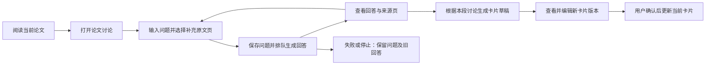

# 第四阶段实施方案：论文讨论与聊天生成卡片

2026-10-13｜M4｜目标应用 0.4.0

【本次更新】根据用户要求，M4 改为论文讨论，优先交付聊天界面及聊天生成卡片。此前规划的内容检索、导出与应用内备份恢复保留为后续事项。

## 1. 用户动线

在论文详情或阅读工具栏进入“论文讨论”，默认使用论文库现有 DeepSeek 配置，不新增密钥。用户提问、查看回答和来源页，可以继续追问、停止生成、重试，以及新建或切换本篇论文的讨论。已发送的问题及生成回答保存在本机数据库。

讨论入口按需打开，阅读页继续保持紧凑。聊天与阅读之间切换保留当前论文位置，来源按钮回跳原文页。消息与来源文本只作为内容显示，不执行其中的指令或 HTML。

## 2. 输入与生成范围

每次回答包含当前问题、最近最多 12 条已完成的聊天消息、当前卡片的论文内容、有限长度的全文文字，以及最多 3 个选定原文页的视觉输入。默认补充上次阅读页，用户可以修改或清空页码。扫描页不做 OCR，通过选定页的视觉输入讨论；不声称未输入的页已覆盖。模型返回来源只能指向这次实际输入的页。

全文文字在隔离子进程中提取，单页最多 6,000 字符、总计最多 40,000 字符，优先保留用户选定页；对话历史另设长度上限和预算预占。界面展示实际文字页数、视觉页和截断提示。论文、图像、已有模型回答不作为可执行指令。个人笔记和个人用途不自动发送，用户在聊天中输入的内容作为本次讨论的一部分发送。

问题上限 2,000 字符，回答上限 4,000 字符。每段讨论最多 50 条消息、60,000 字符，达到上限后新建讨论。整理卡片使用该段讨论的全部已完成问答及论文上下文，生成过程不覆盖聊天或已有卡片。“局限与疑问”必须保留一项“讨论小结：”，记录本段关注问题、关键解释或待验证建议；讨论设想不能进入作者贡献和主要结果。原文事实与作者主张要求原文页证据；讨论推测与个人想法分别标记，不把 AI 建议归为用户提出。聊天只能提供待核对的解释与建议，来源页有效不等于结论已证实。

## 3. 数据与接口

新增迁移 `0006_discussions`：

| 实体 | 主要字段 | 约束 |
| --- | --- | --- |
| `discussion_sessions` | id、workspace_id、user_id、paper_id、file_hash、title、request_id、created_at、updated_at | 用户与论文归属检查；新建请求幂等；原文版本固定 |
| `discussion_messages` | id、session_id、workspace_id、user_id、paper_id、role、content、status、task_id、evidence、context、created_at | 与论文及讨论关联；任务删除后聊天内容保留；论文彻底删除时关联清理 |

继续使用现有 `generation_tasks`，增加 `discussion_reply`、`discussion_card` 任务目的，复用排队、预算、调用记录、取消、有限重试、租约和晚到结果保护。每篇论文同时一个 AI 任务。请求标识不可用于不同内容；网络响应不确定时重试原请求。

| 接口 | 用途 |
| --- | --- |
| `GET /papers/{id}/discussions` | 列出当前用户在本篇论文的讨论 |
| `POST /papers/{id}/discussions` | 幂等新建讨论 |
| `GET /discussions/{id}` | 获取消息、相关任务和模型信息 |
| `POST /discussions/{id}/messages` | 保存问题并创建回答任务 |
| `POST /discussions/{id}/card-tasks` | 根据本段已完成讨论创建卡片草稿任务 |
| 现有任务查询与取消接口 | 查询进度、停止后续处理 |
| 现有卡片编辑与确认接口 | 编辑生成的新版本并人工确认 |

回复与卡片完成后，在同一事务中保存结果和任务完成状态。失败、取消及重启结果不确定时保留问题，可显式重试；停止不能撤销已经发送给远端的请求。聊天草稿尚未发送时离开窗口应提示处理，不自动发送问题以触发模型。

## 4. 页面与状态

聊天页包含本篇讨论选择器、新建讨论、使用中的模型、消息列表、来源页、任务状态、输入框、补充原文页及发送按钮。等待时显示具体阶段，可停止；回复完成后允许追问。已有回答的复制及来源回跳继续可用。

“根据讨论生成卡片”在至少一次回答成功、没有待处理任务且当前论文可写时启用。生成后提供“查看卡片草稿”，直达该版本；原有卡片编辑草稿不被替换，需先完成或取消编辑。卡片记录模型、配置版本、讨论标识和所用消息标识，保留关联讨论入口。

空讨论提供研究问题、方法、实验与局限的示例问题。模型停用、未测试、文件缺失、预算不足、无权限、失效页码和保存响应不确定均展示可操作中文提示。草稿输入、任务与记录不能跨论文或跨用户串用。

## 5. 开发与验收

按“迁移与数据接口 → 上下文与任务执行 → 聊天页面与卡片衔接 → 回归及真实模型验证 → 备份升级与 Git 发布”实施。

验证多轮上下文、全文文字与扫描页范围、有效来源、隐私输入排除、持久记录、重试幂等、取消后晚到结果、卡片不覆盖原版本、人工确认、权限和预算。浏览器验证从阅读打开讨论、问答、生成草稿、编辑确认及来源回跳。正式迁移前完整备份，并先在独立备份克隆中升级验证。

完成后发布 0.4.0，使用中文提交说明和 `v0.4.0` Git 标签。运行数据、论文原文、密钥、备份和临时验证结果不提交。
