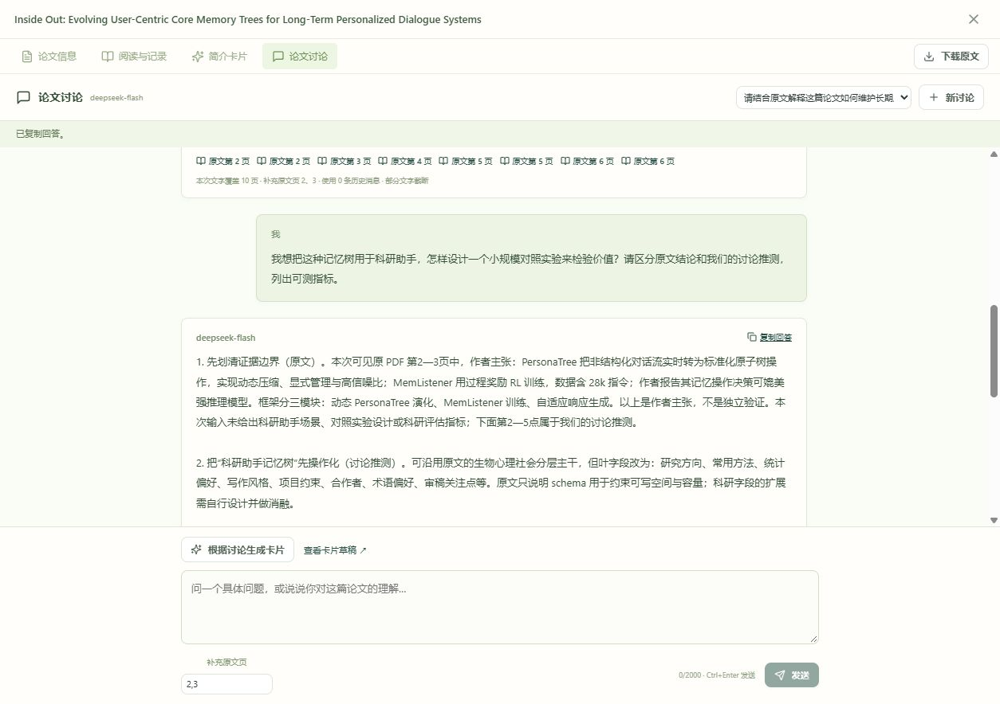
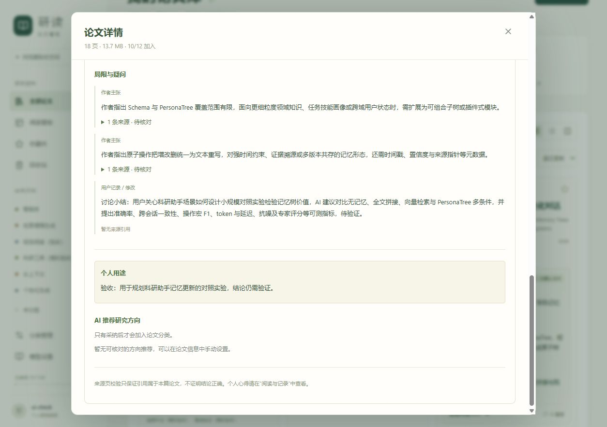

# 第四阶段开发与验收：论文讨论与聊天生成卡片

2026-10-13｜应用 0.4.0｜Git 发布标签 `v0.4.0`

【本次更新】按用户要求将 M4 改为论文讨论，优先交付“讨论当前论文 → 多轮追问 → 根据聊天生成卡片 → 编辑确认”。旧规划的内容检索、Markdown 导出和应用内完整备份恢复保留为后续事项。详细需求、字段与接口见[第四阶段实施方案](第四阶段实施方案.md)。

## 已实现内容

- 论文详情“论文讨论”和阅读工具栏“讨论”，全页面聊天、每篇多段讨论、新建与切换。
- 自动继承已有启用且测试通过的论文模型，当前为 `deepseek-flash`，无需重新输入密钥；划词翻译继续使用独立 Qwen 服务。
- 持久保存问题、回答与来源，支持多轮上下文、补充原文页、来源回跳、复制回答、停止、失败重试及响应不确定时幂等重试。
- 使用本段全部已完成问答生成独立卡片草稿，直达指定版本，编辑保存并人工确认，卡片可返回关联讨论。
- 保留已有卡片和人工个人用途；个人笔记及个人用途不自动发送。未发送的问题有离开保护，关闭窗口不会自动触发模型。

聊天文字输入单页最多 6,000 字符、总计 40,000；最多 3 页视觉补充，选定页的文字优先。界面展示文字覆盖页数、补充页、历史消息数和截断提示。扫描件需指定原文页，通过视觉模型讨论，不增加 OCR。聊天回答使用最近最多 12 条已完成消息；整理卡片使用本段全部已完成问答。每段最多 50 条消息、60,000 字符，每篇最多 100 段。

## 实现文件与扩展方式

| 文件 | 职责 |
| --- | --- |
| `backend/app/discussion.py` | 讨论归属、幂等接口、输入上限、任务快照、提示与来源校验 |
| `backend/app/models.py`、`0006_discussions.py` | 用户与论文隔离的讨论、消息和序号约束；旧任务清理后保留完成记录 |
| `backend/app/ai_render.py` | 隔离提取有限文字、记录实际页与截断，保留既有 PDF／图片准备 |
| `backend/app/ai_worker.py` | 复用持久任务、预算、租约、取消及有限修复；原子发布回答或卡片草稿 |
| `backend/app/ai_provider.py` | DeepSeek 可空联合结构使用 JSON 模式，仍由服务端严格验证完整卡片与来源 |
| `frontend/src/ai/DiscussionPanel.tsx`、`discussion.css` | 聊天界面、任务反馈、草稿保护、来源与卡片衔接 |
| `PaperDetail.tsx`、`CardPanel.tsx`、阅读器组件 | 阅读入口、面板切换、指定草稿展示与返回关联讨论 |

新增讨论能力先调整服务端输入、快照和校验，再调整界面及测试；不要在浏览器接触 API 密钥。卡片沿用既有结构与版本确认接口；不得用讨论推测伪装论文实验结论。后台发布前再次核对任务代次、用户空间、论文归属和原文哈希，取消后的晚到结果不能发布。

## 自动验证

| 项目 | 结果 |
| --- | --- |
| 后端验证 | 150 项全回归通过，最终讨论专项 12 项通过；共 151 项 |
| 前端完整回归 | 101 项通过，17 个文件 |
| TypeScript 与独立构建 | 通过 |
| 升级副本 | `0005_task_order` → `0006_discussions`，外键检查无错误，旧记录数量与全部原文一致 |

讨论后端专项验证多轮已完成上下文、笔记排除、请求幂等、权限与原文版本、页码、预算、长度上限、取消晚到结果、任务清理保留历史、删除级联，以及卡片保留个人用途和人工确认。前端验证发送、补充页、来源回跳、安全重试保留新输入、未发送保护、指定草稿跳转、失败提示和快捷键在生成时禁止二次提交。

## 真实模型与浏览器验证

验收使用 `.test-data/discussion-browser`，与正式 `data` 完全隔离；复制已部署 DeepSeek 配置供验证，密钥不输出、不进入 Git。实际论文为 18 页《Inside Out: Evolving User-Centric Core Memory Trees for Long-Term Personalized Dialogue Systems》，补充第 2、3 页。

两轮问答成功：第一轮解释长期用户画像与核心模块，第二轮讨论将记忆树用于科研助手的对照实验。第二轮使用前一轮两条历史消息，界面显示文字覆盖 10 页、视觉补充 2／3 页及部分截断。原文主张与讨论推测分别呈现；来源回跳并从阅读返回讨论，已发送消息保留。

实际卡片首次触发 DeepSeek 的联合结构拒绝（HTTP 400），短探针确认原因为 `anyOf`。兼容调整后接口接受 JSON 模式；另一次卡片调用因默认思考消耗输出上限未完成，现对这类结构关闭默认思考，保持现有模型、密钥及预算。JSON 模式是 DeepSeek 官方支持的输出格式；本地结构、长度和来源检查继续执行。[DeepSeek Responses 官方文档](https://api-docs.deepseek.com/zh-cn/api/create-response/)

最终提示版本为 `discussion-1.3`，任务 `39beab20cf324e2faf20539cc2be3b92` 成功，生成草稿 `60ec6fb5f0ad4aafa6f96598e9e6e017`。输入包含 4 条已完成历史消息、原文 1～10 页文字及 2／3 页视觉补充；后续页文字截断。卡片正文 921 字符，保留“讨论小结：”中的科研助手实验关注点、对照条件和待验证指标，作者贡献与主要结果只收录原文内容。

在独立验收库中确认：生成第 4 版草稿后第 1 版仍是当前卡片；人工填写个人用途保存第 5 版，点击确认后第 5 版成为当前卡片，第 1～4 版保留，关联讨论入口仍可用。两轮聊天刷新后恢复、复制回答、来源回跳与阅读返回、未发送问题关闭保护均通过；390 像素窄屏没有横向溢出，输入区在页面内。正式库没有写入这些验收消息或卡片。

本轮独立库共 9 个讨论任务（含故障定位、停止和复测），应用记录用量合计 249,333 token；另外发送两个不含论文的结构探针，成功探针返回 242 token。记录是接口报告用量，不换算费用。流程验证不等于所有论文论断已被独立验证，实际科研使用仍需查看原文核对。

## 升级、数据与 Git

发布前完整备份为 `.test-data/discussion-before`，包含在线一致性数据库快照、原文与本机加密资料；在 `.test-data/discussion-upgrade` 验证升级。发布前再次核对正式活动任务为 0、数据库逻辑及原文与备份相同。正式发布用 `start.ps1 -Port 8000 -Rebuild` 构建并自动执行迁移。

正式服务 8000 启动后：健康接口和 `version.json` 均为 0.4.0，入口脚本返回 200；数据库为 `0006_discussions`、外键检查无错误，原有用户、论文、笔记、批注、卡片、模型配置及任务数量与备份一致，全部原文一致，讨论表为空。旧阅读脚本 `ReaderWorkspace-ByrZ0paH.js` 和 `ReaderWorkspace-DG_qLsGf.js` 均返回 200。

后端与前端版本同步为 0.4.0；中文提交关联带中文说明的 `v0.4.0` 标签，运行数据、论文、私有聊天、密钥、备份与依赖不提交。可用 `git show v0.4.0 --stat` 查询发布提交。

首版返回完整回答后展示，暂不逐字流式输出。仅讨论当前论文，未实现跨论文聊天、联网检索、自动执行实验或创新性判定；长文与扫描件请按需补充原文页。
