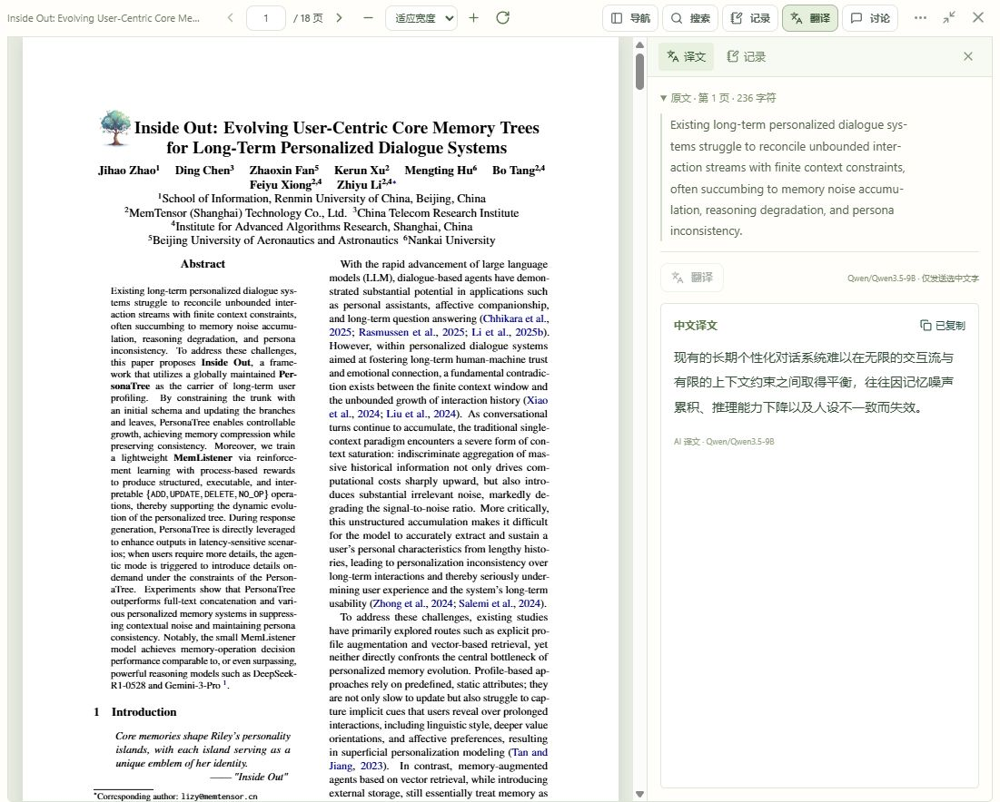

# 翻译侧栏开发与验收

2026-10-14｜应用 0.4.1｜Git 标签 `v0.4.1`

【本次更新】用户反馈右下角浮层不便阅读且不能调整大小。本轮将译文移到阅读器右侧栏，侧栏使用可用阅读高度，支持拖动宽度，与阅读记录切换查看。选区中的高亮和评论继续使用紧凑操作区。

## 使用与行为

1. 在论文中拖选文字，点击选区操作中的“翻译”；右侧栏打开并开始翻译。阅读工具栏的“翻译”可以随时打开或收起侧栏，空侧栏不会自动调用模型。
2. 侧栏展示选中的原文、原页码、翻译进度与译文；原文可折叠，长原文和长译文可以滚动查看。复制、取消、超时与失败重试继续可用。
3. 拖动侧栏左边缘调整宽度；默认 380 像素，范围 280～720 像素，并为原文保留至少 320 像素的可用宽度。双击恢复默认；聚焦分隔条后左右方向键按 20 像素调整，Home／End 跳到宽度边界。
4. 宽度偏好保存在当前浏览器，重新进入阅读时恢复。侧栏可在“译文”和“记录”之间切换，切换或收起不卸载笔记和翻译组件，保留当前译文、请求及未完成笔记。
5. 滚轮跨页、翻页与缩放不清空侧栏译文，侧栏仍标注原始选区页。翻译其他选区时替换原文并取消旧请求；晚到结果不得覆盖新选区。关闭整篇论文时取消进行中的请求，译文不自动写入数据库、笔记或卡片。

窄屏采用上下布局，隐藏横向拖动条，侧栏保持在阅读窗口内；大小窗和全页面阅读均可使用。无文字层扫描页的范围保持不变，本轮不增加 OCR、模型配置或数据库迁移。

## 实现

| 文件 | 变更 |
| --- | --- |
| `ReaderWorkspace.tsx` | 将待翻译选区与临时高亮选区分开，增加共享侧栏、切换及展开状态，保留组件实例 |
| `SelectionToolbar.tsx` | 翻译按钮打开侧栏，浮层不再渲染译文 |
| `SelectionTranslation.tsx` | 展示原文、空状态及译文，显式请求在配置准备后执行一次，保持取消与晚到保护 |
| `useSidebarWidth.ts` | 拖动和键盘调整、容器宽度限制、浏览器偏好与默认恢复 |
| `reader.css`、`ReaderLayout.css` | 可调整的右侧列、独立内容滚动、大小窗与窄屏布局 |

仍使用独立免密钥 Qwen 翻译服务，接口、登录保护、论文归属、原文哈希、页码、字符上限与缓存均未改变。只在用户明确请求翻译时发送所选文字，不发送整份 PDF 或个人笔记。

## 验收结果

- 前端完整回归：18 个文件、107 项通过；包括选区翻译、取消与晚到结果、跨页保留、收起恢复、笔记保持、宽度拖动与偏好。
- 后端现有翻译接口专项：19 项通过；其他后端业务未改变，本轮未重复全部后端回归。
- TypeScript 与独立构建通过；正式发布使用启动脚本完成生产构建。
- 独立浏览器数据目录 `.test-data/translation-sidebar-browser` 与正式数据隔离；关闭其后台卡片工作循环，未调用 DeepSeek。
- 实际拖选公开论文第一页摘要的 236 字符并调用已部署 Qwen，成功返回简体中文译文，复制成功。
- 拖动后从 380 调到 470 像素，切换记录、收起重开及滚轮跨到第二页均保留第一页译文。双击恢复 380，方向键调到 400，关闭论文再打开恢复 400 像素。
- 大小窗切换保留译文；390 × 844 窄屏文档宽度为 390，侧栏宽 372、底边 843，无横向溢出，临时视口已恢复。

## 发布与版本

正式发布前活动 AI 任务为 0，完整备份保存在 `.test-data/translation-sidebar-before`，包含数据库一致性快照、原文及本机加密资料。本轮迁移仍为 `0006_discussions`，不修改既有论文、卡片或聊天记录。

已通过 `start.ps1 -Port 8000 -Rebuild` 构建并启动正式服务。健康接口、前端版本文件均为 0.4.1，入口脚本与新版阅读资源返回 200，旧版 `ReaderWorkspace-Bz57avUV.js` 仍可加载。外键检查无错误，原有用户、论文、笔记、批注、卡片、模型配置、任务和讨论记录数量与备份一致，全部原文一致。

应用与前后端版本同步为 0.4.1；提交使用中文说明，并关联带中文说明的 `v0.4.1` 标签。截图和必要验收文档进入 Git，论文、数据库、密钥、备份和依赖目录继续排除。
