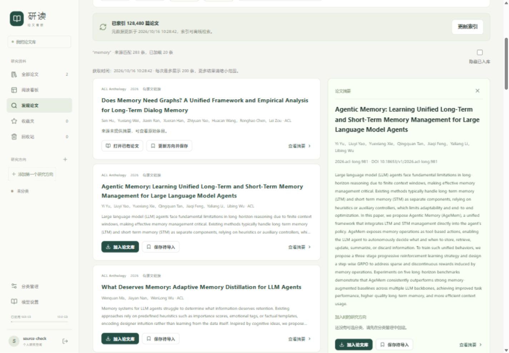
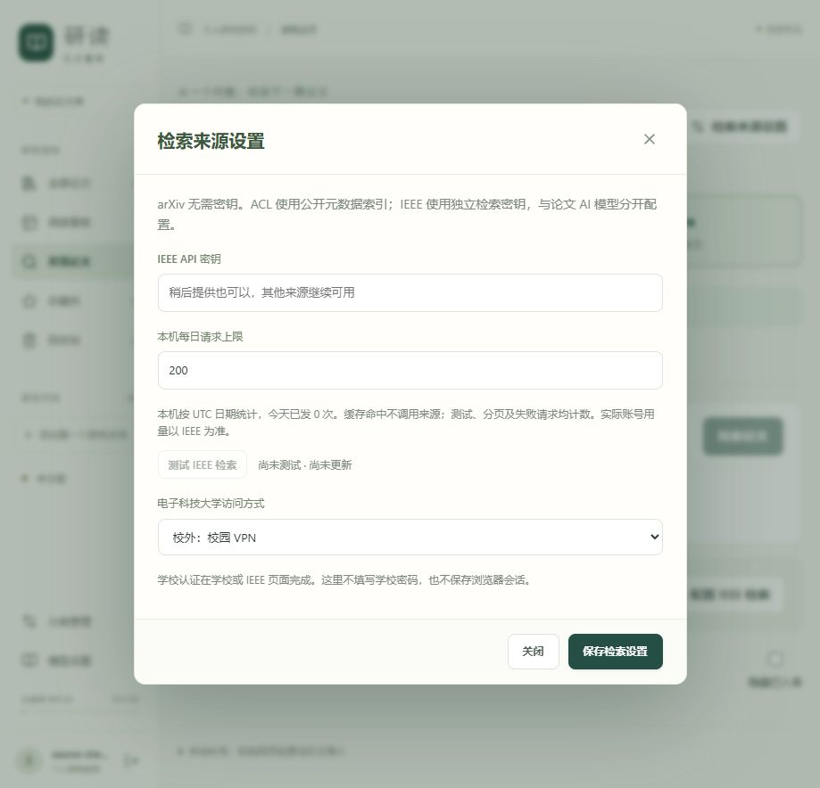
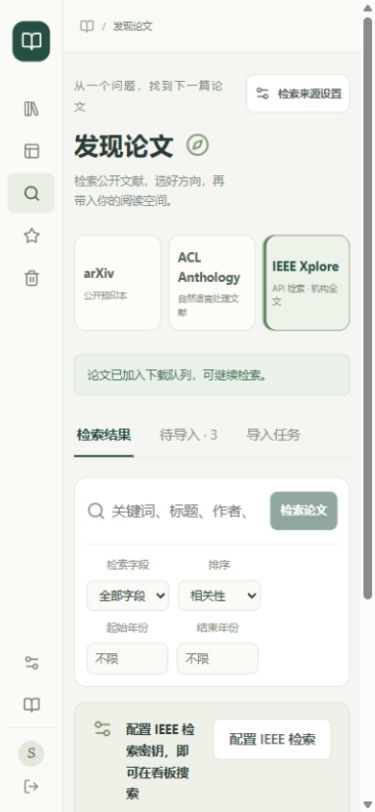

# 联网发现开发与验收

2026-10-16｜应用 0.5.0｜发布标签 `v0.5.0`｜范围：F11 首批联网检索与导入

## 交付范围

左侧新增“发现论文”，包含 arXiv、ACL Anthology、IEEE Xplore 三个来源。输入条件和结果按来源分别保留，只有明确点击检索才请求来源；支持摘要侧栏、研究方向、隐藏已入库、待导入清单和导入任务。切换来源会取消当前等待并忽略迟到结果；加载更多沿用原查询快照，避免修改输入后混合分页。

arXiv 支持关键词、标题、作者、摘要、精确 ID／版本／官方链接、年份、发布日期和学科筛选。ACL 使用官方元数据建立独立 FTS5 索引，支持标题、作者、摘要、短语、ACL 新旧 ID、DOI、年份及会议；接口另支持 `volume_id` 筛选。两者选定论文后自动下载公开 PDF、检查、查重并入库，成功任务可以直接打开阅读。

IEEE 已完成独立密钥设置、加密保存、连接测试、官方元数据 API 适配、结果列表与机构全文交接。当前没有真实密钥，缺密钥时不会发送请求，arXiv 与 ACL 可继续使用。IEEE 真实查询及机构全文补传的真实完整流程待用户补充密钥后验收；不把模拟通过当作真实可用。

## 使用方法

1. 打开“发现论文”，选择来源并输入关键词。中文主题建议先自行换成常用英文检索词；首版没有自动 AI 改写。
2. 点击题名或“查看摘要”，选择加入时的研究方向，再“加入论文库”；也可以先“保存待导入”。方向来自现有分类管理，不自动创建分类。
3. ACL 在全新安装时先“初始化论文索引”，首次只同步公开元数据。同步任务持久保存，更新期间旧索引继续可用。本机交付复用了已验证的公开索引，无需重复首次同步。
4. 在“导入任务”查看阶段、文件大小、错误、取消或重试。下载失败保留候选，可以重新下载或手工补传。任务完成后“打开阅读”。
5. 取得 IEEE 密钥后，打开“检索来源设置”，填写 **IEEE API 密钥**，保存，再点“测试 IEEE 检索”。该密钥与 DeepSeek／Qwen 无关，学校账号不填在这里。
6. IEEE 选定论文后“通过机构获取全文”，打开电子科大入口，从资源列表进入 IEL／IEEE，使用 DOI／文章号／题名定位并下载。回到候选核对对应关系、勾选确认，再上传此篇 PDF。正常 API 结果无需重新导出引文。

未配置 IEEE 密钥时，手动机构检索与 RIS／BibTeX 预览仍在页面底部，作为主动选择的补充路径。每份引文最多 20 条、2 MiB、UTF-8 编码；预览与保存不会访问引文中的任意网址。





## 实现位置与接口

| 文件 | 责任 |
| --- | --- |
| `backend/app/literature_providers.py` | 来源规范化、官方 ID、arXiv／IEEE 请求、限流、有界响应、固定公共地址连接与脱敏错误 |
| `backend/app/acl_index.py` | 独立公开索引、FTS5、源提交、增量集合更新、代次原子切换和旧缓存清理 |
| `backend/app/discovery_service.py` | 私人候选、查询缓存、持久导入任务、取消／重试／恢复、ACL 同步工作循环 |
| `backend/app/discovery_api.py` | 来源配置、查询、候选、任务、机构资料与引文解析接口 |
| `backend/app/discovery_models.py`、`0007_discovery.py` | 六张新增表；不重建或改写已有论文表 |
| `backend/app/pdf_ingest.py` | 本地上传与联网下载共用 PDF 检查、容量、SHA-256 查重与事务登记 |
| `frontend/src/discovery/` | 来源检索、摘要、候选、任务、密钥设置与机构补传界面 |
| `backend/scripts/check_discovery.py` | 正式适配器的真实来源验收；只写隔离测试目录 |

统一接口前缀 `/api/v1`：

- `GET /discovery/providers`、`GET /discovery/search`：来源状态与分页查询。
- `POST /discovery/providers/acl/sync`、`GET /discovery/providers/acl/status`：初始化／更新与进度。
- `GET /settings/discovery-providers`、`PUT /settings/discovery-providers/ieee`、`POST /settings/discovery-providers/ieee/test`：独立加密配置与测试。
- `GET|PUT /settings/institution-access`：电子科大校内／校外访问偏好。
- `POST|GET /discovery/candidates`、`DELETE /discovery/candidates/{id}`：私人候选。
- `POST /discovery/citation-previews`：引文预览。
- `POST|GET /paper-imports`、`GET /paper-imports/{id}`、`POST /paper-imports/{id}/cancel|retry`：任务。
- 原 `POST /papers` 新增可选 `candidate_id` 与 `candidate_confirmed`，旧上传继续可用。

候选与任务验证用户和空间，研究方向验证归属。客户端不能提交任意下载网址；下载前重新从来源标识解析可信记录。公网下载使用允许的官方域名、逐跳检查与 DNS 公共地址固定，拒绝内网、凭据网址和任意重定向。IEEE 元数据中的 PDF 地址不触发后端下载。

IEEE 按 UTC 日期记录本机请求次数，默认每日 200 次，允许调低；缓存命中不计数，测试、分页、失败请求均计数。服务端配置只返回状态、版本、用量与脱敏错误，不回显密钥。测试脚本从 `IEEE_API_KEY` 环境变量读密钥，不通过命令行参数或结果输出暴露密钥。

任务请求标识防重复提交；重复同一请求返回原结果，不同内容重放返回冲突。下载在临时区完成并检查，任务结果、来源关联与论文在同一事务登记。取消与登记共用锁，取消的旧执行不能迟到入库。服务重启将执行中任务标为中断失败，排队任务继续；不自动重发结果不确定的任务。当前只支持启动脚本默认的单 API 进程。

## ACL 数据与兼容

实际缓存位置为 **当前实例数据目录的 `literature-cache/acl/`**，例如 `data/literature-cache/acl/`，与方案建议的项目级 `.cache/` 不同，用于隔离正式与验收实例。公开来源记录不写入私人 `papers`。缓存包含官方浅克隆、独立索引与活动代次指针；不含全量论文 PDF。

固定官方来源提交：`92b2670682358ca561a577473810f25803590cba`，索引 **128,480** 篇；单代索引约 **390.3 MiB**，源副本与单代索引合计约 **650 MiB**。首次成功同步约 **180 秒**，修正姓名格式后全量重建约 **143 秒**，均为本机测量，不保证其他网络和机器相同。保留当前与上一代索引，超过 10 分钟且未受保护的生成索引才清理；不会删除任意命名文件。元数据缓存不计入个人论文原文额度，应为数据目录预留额外磁盘空间。

通过固定提交比较 XML 集合增量更新；无法比较旧提交或其他元数据改变时全量重建。新库的条目数、FTS 数量和完整性检查通过才切换指针；失败继续使用旧代次。旧分页遇到新代次返回明确冲突，要求重新检索。初始化由用户触发，已建立索引时服务运行期间每天检查更新，应用关闭不运行系统定时任务。

官方库当前为 `acl-anthology==1.3.3`。真实数据已增加会议字段 `related_ids`，读取公开 `venues.json` 中所需简称以兼容新增字段，论文主体仍由官方库解析；作者使用官方 `Name.as_full()`，避免把对象表示写入作者字段。官方 SDK 的模式差异和少量不支持的 TeX 转换会产生提示；此次完整遍历及索引校验已通过，不据此宣称未来所有元数据变更都兼容。解析失败保留旧索引。

## 验证结果

| 检查 | 结果 |
| --- | --- |
| 后端全量回归 | **185 项通过**，含 34 项发现功能测试及原上传、阅读、批注、翻译、卡片、讨论回归 |
| 前端全量回归 | **123 项通过**，含 7 项发现交互及分段表单请求边界测试 |
| TypeScript 与生产构建 | 通过；仍有主包大于 500 kB 的构建提示，不影响运行 |
| arXiv 真实精确查询和下载 | `1706.03762` 返回 `1706.03762v7`，题名为《Attention Is All You Need》，隔离库下载检查并入库成功 |
| arXiv 扩展样本 | 主题查询出现超时，完整题名复测出现 429、作者查询超时；已停止批量请求，**10 组真实覆盖尚未完成**，不当作全部通过 |
| ACL 真实元数据 | 完整同步与校验通过，源提交、覆盖量和耗时见上文 |
| ACL 真实检索 | 下表 10 组通过；已建索引断网也能使用，本地样本单次 0～32 毫秒，未单独进行大规模 95 分位压力验收 |
| ACL 真实导入／阅读 | 脚本导入 `W01-0722`；浏览器选择 `2026.acl-long.1232`，自动下载 878,470 字节、25 页 PDF，任务成功并直接连续阅读，无需回传原文 |
| IEEE | 缺密钥、加密保存、测试、缓存计数、配额、403／429／5xx、机构交接和补传均有模拟／事务测试；**真实密钥主流程待验收** |
| 浏览器 | 查询及会议／年份筛选、摘要侧栏、候选、真实任务与阅读、IEEE 设置与无密钥引导通过；控制台无错误 |
| 窄屏 | 390×844，页面无横向溢出；内容宽度 375 像素，见截图 |
| 升级演练 | `0006_discussions` → `0007_discovery`；原 21 张业务表全部行与 3 篇 PDF 哈希一致，外键检查通过 |

ACL 真实样本：

| 条件 | 匹配数 |
| --- | ---: |
| 标题 `Long Short-Term Memory` | 52 |
| 摘要 `dialogue` | 3,675 |
| 作者 `Hammerton` | 4 |
| 短语 `"long term memory"` | 77 |
| 新 ID `2022.acl-long.220` | 1 |
| 旧 ID `W01-0722` | 1 |
| 官方链接 `https://aclanthology.org/2022.acl-long.220/` | 1 |
| DOI `10.18653/v1/2022.acl-long.220` | 1 |
| `memory`，2025～2026，会议 ACL | 283 |
| 无匹配词 `zzqpaperboardunlikelynomatch7429183` | 0 |



## 复现命令

在项目根目录运行，真实验收数据只写入 `.test-data/`，不使用正式用户密码、个人论文或正式 AI 配置：

```powershell
# 无 IEEE 密钥可直接验证 arXiv；结果受上游限流与网络影响。
.venv\Scripts\python.exe backend/scripts/check_discovery.py --provider arxiv --query 1706.03762 --import-pdf --directory live-arxiv

# ACL 首次同步较久，后续不带 --sync-acl 可只检索已有索引。
.venv\Scripts\python.exe backend/scripts/check_discovery.py --provider acl --sync-acl --import-pdf

# 取得密钥后，在当前终端安全设置 IEEE_API_KEY，再运行；不写入脚本。
.venv\Scripts\python.exe backend/scripts/check_discovery.py --provider ieee --query "long term memory"

# IEEE_API_KEY 未设置时明确跳过，不发送无密钥请求。
.venv\Scripts\python.exe backend/scripts/check_discovery.py --provider ieee

# 离线回归不需要 IEEE 密钥。
Set-Location backend
..\.venv\Scripts\python.exe -m pytest tests -q --basetemp ../.test-data/discovery-regression
Set-Location ../frontend
npm.cmd run test -- --run
npm.cmd run build
```

脚本返回 0 表示已执行项目通过或来源明确跳过，1 表示存在失败；应逐项查看“跳过／通过／失败”，不能只凭退出码认定 IEEE 真实通过。环境变量中的 IEEE 密钥仅用于这一验收请求，不保存到隔离库。

## 发布、备份与边界

完整正式备份在 `.test-data/discovery-before/`，含 SQLite 一致性快照、三份原文、加密资料与其他已有数据。迁移演练目录 `.test-data/discovery-migration-trial/`，验证记录 `.test-data/discovery-migration-result.json`。正式运行使用 `data/`，独立验收使用 `.test-data/live-discovery/`、`.test-data/live-arxiv/`，未将验收论文、候选或任务写入正式库。正式启动后核对版本 0.5.0、迁移、原业务行与原文件。

本版明确保留的限制：

- IEEE 实际检索和机构全文权限待密钥补充；学校门户仍在浏览器认证，下载后需手工选文件补传，未自动接收浏览器下载。
- PDF 补传依赖用户核对并确认对应论文；服务器检查文件有效性、归属与来源冲突，**没有自动判断任意 PDF 与引文语义是否一致**。
- 同一来源 ID 已关联其他 PDF 时返回版本冲突，保留旧记录；arXiv 不同 `v` 标识可分别入库。同一 ACL ID 的修订版暂可通过普通上传保留另一份 PDF，未提供完整的修订版本关系界面。
- 来源字段可能缺失或按上限截断；不自动推断作者结论、不调用模型补造元数据。前端会议筛选已实现，卷筛选目前通过 API 使用。
- 本批未开发 AI 检索词改写、摘要解读、方向推荐或 OpenAlex。论文入库后仍按现有操作使用讨论和卡片，不因检索自动生成内容。

本轮源码、测试、依赖、文档与界面截图关联中文 Git 提交及中文说明的 `v0.5.0` 标签；数据库、密钥、原文、公开索引缓存与验收数据均排除在 Git 外。未自动推送远程仓库。
