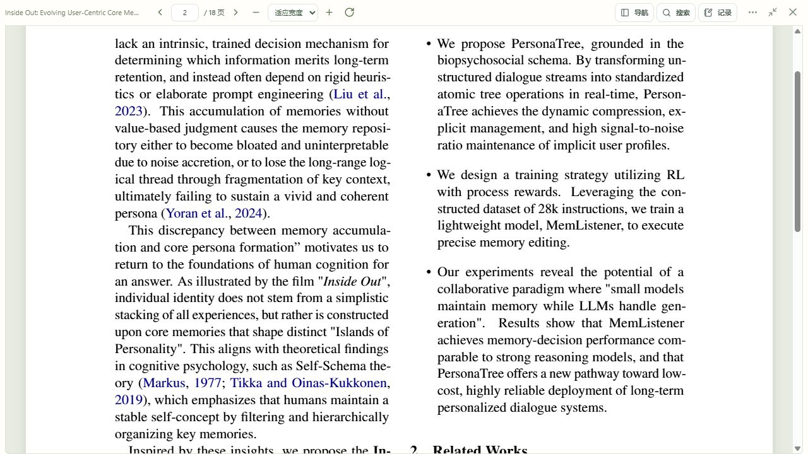

# 聚焦阅读开发与验收

2026-10-13｜应用 0.3.5｜Git 标签 `v0.3.5`

## 用户可见变化

阅读界面顶部收为一条紧凑工具栏：简短论文标题、翻页与页码、缩放、旋转、导航、搜索、记录、更多操作、阅读模式和关闭。去掉重复的“适应宽度”按钮，保留缩放选择器中的同一选项。手机采用紧凑两行布局。

论文信息、简介卡片、下载原文和重新加载原文收进右上角“更多阅读操作”菜单。完整标题与页数在菜单中查看。原先的大标题、文件大小、加入日期、页签和“已继续上次阅读”提示不再常驻阅读区域。

移除底部的阅读位置、正常保存状态、重新加载入口和本机保存说明。笔记面板默认收起，点击“记录”按需打开；切换大小窗、查看论文信息或收起记录时保留阅读与编辑状态。

截图使用独立验收环境的实际 PDF。正式论文和个人记录未用于界面写入测试。

## 保存反馈与交互

移除常驻说明后，自动保存、退出前保存及未保存内容的处理流程继续工作。未保存记录在“记录”按钮上显示小圆点；保存失败、冲突、无效内容或暂停保存时才出现需要处理的提示，修复后自动消失。

阅读位置异常保留重试保存和选择继续位置入口；记录异常可以点击“查看记录”展开具体编辑器。菜单打开时，退出键优先关闭菜单；点击论文区域关闭菜单并继续操作。键盘焦点只在当前可见控件内循环。

## 实现位置

- `PaperDetail.tsx`、`ReaderLayout.css`：压缩阅读标题区与页签，把更多菜单、大小窗和关闭按钮并入工具栏。
- `reader/ReaderOptionsMenu.tsx`：按需显示次要入口，处理退出键与外部点击，保持原文下载和重新加载可用。
- `reader/ReaderWorkspace.tsx`：去掉底部常驻内容和恢复位置提示，默认收起记录，按保存状态显示异常。
- `reader/useAutosave.ts`、`reader/types.ts`：提供即时保存状态读取接口，使隐藏的记录面板仍可反馈需要处理的状态。
- `components.tsx`：焦点循环包含菜单入口，排除隐藏控件。

## 验证

- 前端 72 项检查通过，TypeScript 检查与预览、正式生产构建通过。
- 新增检查覆盖更多菜单原入口、退出键与外部点击、实时保存异常及重试恢复。
- 在 1280 × 720 的实际 PDF 阅读中，顶部工具栏约 41 像素，阅读区约 679 像素；此前同尺寸全页面布局阅读区约 478 像素。
- 在 390 × 844 窄屏中，工具栏为 69 像素，阅读区约 775 像素；页面宽度和可滚动宽度均为 390 像素。
- 实际检查了进入论文信息后返回阅读、展开记录、内容无效时收起记录仍显示提示、修正内容后自动保存并消除提示。页码保持第 2 页。

## 发布与恢复

应用版本为 0.3.5，发布提交关联 `v0.3.5`。刷新 `http://127.0.0.1:8000` 后可见新布局；旧前端资源继续保留供已有页面加载。正式数据备份在 `.test-data/focus-reader-before`，本轮不增加数据库迁移。
