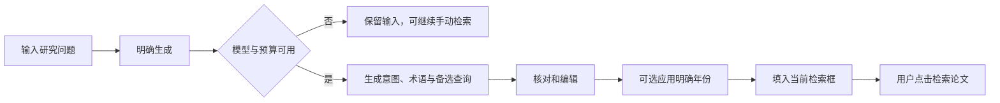
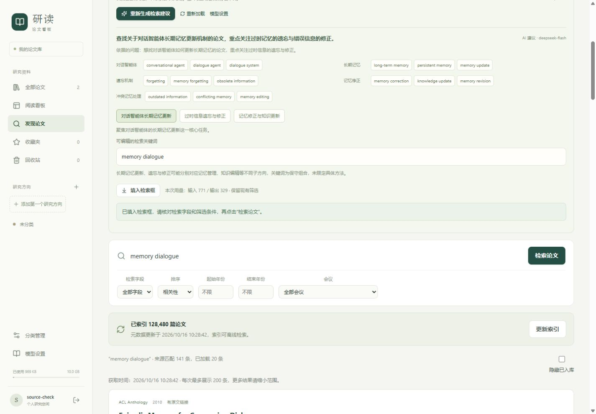

# 自然语言检索开发与验收

2026-10-16｜应用 0.6.0｜标签 `v0.6.0`｜F11：自然语言生成检索关键信息

【本次更新】用户在“发现论文”中输入研究问题，沿用现有论文模型生成中文意图、术语分组和 1～3 条备选查询。支持编辑、选择性应用年份，再填入当前来源的检索框；用户点击“检索论文”后才查询来源。arXiv、ACL、IEEE 各自保留页面内的输入和编辑状态。

## 使用与交互

1. 在“用自然语言描述，让 AI 帮你整理检索词”中输入问题，例如“想找近三年多轮对话中长期记忆更新的论文，重点关注过时信息”。
2. 点击“生成检索建议”，等待独立任务完成。默认沿用已有 `deepseek-flash`，无需新增密钥；也支持现有配置中的兼容模型。
3. 核对中文意图与术语，选择备选表达，按需编辑关键词。结果属于 AI 建议，没有预先检索论文，也不是论文结论。
4. 点击“填入检索框”只替换当前来源的关键词，保留检索字段和现有筛选；需要覆盖年份时先勾选年份建议。填入后仍需核对字段和条件，再点击检索。
5. 助手区域可以折叠。切换来源、待导入页或任务页后返回，页面内未提交的输入与关键词编辑仍在；刷新页面会读取本机保存的最近生成任务，尚未提交的草稿不会持久保存。



| 状态 | 用户反馈与恢复 |
| --- | --- |
| 未启用模型 | 显示模型设置入口；普通检索继续可用；保存模型后自动更新助手状态 |
| 排队／生成中 | 显示进度状态，可停止；同一页面不重复提交，等待期间编辑的新问题不会被覆盖 |
| 成功 | 显示本次问题、模型、意图、术语、查询和用量，可修改后填入 |
| 失败 | 保留问题与上次成功结果；明确点击重新生成才新增调用，不自动重试模型 |
| 提交响应不确定 | 提供“安全重试提交”，重复相同请求标识读取原任务，不把后来编辑的问题重复发送 |
| 取消 | 排队取消释放预占；已发送请求停止等待，远端用量可能仍需核对，不应用晚到结果 |
| 重启／模型变更 | 已发出的不确定任务转为失败，不自动重复调用；生成期间配置改变不发布旧配置结果 |



## 数据与模型边界

只发送本次自然语言问题、当前公开来源类型、参考日期、固定任务规则和返回结构，不附带个人论文、笔记、聊天、方向字典、候选或检索历史。问题与已验证结果按用户和空间保存在本机，新表不依赖虚拟论文。最近接口最多返回 5 项，界面复用最近状态与成功结果；终态任务保留 30 天，请求去重期限与保留期一致。

模型返回的查询只允许普通关键词、必要标识或双引号短语，不接受网址、布尔运算符或来源专用语法；不从模型输出创建论文、下载地址或分类。格式校验失败明确报错，已消耗的模型用量继续记录，不自动发起修复调用。兼容 JSON 模式会在提示中同时给出字段结构，避免仅请求 JSON 却缺少实际结构定义。

年份建议由服务端从原问题的明确表达提取，模型不能额外返回年份字段。支持常见年份区间、某年及以后／以前、单年、今年、去年和近 1～10 年；未明确限定时不添加年份。参考日期使用北京时间提交日，“近三年”按含今年的自然年计算，例如 2026 年为 2024～2026，并展示计算依据。首版不是完整的自然语言日期解释器，含混日期需人工修改筛选；年份建议默认不勾选。

| 字段 | 范围 |
| --- | --- |
| 输入问题 | 2～2000 个字符；空白或无有效字符拒绝 |
| 来源 | arXiv／ACL／IEEE，仅提供检索上下文，不自动切换来源 |
| 中文意图 | 最多 250 字符 |
| 关键词 | 1～6 组概念，每组 1～4 个术语，单术语最多 80 字符 |
| 备选查询 | 1～3 条，每条最多 500 字符；名称 30、理由 150 字符以内 |
| 歧义说明 | 可空，最多 250 字符 |
| 年份 | 显式提取的起止建议及原文依据，是否覆盖由用户决定 |

共享现有模型配置和月度预算，不要求模型通过视觉能力测试，因为本功能只有文字输入。每次最多输出 2048 token，同时受现有较低输出限制约束；使用输入、规则和结构的字节长度估算预占。创建与预算检查共用写锁；排队预占、已确认用量和未知估算分别处理。默认月度上限仍来自模型设置，不能把估算当作服务商账单的硬性保证。

每空间最多 3 个活动检索词任务、每分钟最多 10 次新提交。相同请求标识与输入重放返回原任务，输入不同返回冲突；“重新生成”使用新标识，会产生新调用。关闭云端模型会取消该空间的排队及活动检索词任务，取消或配置变更后的结果不能迟到应用。当前保持单个 API 服务进程。

## 开发位置与 API

| 文件 | 实现 |
| --- | --- |
| `backend/app/query_assistant.py` | 输入／输出结构、年份提取、独立队列、共享预算、模型调用、取消、恢复与权限 |
| `backend/app/discovery_models.py`、`0008_query_assists.py` | 新增 `search_query_tasks`，关联模型版本和调用记录，不绑定论文 |
| `backend/app/main.py` | 工作循环、API、30 天终态清理与版本更新 |
| `backend/app/ai_service.py`、`ai_api.py` | 独立调用预占、未知用量、生成统计和关闭模型时取消 |
| `frontend/src/discovery/QueryAssistant.tsx` | 问题、分组、选择、编辑、任务状态、安全重试和人工填入 |
| `frontend/src/discovery/DiscoveryPage.tsx` | 按来源保持独立助手，应用关键词与可选年份，不自动检索 |
| `frontend/src/ai/ModelSettings.tsx` | 显示检索词调用和独立调用未知用量 |
| `backend/scripts/check_query_assistant.py` | 可显式使用已保存模型进行独立验收，不回显密钥 |

接口统一前缀 `/api/v1/discovery/query-assists`：

- `GET /status`：是否启用、模型名称、输入上限，不返回地址或密钥。
- `POST`：用 `request_id`、`provider`、`text` 创建任务，返回 202。
- `GET ?provider=acl`：返回当前用户在该来源的最近 5 项。
- `GET /{id}`：任务结果、输入快照、模型和用量。
- `POST /{id}/cancel`：取消并保留原问题；已完成的任务不会回滚。

## 验收与复现

| 检查 | 结果 |
| --- | --- |
| 后端 | 全量 **217 项通过**；最终补充空白字段边界校验后，自然语言检索 **33 项回归通过**（当前后端共 218 项） |
| 前端 | 全量 **132 项通过**，新增 **9 项**，覆盖输入不调用、编辑填入、年份勾选、状态刷新、取消及草稿保持 |
| TypeScript、独立及生产构建 | 通过；保留原有主包大于 500 kB 的构建提示 |
| 真实 DeepSeek | 独立库共 4 次、3 次成功、1 次在修复 JSON 结构提示前失败；共记录 3929 token，均未发送论文或笔记 |
| 年份真实验证 | “近三年”显示 2024～2026 及依据；不含年份的问题没有年份建议 |
| 浏览器完整流程 | 页面发起生成、显示排队并自动更新、编辑关键词、填入、勾选年份及手动检索通过；未调用 IEEE |
| 实际 ACL 查询 | 编辑为 `memory dialogue`，2024～2026 返回 78 条；未限制年份返回 141 条。表达精确程度会改变结果，不能保证每条 AI 建议都有匹配 |
| 响应布局 | 1440×1000 与 390×844 检查通过；窄屏内容宽 375、视口 390，无横向溢出；问题框使用可用宽度 |
| 数据升级 | `0007_discovery` → `0008_query_assists`；27 张旧业务表全部行一致，3 篇 PDF 哈希一致，外键检查通过 |
| 正式服务 | 健康接口、前端版本为 0.6.0；正式检索词任务表为空，未写入验收问题或结果 |

真实模型用量保存在独立 `.test-data/live-discovery/`，不混入正式问题列表或正式用量记录。截图也来自独立验收空间。模型输出的术语翻译、范围和研究方向仍需用户核对；本版仅完成原 B 批中的检索词生成，摘要解读、AI 方向推荐与 OpenAlex 继续保留后续范围。

```powershell
# 默认只说明用途，不调用模型。
.venv\Scripts\python.exe backend/scripts/check_query_assistant.py

# 明确发送示例问题，可能产生模型用量；结果只写 .test-data/query-assistant-live。
.venv\Scripts\python.exe backend/scripts/check_query_assistant.py --use-saved-model --question "想找多轮对话长期记忆更新的论文"

# 离线模拟回归，不需要真实密钥。
Set-Location backend
..\.venv\Scripts\python.exe -m pytest tests/test_query_assistant.py -q --basetemp ../.test-data/query-assistant-regression
Set-Location ../frontend
npm.cmd run test -- --run src/discovery/QueryAssistant.test.tsx
```

正式业务备份位于 `.test-data/query-assistant-before/`，含 SQLite 一致性快照、原文和本机加密资料；公开 ACL 缓存保留在原目录，因可重建而未重复复制。迁移演练及核对记录分别为 `.test-data/query-assistant-migration-trial/`、`.test-data/query-assistant-migration-result.json`、`.test-data/query-assistant-release-result.json`。恢复时先停止服务、另存当前业务数据，再使用对应备份和旧版本；不要覆盖后续产生的记录。

本轮源码、必要文档、测试与界面截图关联中文 Git 提交及中文说明的 `v0.6.0` 标签。原文、密钥、数据库、依赖和验收数据继续排除在 Git 外；未自动推送远程。
