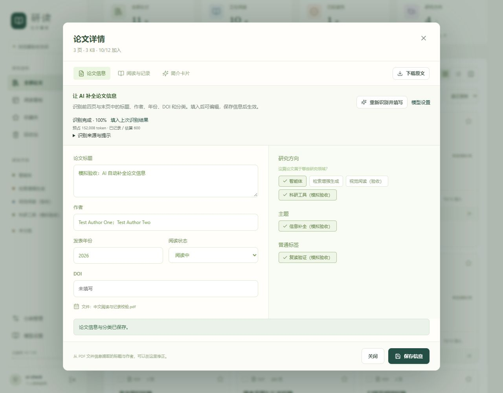

# 论文信息 AI 填写：开发与验收

版本 1.0｜2026-10-13｜应用 0.3.2

【本次更新】论文详情的“论文信息”页新增“AI 识别并填写”。复用已配置的视觉模型、持久队列、用量及取消机制，识别标题、作者、年份、DOI、研究方向、主题和普通标签；不生成或修改阅读状态。结果先进入可编辑表单，保存后才修改论文与分类。

## 使用流程

进入论文信息 → AI 识别并填写 → 查看进度 → 自动填入识别结果 → 核对字段及来源 → 修改或取消分类建议 → 保存信息。

等待期间可以编辑。结果只填入等待过程中未修改的字段或分类组，其他编辑保留。缺失的标题、作者、年份或 DOI 保持原值，禁止从文件名推断 DOI 或年份。保存前关闭会触发未保存内容提示。

重复打开不产生模型调用。历史成功结果可通过“填入上次识别结果”复用，重新识别按钮会明确创建新任务。离开信息页停止轮询，后台任务继续；可显式取消。保存响应不确定时重试同一请求，不重复创建分类，之后的新编辑仍保留。

## 输入、任务与证据

- 首版识别前四页及末页，去重后最多五页，主要覆盖标题区、摘要、方法简介与末页出版信息；不声称完成全文分析。
- 原生 PDF 或页面图片沿用已通过的模型模式；DeepSeek 使用图片，无独立 OCR，也不发送个人笔记。
- `generation_tasks.input_snapshot.purpose` 为 `metadata`，保存选定页序和三类分类字典；复用已有表，不新增数据库迁移。卡片任务列表排除信息任务，两种结果互不覆盖。
- 结构化结果包含四个信息字段及各自来源页、分类建议、识别页序和警告。非空字段必须有本次输入页面来源，年份和 DOI 校验后才填入。
- 长于请求上限时拆批；各批分别识别，服务端合并。冲突保留前部页段结果并提示核对，不用后部参考文献作者替换首页作者。
- 预算按所选页数及实际批次数估算；沿用运行代次、租约、重试、未知用量和取消晚到结果检查。任务成功只保存候选，不自动写论文或创建分类。

## 保存与分类

保存采用论文版本、原文哈希及请求回执检查。已选分类保留，已有名称或别名复用，合并后的分类沿用有效目标。新方向、主题或普通标签支持改名和取消，保存时与论文信息在同一事务中创建、关联。

分类归档、版本冲突、字段无效或数量超限时，整个事务回滚；不会留下只创建了一半的分类。继续遵守十个研究方向、十个主题，以及方向与普通标签合计二十个的上限。AI 建议每类最多三项。

## 实现位置

| 文件 | 作用 |
|---|---|
| `backend/app/ai_metadata.py` | 识别结构、提示、来源及字段校验、分批合并、分类别名解析 |
| `ai_service.py`、`ai_worker.py` | 信息任务入队、选页快照、持久执行与结果 |
| `ai_api.py` | `/papers/{id}/metadata-tasks` 的创建与列表，沿用任务详情及取消接口 |
| `schemas.py`、`main.py` | 论文保存增加新分类、原文哈希与请求回执，原子保存 |
| `frontend/src/ai/MetadataAssist.tsx` | 按钮、进度、取消、结果复用、来源页回跳 |
| `frontend/src/PaperDetail.tsx` | 字段填入、编辑保护、分类建议、可靠保存与离开检查 |
| `frontend/vite.config.ts` | 保留旧版延迟加载模块，避免已打开页面因升级缺少资源 |

## 验证结果

后端 **113 项**、前端 **58 项**测试通过，类型检查、独立及正式生产构建通过。新增后端九项验证选页、真实页序还原、私人笔记不发送、只生成候选、原子保存、别名复用、请求去重、分类超限回滚、有限修复及取消晚到结果；前端新增六项验证字段填入、缺失值与状态保留、等待时编辑保护、离开检查、保存重试、普通标签额度及停止轮询。

独立浏览器验收使用 `.test-data/stage3-browser` 与模拟模型，完成识别、自动填表、关闭保护、保存和新分类回显。在 390 像素宽度下页面没有横向溢出，正式数据未写入模拟结果。

## 真实论文验证与数据保留

用户截图中的 `2026.acl-long.614.pdf` 共十八页，已用当前 DeepSeek 配置完成一次真实识别，输入页序为 1、2、3、4、18，已记录用量合计 **7,420 token**。金额以服务商账单为准。

识别标题为《Inside Out: Evolving User-Centric Core Memory Trees for Long-Term Personalized Dialogue Systems》，作者八位，年份 2026；标题与全部作者已和 PDF 首页文字核对，年份在首页出现。DOI 未能确认，保留原值。分类为 AI 推断，仍需用户审阅。

真实结果保存在正式任务中，未自动改写论文或创建分类。刷新信息页后点击“填入上次识别结果”，可无调用地填表并核对保存。记录位于 `.test-data/metadata-real-task.json`、`metadata-real-result.json` 和 `metadata-real-verification.json`，不含模型密钥。

发布前完整数据备份在 `.test-data/metadata-before`。数据库版本仍为 `0005_task_order`；账户、原文、卡片及阅读记录保留。0.3.2 正式服务已在 8000 端口启动，用户原页面未被强制刷新。
