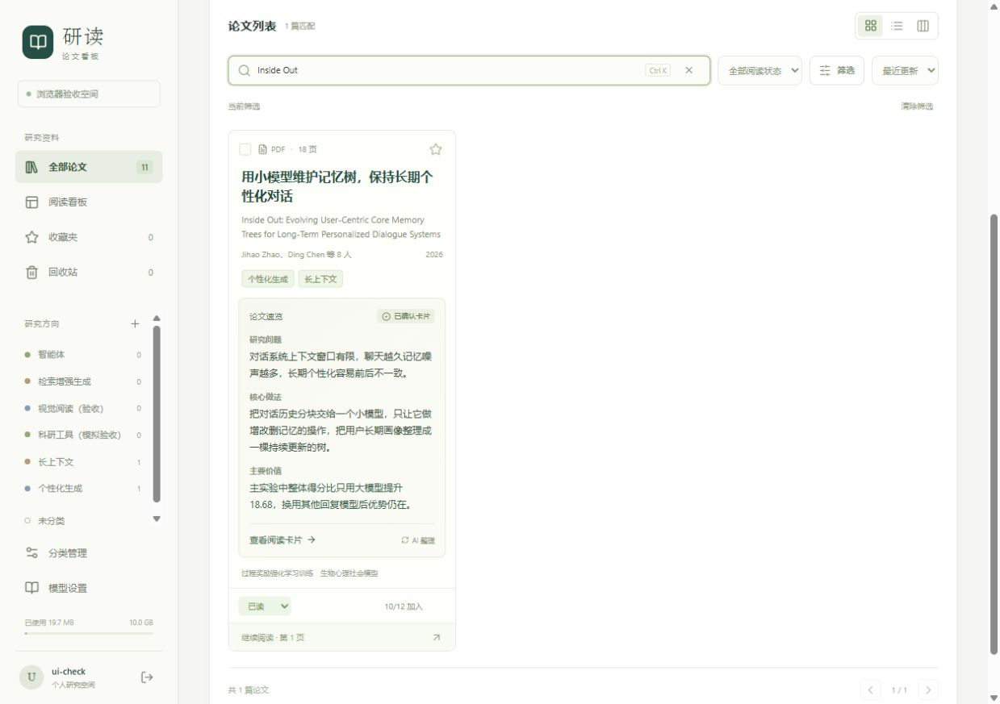

# 论文卡片速览开发与验收

2026-10-13｜应用 0.3.3

## 交付效果

论文库卡片优先显示一句中文短标题，英文原题放在下方，作者显示前两位和总人数。研究方向继续支持点击检索。简介区域采用独立底色、边距和三段内容：研究问题、核心做法、主要价值；确认状态独立显示，不参与正文截断。

“查看阅读卡片”直接打开详情的简介页签；继续阅读、选择、收藏、阅读状态和拖动看板保留原入口。阅读看板使用紧凑布局，手机增加正文可见行数。

截图在独立验收空间拍摄，使用当前论文的确认卡片和真实模型速览。界面中的论文数量与测试账号属于验收环境。

## 如何生成和保存

新生成的完整阅读卡片在原模型调用中同时请求 `preview` 四项：`headline`、`problem`、`approach`、`benefit`，长度上限分别为 40、70、90、70 字符。优先使用通俗中文，减少模型名、训练参数与缩写，保持作者主张和系统推测的语气。

旧卡片没有速览时，界面显示已有的研究问题、方法和第一项结果，并提供“生成简明速览”。点击后，云端只收到已有卡片的非用户记录内容及其来源类型，不收到 PDF、个人用途或笔记。生成成功后，速览存入独立任务结果，不修改原卡片、版本号或确认标记。

速览绑定生成时的当前版本。发送前和发布结果前都核对版本；若当前版本改变，任务报告过期并丢弃晚到结果。修改正文后保存的新草稿会清除继承的旧速览；确认新版本后不再显示旧版本的派生速览。仅修改引用核对状态不会使同版本内嵌速览失效。

打开论文库只读取已有结果，不触发模型调用。已完成速览旁的刷新按钮可以显式重新整理。任务可取消，取消或失败仍显示已有内容；提交响应丢失时保留请求标识供安全重试。费用纳入现有调用次数、单任务和月度预算。

## 实现入口

| 位置 | 职责 |
|---|---|
| `frontend/src/PaperLibraryCard.tsx`、同名样式 | 卡片信息层级、三段速览、任务读取与显式生成 |
| `frontend/src/App.tsx`、`PaperDetail.tsx` | 保留原论文操作，直达简介页签 |
| `backend/app/ai_preview.py` | 输入过滤、通俗重述提示、去重、预算与入队 |
| `backend/app/ai_worker.py` | 文本速览执行、一次格式修复、版本校验、取消与记账 |
| `backend/app/ai_schemas.py`、`ai_service.py` | 可选速览字段、长度约束、正文修改后的失效规则 |
| `backend/app/services.py` | 读取当前版本速览、匹配派生缓存与旧卡片展示字段 |

新增接口为 `POST /api/v1/papers/{paper_id}/preview-tasks`，请求包含 `request_id` 和可选 `regenerate`；`GET` 同一路径列出该论文速览任务。进度和取消继续复用 `/card-tasks/{task_id}` 与其 `/cancel` 接口。需要登录，遵守原论文权限和回收站限制。

数据库继续使用 `0005_task_order`，复用现有持久任务表，不增加迁移。完整卡片提示版本更新为 `1.1`，旧卡片没有 `preview` 字段仍可正常读取。

## 验证结果

- 后端 119 项、前端 65 项检查通过，TypeScript 与生产构建通过。
- 新增检查覆盖：个人记录过滤、无 PDF 输入、原确认版本保持完整、任务去重、取消晚到结果、当前版本改变后的丢弃、格式修复次数及新草稿速览失效。
- 前端检查覆盖：打开页面不调用模型、直达简介页签、原操作入口、重复提交标识保留、无卡片和回收站入口。
- 浏览器检查覆盖：桌面三段内容、390 像素窄屏无横向溢出、核心做法完整显示、看板紧凑组件和进入完整简介页。
- 截图中的论文使用现有云端配置完成真实速览。最终任务 `d787733e26dd40c29c04308dd60a9a0e` 成功，用量 2,489 token；此前初版任务 2,113 token。两次结果均通过结构校验，当前显示后一版。对照版本标识、确认时间、修订号及正文摘要值，原确认内容保持完整。这里只验证重述与处理流程，不代表重新核验了原论文实验结论。

## 本地发布与恢复

正式页面和 API 均为 0.3.3，运行在 `http://127.0.0.1:8000`。已保留旧前端资源，已有页签的延迟加载可以继续工作；刷新后显示新布局。

发布前完整备份在 `.test-data/preview-before`，包含在线一致的数据库备份、文件和加密密钥文件。恢复时先停止服务，并另存当前数据目录，再恢复完整备份；不要混用不同时间点的数据库与密钥。
