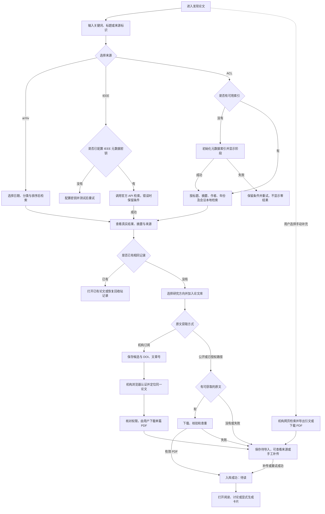
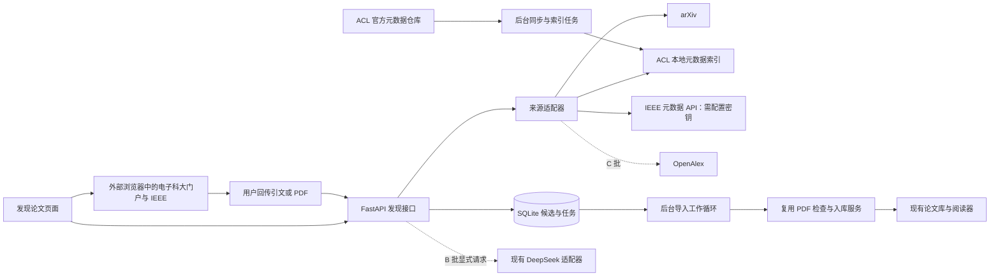

# 论文联网检索与导入方案

版本：0.6｜日期：2026-10-16｜应用 0.5.0｜状态：首批已实现，IEEE 真实密钥流程待验收

【本次更新｜IEEE 主流程确认】用户确认采用“配置有效 IEEE 元数据 API 密钥 → 看板内检索并展示论文列表 → 选定论文 → 通过电子科大机构认证获取全文”。检索无需学校登录，全文获取按实际机构订阅与浏览器会话判断；正常流程直接使用 API 返回的论文信息，不需要另行导出引文。无密钥的机构网页检索和引文回传保留为手动补充入口，不再作为 IEEE 主检索方式；不以网页爬虫替代官方 API。机构 PDF 首版下载后补传关联候选，自动接收下载结果为待验证增强，目前未实现。

【本次更新｜ACL 检索】ACL Anthology 纳入 A 批首版，与 arXiv、IEEE 并列为来源。通过官方 Python 库同步公开元数据，建立本地索引；用户在看板内检索标题、摘要、作者、年份和会议，选中后自动取得官方 PDF 并沿用查重入库，不要求打开 ACL 网页或手工回传文件。首次同步、增量更新、索引状态、字段、接口及验收同步补充；目前只完成官方资料调研，尚未实测 ACL 数据同步、检索或 PDF 导入。

【本次测试】arXiv 公开接口已取得 3 条论文记录。2026-10-16 已从电子科大校园 VPN 的 IEL 入口进入 IEEE，页面识别到学校机构；实际提交 `long term memory`，显示 124,941 条结果，前三条样本标注包含于订阅。原文获取、引文回传和看板导入尚未验证；IEEE 无密钥 API 请求此前返回 HTTP 403，机构网页权限不等于 API 授权。详见[连通性测试记录](论文检索连通性测试记录.md)，本次没有发布 F11 功能。

【本次更新｜IEEE 机构访问】机构为电子科技大学，IEEE 元数据 API 承担看板内检索，机构浏览器仅承担所选论文的全文获取及手动检索补充，配置与机构登录分别管理。电子科大校外访问使用学校校园 VPN 门户，已验证其 IEL 入口和当前会话内的关键词检索；逐篇全文获取仍需核对，不假定浏览器登录等于后端取得全文权限。

【本次更新】用户已确认新增范围为“联网找新论文并导入”。本方案增加 F11“发现论文”，衔接现有上传、研究方向、阅读、讨论与卡片；F07 的库内检索、跨论文问答和自动新文献监测仍按各自范围安排。

## 1. 目标与交付边界

为个人科研用户提供“查找学术论文 → 筛选摘要 → 获取原文 → 加入论文库 → 阅读讨论”的完整流程，减少在搜索网站、下载目录和论文管理系统之间切换。

继续使用现有网页、FastAPI、SQLite 和本地文件存储。价值先用找论文和导入所需操作数、导入成功率及重复记录数量评估，不增加收费或团队权限系统。

| 批次 | 交付范围 | 建议版本 |
| --- | --- | --- |
| A：首版【本次更新】 | arXiv 检索与导入；ACL 元数据同步、本地检索与一键 PDF 导入；IEEE 密钥配置及连接测试、官方 API 看板内检索、所选论文的电子科大机构全文获取与 PDF 补传；手动机构检索和引文回传作为补充；共用候选、查重和导入任务 | 0.5.0 |
| B：AI 辅助 | 中文意图转英文检索词、基于摘要的中文简介与研究方向建议，用户显式触发 | 后续小版本 |
| C：覆盖扩展 | OpenAlex 接入、DOI 定位、跨来源合并与排序、小批量导入 | 后续小版本 |

以上为建议发布划分；本轮只提交文档，不增加应用版本或创建发布标签。机构订阅范围内的访问属于本次范围；第一版不自动购买订阅外内容、不自动批量下载机构全文，不包含监测推送或自动生成创新结论。

## 2. 数据源选择

**arXiv 使用官方 API。** 当前使用场景集中在智能体、记忆和个性化对话等研究，适合先验证这一来源的检索与原文导入。API 提供题名、作者、摘要、分类、标识及原文链接，可按相关性和日期排序；返回 Atom，需要单独解析适配。[arXiv API 手册](https://info.arxiv.org/help/api/user-manual.html)

**ACL Anthology 使用官方 Python API 与本地索引【本次更新】。** 官方推荐 `acl-anthology` 库访问其公开论文、作者和会议数据；元数据位于官方 Git 仓库，PDF 位于官方服务器。当前查阅的官方文档未提供通用在线关键词搜索 REST 接口，本系统自行建立标题、摘要和作者索引，不将 Python API 写成可直接发送关键词的远程搜索服务。此路径无需 API 密钥或校园 VPN；具体实现与用户体验见 2.2 节。[ACL 官方开发说明](https://aclanthology.org/info/development/)、[数据访问说明](https://aclanthology.org/faq/api/)、[Python 库用法](https://github.com/acl-org/acl-anthology/blob/master/python/README.md)

**IEEE 首批采用“API 检索、机构获取全文”主流程【本次更新】。** 用户提供获批且有效的 IEEE 元数据 API 密钥，在看板内搜索及查看题名、作者、摘要、刊会、DOI 和文章号；点击所选结果的“通过机构获取全文”后，再进入电子科大机构浏览器。IEEE 官方说明元数据结果可能超出机构订阅范围，因此“找到论文”和“当前有全文权限”分别显示，API 密钥、学校账号和付费全文 API 授权不能互相替代。无密钥时提示配置，不改用爬虫或自动切换其他数据源。[IEEE 接入步骤](https://developer.ieee.org/Quick_Start_Guide)、[元数据检索范围](https://developer.ieee.org/docs/read/Searching_the_IEEE_Xplore_Metadata_API)、[全文 API 说明](https://developer.ieee.org/)

**后续来源使用 OpenAlex。** 用于补充综合学科和期刊、会议记录。按其当前规则，基础查询可以不带密钥，但正式使用建议配置免费 API 密钥，并处理预算与限流；游标翻页有密钥要求。[OpenAlex 鉴权文档](https://help.openalex.org/api/authentication/)、[检索文档](https://help.openalex.org/api/searching/)

搜索框明确标注当前来源，不承诺覆盖所有期刊、会议或中文数据库。IEEE 通过元数据接口支持 DOI／文章号定位；未配置密钥时显示“配置 IEEE 检索”，用户仍可显式选择独立的“手动机构检索”补充入口。仅选 arXiv 且输入 DOI 时说明能力范围，不把“来源不支持”显示为“没有这篇论文”。不抓取机构登录后的搜索网页来替代官方 API。【本次更新】

### 2.1 IEEE API 检索与电子科技大学机构全文获取【本次更新】

**主流程**：在“检索来源设置”保存并测试 IEEE 元数据密钥 → 在看板选择 IEEE 并检索 → 查看 API 返回的论文列表与摘要 → 选择研究方向和论文 → 点击“通过机构获取全文”并保存候选 → 在电子科大机构浏览器核对同一篇论文、完成所需认证并下载 → 回到候选补传 PDF → 校验、查重并入库。检索阶段不要求学校登录，机构认证按实际会话需要执行；已有效登录时无需为了每篇论文重新登录。

**全文交接约定**：点击机构获取时显示所选论文的题名、DOI、IEEE 文章号和规范来源链接，提供“复制 DOI／文章号／标题”与“打开机构入口”。校外从学校资源列表进入 IEEE 后按这些信息定位同一论文；只有实际验证过的入口支持直接定位，才增加带入文章的跳转。不把普通 IEEE 链接在新页打开就当成保留了 WebVPN 上下文，也不硬编码本次测试的加密代理路径。正常 API 结果不需要再导出 RIS／BibTeX；首版由用户在机构页面触发单篇下载，再向当前候选拖入或上传 PDF，系统完成信息核对与关联。自动接收浏览器下载文件列为后续开发验证，不作为首版已经具备的能力。

学校公开说明的新版校外访问入口为 [校园 VPN](https://vpn.uestc.edu.cn/)，面向学校公共服务和图书馆资源。门户 FAQ 明确网页版 VPN 应从资源列表进入，另在地址栏输入应用网址不会自动经过代理。2026-10-16 已实际验证“校园 VPN → 统一身份认证登录 → 图书馆常用外文数据库 → IEL（IEEE/IET Electronic Library）→ IEEE Xplore”的机构检索路径；系统只保存学校门户入口，不拼接或猜测加密代理 URL。[学校 VPN 升级说明](https://jgsy.uestc.edu.cn/wlxxfw/VPNxwfw.htm)、[校园 VPN FAQ](https://vpn.uestc.edu.cn/)、[本机测试记录](论文检索连通性测试记录.md)

| 层次 | 设计与边界 |
| --- | --- |
| 机构资料 | 保存“电子科技大学”、学校门户、访问方式偏好和已核对的官方入口；机构选择决定访问身份，不默认将结果限制为本校作者论文 |
| 校外全文获取【本次更新】 | 从看板选定结果后进入学校门户，按资源列表进入 IEEE，使用 DOI、文章号或题名定位该论文；核对机构及全文权限后下载，返回同一候选补传 |
| 校内访问 | 提供直接打开 IEEE Xplore 的选项，以浏览器实际显示的机构名称及对应文章访问情况为准；不能根据本机 IP 或用户选中校名就显示“全文已授权” |
| 机构登录 | IEEE 支持机构登录等远程访问方式；电子科大在该入口的当前可用链路列为待验证选项，未验证前不承诺已开通 CARSI／Shibboleth 或自动选择学校。[IEEE 远程访问说明](https://innovate.ieee.org/tips-to-access-your-organizations-ieee-xplore-subscription-when-working-remotely/) |
| 站内结果【本次更新】 | 使用获批的 IEEE 元数据 API 密钥搜索、筛选和分页，显示题名、摘要、作者、年份、刊会、DOI、文章号与来源链接；未配置或接口拒绝密钥时显示配置／修复入口，不能返回伪造空列表或切换爬虫 |
| 原文获取 | 机构订阅文章由用户在该机构访问浏览器中取得 PDF，再补传到候选；开放 PDF 或另有明确全文 API 授权的下载路径才进入后端自动导入，且仍须确认实际返回 PDF |
| 手动补充【本次更新】 | 无密钥时可由用户主动选择“手动机构检索”，在机构网页检索后回传引文或 PDF；与 API 结果列表分开展示，不将它作为主流程的自动降级结果 |

学校密码、验证码和浏览器会话只在原学校／IEEE 登录页面处理，本系统不收集或保存，也不要求用户导出 Cookie。浏览器会话与 FastAPI 请求彼此独立：WebVPN 登录不会自动改变服务端的网络出口或登录状态。IEEE 元数据密钥单独在服务端加密保存，接口和日志不回传密钥，不能复用已有 DeepSeek 密钥。

**密钥配置与能力验证【本次更新】**：设置页分别显示“未配置”“已保存待测试”“测试通过”及最近一次错误与时间。密钥只由服务端使用，保存后不回传明文；显式“测试 IEEE 检索”只发一个最小元数据查询，不发送论文、笔记或聊天。保存成功不等于测试通过；401／403 统一说明接口拒绝请求并引导检查密钥及授权状态，不仅凭状态码判定具体原因。429、来源不可用、超时与真正的零结果分别报告，保留查询条件；不进行无限重试或网页抓取。请求 URL 中的 `apikey`、响应错误所带地址与日志均需脱敏。API 不可用只影响新 IEEE 查询，不阻止已有候选的机构获取、PDF 补传、arXiv／ACL 检索或已有论文阅读。

手动补充路径中，机构网页检索完成后，用户可回传选定论文的 RIS／BibTeX 引文，先保存为候选，再补传 PDF；也可仅上传 PDF 并核对论文信息。此入口用于没有 API 结果或已有外部引文的情况，不要求 API 检索用户重复操作。IEEE 引文导出提供这两种格式，具体导出操作在用户实际页面验收。[IEEE 引文导出页面](https://ieeexplore.ieee.org/assets/html/download_citations-v2.html)

引文导入先预览再保存，单文件最多 2 MiB、最多 20 条；按 DOI／IEEE 文章号提示重复，不自动读取引文里的任意 URL 或下载全文。未识别文章号的条目保留为本地待核对候选，不编造官方标识。无摘要或字段不全时仍可保存和补传；需核对来源标识与所传 PDF 的对应关系，发生明显冲突时不自动关联。

校园 VPN 中的 IEL 入口、IEEE 机构身份和关键词搜索已通过当前会话测试。主流程开发验收仍需用户提供有效的 IEEE 元数据 API 密钥，完成真实 API 搜索与所选论文的机构下载／补传。逐篇订阅覆盖、引文导出、直接 IEEE 机构登录和自动接收浏览器下载结果均未验证；缺少密钥时可以先开发并检查适配器和设置，但不能宣称站内 IEEE 检索已验收通过。【本次更新】

### 2.2 ACL 元数据同步与看板内检索【本次更新】

**用户流程**：选择 ACL → 首次点击“初始化论文索引” → 后台同步完成 → 在看板输入关键词并筛选 → 查看摘要 → 选择研究方向并点击“加入论文库” → 自动下载官方 PDF、校验和查重 → 打开阅读。正常流程不需要用户另开 ACL 网站或下载后补传；原文不可获取时才保留候选，允许查看来源、重试或补传。

| 项目 | 首版约定 |
| --- | --- |
| 数据范围 | 同步 ACL Anthology 官方元数据中的论文记录，以来源实际收录为准；会议、卷和分会场来自来源字段，不把 Anthology 等同仅 ACL 主会，也不凭标题猜测主会／Findings／研讨会 |
| 首次初始化 | 用户首次启用 ACL 时显式启动持久同步任务；首次同步只获取元数据并建索引，不批量下载 PDF。检查 Git、官方库与 SQLite FTS5 是否可用，显示真实阶段与已处理记录数；未知总量时不编造百分比，不在同步完成前允许普通关键词搜索 |
| 后续更新 | 应用运行且 ACL 已启用时，每隔 24 小时检查一次官方仓库更新，也提供“更新索引”。以 Git 提交为同步依据，增量处理新增、修改及删除的元数据；无变化只更新检查时间。关闭应用后不额外创建系统定时任务 |
| 发布与失败 | 新代次构建并校验通过后才切换活动索引，已有读请求保持一致快照；更新失败或中断继续使用上次成功索引并显示失败原因。没有旧索引时提示初始化失败，不显示为零结果；重复初始化／更新复用同一活动任务，重启后中断任务可重试，不激活半成品 |
| 可见性 | 显示索引覆盖记录数、最后成功更新时间与更新按钮；无变化时区分“最后检查”和“数据更新时间”。检索结果说明来自该时间点的本地元数据，不承诺即时覆盖 ACL 网站的所有最新修改 |
| 关键词 | 标题、摘要、作者字段检索；默认关键词分词后均需匹配，支持双引号短语，短横线按分词处理；用户输入转成受控查询，不直接作为 SQL 或完整 FTS 表达式执行。首版为词法检索，中文输入按原文检索，B 批才增加 AI 改写 |
| 精确定位 | 支持新旧 ACL Anthology ID、官方条目链接，以及本地记录已有的 DOI 精确匹配；标识经官方库解析和规范化。旧索引未收录的标识提示“当前索引未收录，可更新或查看官方来源”，不声称全站无此论文 |
| 筛选排序 | 支持年份／年份范围、会议、卷或分会场；按本地相关性或年份由新到旧排序，同分以规范 ACL ID 稳定排序。会议筛选项来自已激活索引；arXiv 学科分类不套用到 ACL |
| 日期精度 | 保留来源实际提供的年、月、日及精度，缺少日时不补造月日；ACL 首版以年份筛选，不提供最近 7 天／30 天等要求精确发布日期的筛选。日期不完整时“最新”仅表示年份排序，同年不承诺时间先后 |
| 下载与查重 | 服务端按 ACL ID 重新查询活动索引中的官方记录与 PDF 链接，再执行现有下载校验；不根据 ID 盲目拼接固定 PDF 路径。同 ID 已入库时打开已有论文；官方文件发生修订时保留原文件与批注，采用已有版本差异核对流程 |

本地搜索首选 SQLite FTS5，按标题、作者、摘要建立索引，相关性采用加权 BM25，标题权重高于摘要；部署验证 FTS5 能力，不支持时明确提示依赖条件，不悄悄改用全表模糊扫描。[SQLite FTS5 官方说明](https://sqlite.org/fts5.html)

同步副本和派生索引放在项目 当前实例数据目录的 `literature-cache/acl/` 下，该目录已被 `.gitignore` 排除；公开源索引与私人论文库分离，所有来源记录不直接写入 `papers`、不增加个人论文数量。安装时锁定兼容当前 Python 的官方库版本，按其公开 API 加载固定提交的数据副本；联网更新放入后台任务，不能在每次查询时运行 `Anthology.from_repo()` 或拉取整个仓库。检索缓存带索引代次，代次变化使旧分页失效并提示重新检索，保留原查询条件。

字段缺失继续按 5.2 节展示。官方元数据提供的摘要、DOI 或 PDF 链接均允许缺失；缺失不调用模型补造。候选保留保存时快照和源提交；更新索引只影响来源数据及后续检索，不覆盖已入库论文的人工元数据、标签、阅读记录和卡片。

## 3. 入口与页面

侧边导航增加“发现论文”，与“全部论文”分开。保留现有论文库搜索框的含义，阅读器顶部不增加联网搜索控件。

```text
┌──────────┬────────────────────────────────────────────────┐
│ 全部论文 │ 发现论文               来源：[arXiv/ACL/IEEE]│
│ 阅读看板 │ [关键词、论文标题或来源标识             ][检索]│
│ 发现论文 │ [年份/日期] [学科分类] [排序] [隐藏已入库]      │
│          │ IEEE 检索：[配置/测试密钥]  机构：电子科技大学 │
│ 收藏夹   │ [搜索结果] [待导入] [导入任务]                  │
│ ……       ├────────────────────────────────────────────────┤
│          │ 原始标题 · 作者 · 首次发布日期 · 来源          │
│          │ 摘要片段……                       [展开摘要]    │
│          │ v2 · 已入库/可获取原文/需自行获取              │
│          │ [加入论文库/机构获取原文] [保存待导入]         │
│          ├────────────────────────────────────────────────┤
│          │ 结果列表……                           [加载更多]│
└──────────┴────────────────────────────────────────────────┘
```

结果采用便于比较的纵向列表，原始标题始终保留。详情在可关闭侧栏中展示完整摘要、作者、日期、来源、版本和获取入口；公式复用现有 `MathText` 渲染。窄屏详情使用单独面板，返回列表后恢复查询和位置。

【本次更新｜来源差异】选择 ACL 时显示年份、会议／分会场、索引更新时间及初始化／更新入口；选择 IEEE 时展示密钥状态，查询只走官方 API，机构获取按钮随具体结果显示。“手动机构检索／导入引文”置于补充入口，不占主检索动线。切换来源保留各自查询，清除不适用筛选，不能将 ACL 初始化按钮或 IEEE 登录要求套用到其他来源。

## 4. 用户流程



导入成功不等于已读。打开原文时继续沿用现有阅读状态规则；完整卡片仍在用户明确操作或已有自动已读规则满足时生成，搜索和下载不触发全文模型分析。

## 5. 核心功能与交互

### 5.1 检索与筛选

- 支持英文关键词、完整或部分标题、作者字段，以及 arXiv ID、IEEE 文章号、DOI 与官方条目链接。输入首尾空白归一，查询上限 500 字符；各适配器只处理已支持的标识和字段，不直接抓取任意网页。
- 首版中文关键词按原文检索，并提示可使用英文术语；B 批增加“AI 生成检索词”，由用户核对后检索，不声称首版已有跨语言语义搜索。
- 日期能力按来源提供：有精确发布日期的来源支持最近 7 天、30 天、一年与自定义范围，默认按首次发布日期过滤；ACL 首版按 2.2 节仅提供年份筛选。更新时间单独展示，范围倒置时在输入处提示，保留其他条件。【本次更新】
- 支持来源分类、相关性与最新发布排序。一个来源不提供的排序不显示为可用。每次返回 20 条，可继续加载，单次查询最多展示 200 条，超过后提示缩小范围。
- 搜索按钮显式触发请求，不在每次输入时联网。切换条件后重新检索，取消旧请求并忽略晚到结果。缓存有效期建议 15 分钟，显示获取时间并提供刷新；待导入和已入库状态每次按本地数据重新计算。
- 原始来源计数、去重后已加载数量分别呈现，不把外部总数当成本地去重后的精确总数。
- IEEE 主检索只走元数据 API，缺密钥时提示配置，接口拒绝、限流或超时不自动转入网页爬虫、机构网页或其他来源。手动机构检索作为用户显式选择的补充入口，不把外部页面结果伪装成站内列表。首版按来源切换展示；跨来源统一合并仍在 C 批实现。IEEE 作者单位筛选与机构访问身份独立，首版不因选择电子科大而附加作者单位条件。【本次更新】

【本次更新｜ACL】输入支持 ACL ID、官方条目链接和本地 DOI；检索字段及语义按 2.2 节执行。每页 20 条、最多展示 200 条的约束沿用，结果数明确指本地索引中的匹配数；FTS 分数只在 ACL 来源内排序。缓存、分页和结果均携带索引代次，旧代次分页返回可识别的冲突提示，不混入新代次结果。

### 5.2 结果与摘要

必须显示原题、作者、来源链接、首次发布日期、更新时间、版本，以及摘要是否可用。元数据缺失时显示“来源未提供”，不生成作者、会议、DOI 或实验成绩。

【本次更新｜ACL】结果同时显示 ACL ID、会议／卷／分会场、年份与索引更新时间；“版本”只在来源明确提供时显示，不把 Git 提交号当作论文版本。日期按实际精度展示，元数据更新或同步时间不冒充论文发布日期。

“可获取原文”表示来源提供了下载候选链接，下载校验完成前不保证一定成功。IEEE 的 `pdf_url` 只视为来源链接，不等同当前用户有下载权限；订阅内容显示“通过机构获取原文”，按实际返回再判断。无摘要仍可查看来源和保存候选；无 PDF 时不显示可立即阅读。论文预印本与正式发表信息分别标注。[IEEE 返回字段说明](https://developer.ieee.org/docs/read/Metadata_API_responses)

【本次更新｜IEEE】列表分别展示“元数据来源：IEEE API”与“全文获取：机构核对／公开路径”，API 返回成功、`accessType` 或有 PDF 链接都不直接转换成“电子科大可下载”。全文权限尚未核对是合法状态，不阻止查看摘要、保存候选或打开机构入口；结果已有题名、DOI 与文章号时不要求再导出引文。

B 批的中文简介最多说明“研究问题、核心方法、可能相关性”，每项建议不超过 80 字，明确标为“仅根据摘要生成”；不能充当已有“已确认阅读卡片”，不填写摘要未报告的实验结果。

### 5.3 保存待导入

保存元数据、来源标识、选定研究方向和保存时间，不下载全文、不调用模型。重复保存返回同一候选条目。移出待导入只取消保存标记，保留必要任务关联，不删除已入库论文；正在执行的导入需在任务中单独取消。

**当前 `papers` 要求文件哈希、文件大小和页数，不能直接塞入没有 PDF 的条目。** 候选条目独立存储和展示，不计入论文库篇数、已读统计或阅读看板。手工补传成功后关联论文，并保留来源信息。

### 5.4 加入论文库

点击“加入论文库”时，可选已有研究方向，默认不分类；不根据当前搜索词自动创建分类。首版一次导入一篇，允许不同操作排队，系统同时下载最多一份文件。

执行顺序为：解析受支持的来源标识 → 服务端重新取得来源记录 → 下载到临时文件 → PDF 检查 → 文件哈希与文献标识查重 → 事务入库 → 返回现有论文详情。

上述自动下载顺序用于已有可用原文路径的来源。IEEE 机构浏览器获取分支先保存候选，再由用户补传；不能把校园 VPN 登录页、IEEE 登录页或 200 状态的 HTML 当成 PDF。识别出访问验证页面时提示“请通过机构入口获取后上传”，不无限重试。不得将机构网页会话当作卡片模型或来源 API 凭据。

【本次更新｜IEEE 交接】“通过机构获取全文”只创建／复用候选并展示定位资料，不先创建长期等待浏览器的后台下载任务，不把打开机构页面记录成下载成功。用户返回该候选选择 PDF 后，调用共享上传校验并核对题名、DOI／文章号及文件对应关系；来源无法自动确认时由用户核对，冲突不静默关联。首次入库保持待读；此环节的自动化目标是减少回传操作，首版明确保留手工补传，不能把其写成后端已继承机构认证。

【本次更新｜ACL】正常导入直接进入自动下载分支，无需手工回传引文或 PDF。以服务端可用的官方元数据校验 ACL ID 和 PDF 路径；索引暂缺或原文链接已失效时保留候选，允许更新来源后重试，不在 HTTP 查询中临时同步全库。成功导入后沿用“待读”、来源关联与方向设置，不自动生成完整卡片。

继续执行现有 50 MiB、300 页、容量、损坏／加密文件、页来源准备和私有文件访问规则。新论文可用来源元数据填写标题、作者、年份和 DOI，并保留来源快照供编辑核对。已有论文的人工标题、方向、笔记、讨论和卡片不被外部元数据覆盖。

无原文、下载超时、来源拒绝访问或校验失败时，保留待导入条目，提供“查看来源”“上传本地 PDF”“重试”；不会留下假成功的论文记录。

### 5.5 查重与版本

| 依据 | 处理 |
| --- | --- |
| 同空间、同文件 SHA-256 | 返回已有论文；并发导入仍只创建一条 |
| 相同 arXiv 基础标识及相同版本 | 提示已入库，优先打开已有记录；缺少版本信息时不猜测 |
| 相同 IEEE 文章号 | 提示已有论文或已有候选；文件不同仍先核对版本及文件哈希，不覆盖既有 PDF |
| 相同 ACL ID【本次更新】 | 重复保存返回已有候选，重复导入返回已有论文；用户显式重取且文件哈希不同则提示官方文件可能修订，可另存并保留旧文件，源提交只用于溯源 |
| 相同 arXiv 基础标识但版本不同 | 显示版本差异，允许用户选择另存新版；保留旧 PDF、批注和页码关系 |
| DOI 相同但文件不同 | 提示可能是不同版本，由用户选择关联或分别保留，不自动覆盖 |
| 仅标题相似 | 提示“可能重复”，不能直接合并 |
| 已有记录在回收站 | 提供恢复入口，不偷偷创建同一文件的另一条记录 |

跨来源归并在 C 批实现：优先使用来源标识与规范化 DOI，标题／作者相似度只用于提示。预印本和正式版的关系应保留，不能因 DOI 相同就替换用户当前阅读文件。

## 6. 状态、错误与文案

| 状态 | 页面表现与下一步 |
| --- | --- |
| 初始／空输入 | 显示示例和输入说明；禁用检索按钮 |
| 检索中 | 显示来源和等待状态，可取消；保留已输入条件 |
| 无匹配 | “当前来源没有找到匹配论文”，可修改关键词、日期或分类 |
| 服务超时／限流 | “来源暂时无法响应，请稍后重试”；有缓存时显示缓存及时间，不伪装成实时结果 |
| 待下载／下载中／检查中 | 显示真实阶段；只有长度已知时展示下载百分比，否则展示已下载大小 |
| 入库成功 | “已加入论文库”，提供“打开阅读”；等待中的重复点击返回同一任务 |
| 已入库／回收站 | “打开已有论文”或“恢复已有论文”，不重复下载 |
| 无 PDF／失败 | 保留候选和条件，说明原因，提供来源、补传与重试 |
| 取消 | 临时文件清理，保留候选；取消后晚到结果不得入库 |
| 登录失效 | 停止新增写入，保留当前查询；重新登录后查询任务结果，避免盲目重复导入 |
| IEEE 元数据密钥未配置【本次更新】 | “先配置 IEEE 检索密钥，即可在看板搜索”，提供配置入口并保留关键词；不发送 API 请求，不显示零结果 |
| IEEE API 拒绝／限流／超时【本次更新】 | 分别显示检查密钥及授权、稍后重试或来源暂不可用；保留已有结果及时间，不自动切换爬虫或其他来源，已有候选仍可获取原文 |
| IEEE 待机构获取／待补传【本次更新】 | 显示所选论文的 DOI、文章号与机构入口；下载后提供“上传此篇 PDF”，打开机构页面或浏览器下载未确认前不显示已入库 |
| 机构会话失效／未覆盖该文章 | 保留候选，返回原机构页面重新登录或核对权限；不自动购买，不显示已取得全文权限 |
| 引文待核对 | 显示 DOI、文章号与文件对应关系，可修改或取消，不静默匹配同名论文 |
| ACL 未初始化【本次更新】 | “先同步 ACL 论文索引，完成后即可检索”，提供“初始化论文索引”；不显示无结果 |
| ACL 初始化／更新中【本次更新】 | 显示获取元数据、解析、建立索引等真实阶段；有旧索引时仍可搜索，没有旧索引时等待完成，重复点击不创建新任务 |
| ACL 更新失败／依赖不可用【本次更新】 | 有旧索引时提示沿用其日期，允许重试；无旧索引时说明原因并提供重试或依赖修复说明，arXiv、IEEE 及已有论文阅读仍可用 |
| ACL 索引代次已更新【本次更新】 | “论文索引已更新，请重新检索”，保留条件；重新查询后重置分页，不混合两个代次的结果 |

文案沿用简洁、学术且可操作的风格；技术错误和地址诊断放在详情，不挤占结果列表。无 DOI、作者、摘要或下载链接均为合法缺失状态。

## 7. 实现结构



- 前端建议新增 `discovery/DiscoveryPage.tsx`、`SearchForm.tsx`、`DiscoveryResult.tsx`、`CandidateList.tsx`、`ImportTaskList.tsx`。翻译和公式展示复用现有组件，不修改阅读器布局。
- 后端建议新增 `discovery_api.py`、`discovery_service.py`、`literature_providers/arxiv.py`、`literature_providers/ieee.py`、`citation_import.py`、`paper_import_worker.py`。适配器统一 `search`、`get_record`、`resolve_pdf` 返回结构，并增加 `institution_required` 结果类型，搜索语法与来源字段映射留在适配器内部。
- 【本次更新｜ACL】新增 `literature_providers/acl.py`、`acl_metadata_sync.py` 与 `acl_search_index.py`，来源代码固定 `acl`。官方库负责加载来源模型，本地索引实现搜索、计数、筛选及分页；与共用候选和导入任务连接。同步任务不占用 AI 预算，也不复用要求论文已存在的生成任务；应用内独立工作循环执行，单实例同时最多一个 ACL 同步任务，搜索不持有同步写锁。
- 抽出共享 `pdf_ingest.py`，将当前上传端点中的检查、查重、容量、分类和页来源准备供本地上传与网络导入共同调用；不通过服务内部 HTTP 再调用自己。
- 导入任务独立于 AI 卡片任务：现有 `generation_tasks.paper_id` 必填，而且论文此时尚未创建，不能用虚拟论文绕过约束，也不能因下载失败占住 AI 预算。采用 SQLite 持久任务及同一应用内的独立工作循环，无需新数据库或 Redis。
- 下载读取分块数据，建议连接超时 8 秒、单篇总时限 120 秒；检索单次时限 20 秒。可恢复网络错误最多自动重试两次，遵守来源要求；403、格式错误、超限等直接报告。部署前按真实网络情况复核这些应用默认值。
- arXiv API 全局保持单连接，连续请求间隔至少 3 秒；重试与分页也计入同一限流器。[arXiv API 使用限制](https://info.arxiv.org/help/api/tou.html)
- 首版下载来源限定已实现的官方域名与路径，服务端只接受来源类型和论文标识。来源返回的链接仍视为外部输入；每次连接与重定向都检查目标地址，拒绝本机、内网和非 HTTP(S) 地址，限制重定向次数，并复用现有地址校验思路。
- 学校门户只由用户浏览器打开，不纳入后端通用下载代理。候选只保存规范 IEEE 条目链接和来源标识，不保存临时校园代理地址、登录回调参数或认证信息。引文解析只处理文本，不执行 BibTeX 内容或其中的 HTML；来源 API 的密钥及访问配置需单独管理。
- 取消、重启恢复和入库采用租约及执行代次检查；文件登记和任务成功必须一致。正式登记前再次检查取消状态、重复记录、权限与剩余容量。重启后的旧执行结果不得覆盖新任务状态。

## 8. 数据与 API 草案

| 实体 | 核心字段与约束 |
| --- | --- |
| `institution_access_profiles` | 空间、用户、机构名称、门户 URL、访问方式偏好、已核对入口与时间；首个机构为电子科技大学，不包含学校密码、Cookie 或登录令牌；保存入口不代表认证成功 |
| `discovery_provider_configurations` | 来源类型、加密 API 密钥（按需）、启用状态和可用能力；与模型配置分开，公开接口只返回配置状态和能力；ACL 仅需要启用和同步设置，不要求密钥【本次更新】 |
| `literature_candidates` | 空间、用户、来源、来源记录标识（待核对引文可空）、arXiv 基础标识／版本、IEEE 文章号、DOI、标题、作者、摘要、日期、规范来源链接、元数据快照、访问提示、选定方向、保存时间；可识别的同用户同来源记录重复保存幂等，不存机构会话 |
| `acl_source_records` 与 `acl_search_fts`【本次更新】 | 独立可重建索引库中的公开元数据和 FTS5 表：规范 ACL ID、标题、作者、摘要（可空）、年份、日期及精度、会议／卷／分会场、DOI（可空）、条目链接、官方 PDF 链接（可空）、源提交与索引代次；ACL ID 在同代次内唯一，不属于私人论文库 |
| `literature_source_sync_tasks`【本次更新】 | 来源、触发用户（自动更新时可空）、请求标识、可选原重试任务、状态、阶段、执行代次／租约、目标源提交、已处理数、可选总数、错误与起止时间；持久保存到应用库，用于 ACL 初始化、更新、幂等及重启处理 |
| ACL 来源状态【本次更新】 | 活动索引代次、活动源提交、记录数、最后检查和成功更新时间；状态为未初始化、排队中、同步中、就绪、失败，同时返回是否仍有可查询的旧索引 |
| `paper_external_identifiers` | 空间、论文、标识类型、规范化值、版本、来源快照；同论文标识去重；允许同一文献关联不同 PDF 版本，不把 DOI 设为全空间强制唯一 |
| `paper_import_tasks` | 空间、用户、请求标识、候选条目、输入快照、状态、阶段、下载大小、执行代次／租约、尝试次数、原重试任务（可空）、结果论文、错误码、起止时间；同用户请求标识唯一，内容不同的重放返回冲突 |

任务状态固定为排队中、执行中、等待重试、成功、失败、已取消；执行阶段分别记录解析来源、下载、检查和登记。成功后取消只返回“已入库”与论文入口，不回滚论文。失败或取消后的显式重试用新的请求标识创建任务并关联原任务，同一重试请求重放仍返回原结果。

候选标题上限 500 字符、作者最多 100 人且单名最多 200 字符、摘要最多保存 20,000 字符、DOI 上限 200 字符、来源链接上限 2,048 字符；超长外部字段标记截断，不将截断后的标识用于精确查重。新论文入库时必须通过现有字段校验。

【本次更新｜ACL 字段】`provider=acl`，通用 `source_record_id` 保存规范 ACL ID（上限 128 字符，不能截断查重）；`paper_external_identifiers` 增加 `acl` 标识类型。来源结果和候选快照增加 `venue`、`volume_id`、`track`、`date_precision`、`source_revision` 与 `index_generation`；会议／分会场名称最多 500 字符，卷标识最多 128 字符，索引代次由系统生成。`date_precision` 取 `day`、`month`、`year`、`unknown`，未知日期、版本与来源字段均可空；不将空日期填成当年或 1 月 1 日。其他外部字段沿用共用上限，完整源副本留在可重建缓存。

ACL 同步任务状态为排队中、执行中、成功、失败；执行阶段为检查来源、获取元数据、解析、建立索引与激活。任务与活动索引状态分别记录：更新失败不会清除活动代次，进程重启后过期租约的中断任务转为失败；显式重试使用新请求标识并关联原任务，同一重试请求重放仍返回同一任务。只有成功激活后才更新数据时间。更新接口仅空间所有者可触发，当前单用户应用的公开源索引可共享，个人候选与论文依然按空间隔离。

| 接口草案，统一前缀 `/api/v1` | 用途 |
| --- | --- |
| `GET /discovery/providers` | 来源状态、能力与可用筛选项，不返回密钥 |
| `POST /discovery/providers/acl/sync`【本次更新】 | 用请求标识启动首次初始化或更新，返回 202 与任务标识；同一活动同步复用任务，不自动下载全文 |
| `GET /discovery/providers/acl/status`【本次更新】 | 返回是否有可用索引、代次、源提交、覆盖数、最后检查及成功时间、当前任务阶段和错误；不公开本机缓存绝对路径 |
| `GET /settings/institution-access`、`PUT /settings/institution-access` | 机构名、官方门户和访问方式偏好；不收集账号密码 |
| `GET /settings/discovery-providers`、`PUT /settings/discovery-providers/{provider}` | 独立配置 IEEE 元数据密钥与来源能力，不返回明文密钥 |
| `POST /settings/discovery-providers/ieee/test`【本次更新】 | 服务端用已保存密钥执行一次最小元数据查询，返回可用状态、测试时间和脱敏错误；不发送个人论文或笔记 |
| `GET /discovery/search` | 查询及来源分页；返回规范化结果、获取时间、来源计数和下一页标识 |
| `POST /discovery/citation-previews` | 解析 RIS／BibTeX，返回最多 20 条可核对记录；保存仍走候选接口，不自动下载 URL |
| `POST /discovery/candidates`、`GET /discovery/candidates` | 幂等保存与列出待导入条目 |
| `DELETE /discovery/candidates/{id}` | 移出待导入，不删除已入库论文 |
| `POST /paper-imports` | 用来源标识、方向和请求标识创建任务，返回 202 |
| `GET /paper-imports`、`GET /paper-imports/{id}` | 显示进行中及近期任务、逐项结果 |
| `POST /paper-imports/{id}/cancel` | 取消尚未登记的导入 |
| `POST /paper-imports/{id}/retry` | 幂等创建失败／取消任务的重试；已成功则返回已有论文 |
| 现有 `POST /papers` 增加可选候选标识 | 手工补传后在同一业务事务中关联候选；旧上传请求继续可用 |

搜索结果和来源分页标识不携带授权能力；保存、导入与补传时重新验证当前用户、空间、来源标识和分类。未来多来源检索各自维护分页状态，不能把一个来源的相关性分数当作全局统一得分。

【本次更新｜IEEE 能力与交接】来源配置增加最近测试状态、时间和脱敏错误，`GET /discovery/providers` 分别返回密钥是否配置、最近测试结果、API 检索能力与机构获取方式；不将其中任何字段称为机构登录成功或全文已授权。主检索使用 `provider=ieee`，缺少密钥返回 `provider_not_configured`（HTTP 409）；来源拒绝、限流和超时采用可区分的错误码，不返回伪造空列表。机构获取复用候选接口，以候选标识关联补传；只存 IEEE 规范来源链接、DOI、文章号和机构资料引用，不存当前浏览器会话或临时代理地址。

【本次更新｜ACL 查询约定】共用搜索接口接受 `provider=acl`、`q`、`field`（`all`／`title`／`abstract`／`author`）、`year_from`、`year_to`、`venue`、`volume_id`、`sort`（`relevance`／`year_desc`）、`cursor`；卷或分会场筛选映射为对应 `volume_id`，不接受精确日期筛选冒充年份筛选。返回结果带源提交、索引代次和数据时间。首次索引不可用返回可识别的 `source_not_ready`（HTTP 409），旧代次分页返回 `index_changed`（HTTP 409）；依赖／解析错误单独报告，不转换成空列表。同步状态轮询不重新启动任务。

## 9. B 批 AI 辅助规则

用户输入“多轮对话中的长期记忆如何更新”后，可显式生成如 `long-term memory`、`conversational agents`、`memory update` 等检索词，看到改写结果后修改并检索。示例仅演示交互，实际关键词需要模型生成和用户核对。

默认沿用已有 DeepSeek，不另填模型密钥。只发送本次问题或显式选择的公开摘要，不自动发送库内论文、阅读记录、笔记或聊天历史。扩展词不得擅自增加年份、研究结论或排除条件，结构校验失败时回到手工检索。

摘要解读一次只处理用户选中的一条结果，显示模型、依据和用量；研究方向建议逐项采纳，新分类仍须用户创建或确认。另建无论文依赖的 AI 请求记录，复用模型适配、月度预算及调用记录，规划独立的短文本输入与输出上限；不能直接复用必须绑定论文的卡片任务。

AI 返回内容不作为作者、DOI、论文地址或可下载链接的权威来源。模型不可用、预算不足或用户取消时，基础联网检索与导入继续可用。

## 10. 开发顺序与验收

| 顺序 | 工作与完成标准 |
| --- | --- |
| 1【本次更新】 | 验证 arXiv、IEEE 元数据 API 的配置与连通性；验证 ACL 官方库、Git、FTS5、元数据同步及至少一条可解析的官方 PDF 路径；另由用户在电子科大机构浏览器中核对资源入口、检索及一篇可访问原文，不接管学校账号，不先改正式库 |
| 2【本次更新】 | 新迁移、来源适配、查询参数与缓存；完成 ACL 同步任务、独立元数据索引、代次切换、年份／会议筛选；覆盖精确标识、分页、缺失字段及取消晚到结果测试 |
| 3【本次更新】 | 发现页面、详情、ACL 初始化／更新和索引状态、IEEE 密钥设置与测试、API 结果列表及所选论文的机构全文交接、待导入与引文补充入口；验证 ACL 一键下载、IEEE 有效密钥时看板内检索且不要求学校登录、选文后机构获取并补传，检查查询保持、空状态、键盘操作、窄屏和公式摘要 |
| 4 | 抽取共享 PDF 入库服务，完成持久导入、补传、查重、版本提示、取消和重启恢复；回归原上传流程 |
| 5 | 独立验收库验证真实检索到原文阅读的完整流程，检查原有论文、批注、卡片和聊天未受影响 |
| 6 | 备份正式数据、演练迁移、构建发布；按规范同步应用版本、中文提交和中文说明标签，预计使用 `v0.5.0`，通过验收后才创建 |

首版验收至少包含：

1. 固定记录 10 组真实检索样本：完整标题、主题词、作者、精确 arXiv ID、带版本链接、日期边界及无结果条件。已知标识应返回对应论文，主题结果按预期相关性人工核对，不承诺穷尽全部文献。
2. 成功导入后题名、作者、日期、方向及来源可核对，PDF 可阅读，页数与哈希有效，状态为待读；首次打开后仍能保存进度、批注、讨论和卡片。
3. 同一任务重试、双击、并发、不同来源同文件均无重复论文；版本不同不覆盖旧文件，回收站记录提示恢复。
4. 限流、403、超时、断流、损坏文件、伪 PDF、超限、无原文等情况保留可操作的候选记录，错误不会显示成入库成功。
5. 取消下载、进程重启、取消与登记竞争以及手工补传并发均有确定结果，旧执行不能晚到入库。
6. 跨用户条目、任务或分类不可访问；恶意 URL、内网重定向及伪造来源标识不能让服务访问私有地址。
7. 外部元数据不覆盖已有人工内容；未执行 AI 操作时没有模型调用，保存候选和导入也不会自动生成完整卡片。
8. 【本次更新｜IEEE 主流程】用有效密钥完成至少 10 组看板内真实查询，覆盖关键词、完整标题、作者、DOI／文章号、分页及无匹配；无需先进行学校登录，字段与 API 返回可核对，正常流程不要求导出引文。之后选择一篇论文，从学校资源列表进入 IEEE，由用户核对机构、DOI／文章号与全文权限，下载并补传后可阅读；不得把机构首页打开视为这条流程通过。
9. 【本次更新｜IEEE 状态】无密钥、已保存未测试、API 拒绝、限流、超时及真正的无结果分别提示；无密钥不发送请求，API 失败不改走爬虫、机构网页或其他来源。机构未覆盖、浏览器会话失效、未关联所选论文、返回 HTML 登录页与 PDF 获取失败分别处理，保留候选；API 结果不作为全文授权证明，密钥与认证参数不出现在响应、日志或 Git 中。
10. 引文缺摘要、缺文章号、重复 DOI、超过条数／大小、内容含命令或任意下载 URL，以及引文和 PDF 对应冲突时，均不自动执行、覆盖或错误关联；浏览器登录参数不进入日志、数据库或 Git。
11. 【本次更新｜ACL】首次未同步、初始化中、成功、失败、更新中沿用旧索引和更新失败分别有真实状态；双击或重启不激活半成品。固定源提交复测新增、修改、删除及无变化场景，校验条目与 FTS 索引一致，活动代次切换后旧分页不会混入新结果。
12. 【本次更新｜ACL】覆盖标题、摘要、作者、双引号短语、含短横线的关键词、新旧 ACL ID、官方链接、已有 DOI、年份和会议／分会场筛选；无摘要、仅年份、缺原文及特殊字符均不伪造字段或报作成功。用至少 10 组真实样本核对相关性与标识；记录源提交、索引覆盖数、同步耗时与磁盘占用。
13. 【本次更新｜ACL】不打开外部 ACL 页面、不手工回传文件，从看板完成至少一篇论文的检索、方向选择、自动下载、查重和可阅读入库；同 ID 重复导入只返回已有论文，修订 PDF 不覆盖旧批注。断网时已建立的元数据索引仍可搜索，下载失败保留候选；全新索引中的普通查询以本机 95% 请求在 1 秒内返回为验收目标，首次同步与 PDF 下载单独计时，不伪装成已达到的性能。
14. 【本次更新｜IEEE 补充路径】无密钥时配置引导为主，手动机构检索、RIS／BibTeX 回传及 PDF 补传仍可由用户主动选择；只验收这些补充操作，不能代替有效密钥的 API 主流程验收。验证已有候选在密钥不可用时仍能完成机构全文获取与补传；自动接收下载结果不作为本轮已实现能力。

0.5.0 已实现本方案首批接口、迁移和页面，并验证 arXiv 精确检索到 PDF 入库、ACL 完整元数据同步、10 组真实检索及看板自动下载到阅读。IEEE 没有真实密钥，仅完成代码与模拟验证；arXiv 扩展真实样本遇到上游限流，10 组覆盖未全部完成。同 ACL ID 修订关系、补传语义自动核对及自动接收机构下载等未交付边界，详见[联网发现开发与验收](联网发现开发与验收.md)，不以方案草案代替实际实现。
