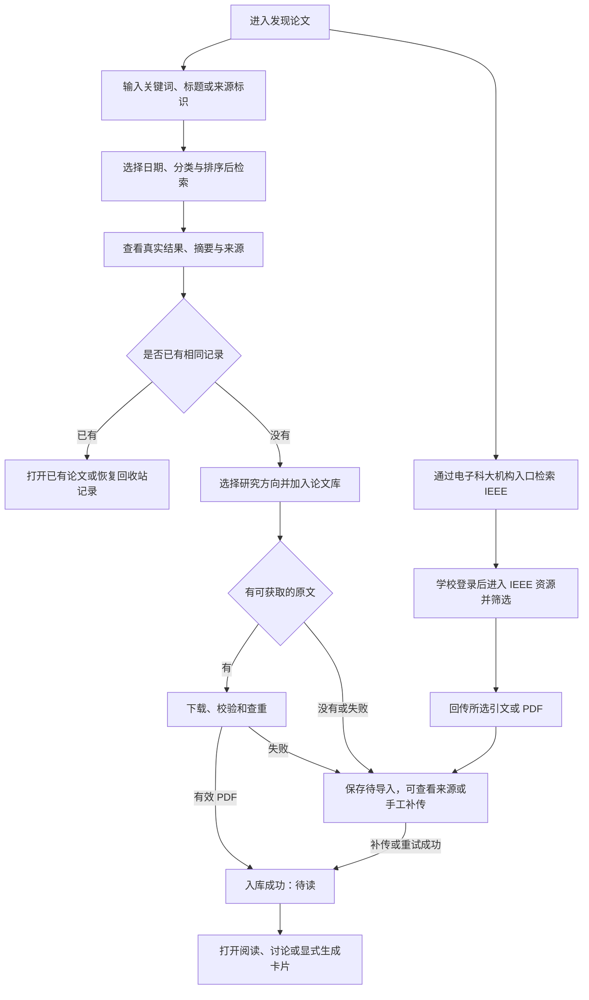
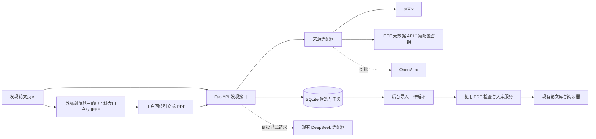

# 论文联网检索与导入方案

版本：0.3｜日期：2026-10-16｜基于应用 0.4.2｜状态：方案，尚未开发

【本次测试】arXiv 公开接口已取得 3 条论文记录。2026-10-16 已从电子科大校园 VPN 的 IEL 入口进入 IEEE，页面识别到学校机构；实际提交 `long term memory`，显示 124,941 条结果，前三条样本标注包含于订阅。原文获取、引文回传和看板导入尚未验证；IEEE 无密钥 API 请求此前返回 HTTP 403，机构网页权限不等于 API 授权。详见[连通性测试记录](论文检索连通性测试记录.md)，本次没有发布 F11 功能。

【本次更新｜IEEE 机构访问】用户要求加入 IEEE，并确认机构为电子科技大学。首批范围增加 IEEE Xplore 机构检索入口、机构获取原文与引文／PDF 回传；站内 IEEE 结果通过官方元数据 API 接入，配置与机构登录分别管理。电子科大校外访问使用学校校园 VPN 门户，已验证其 IEL 入口和当前会话内的关键词检索；逐篇全文获取仍需核对，不假定浏览器登录等于后端取得全文权限。

【本次更新】用户已确认新增范围为“联网找新论文并导入”。本方案增加 F11“发现论文”，衔接现有上传、研究方向、阅读、讨论与卡片；F07 的库内检索、跨论文问答和自动新文献监测仍按各自范围安排。

## 1. 目标与交付边界

为个人科研用户提供“查找学术论文 → 筛选摘要 → 获取原文 → 加入论文库 → 阅读讨论”的完整流程，减少在搜索网站、下载目录和论文管理系统之间切换。

继续使用现有网页、FastAPI、SQLite 和本地文件存储。价值先用找论文和导入所需操作数、导入成功率及重复记录数量评估，不增加收费或团队权限系统。

| 批次 | 交付范围 | 建议版本 |
| --- | --- | --- |
| A：首版 | arXiv 检索与导入；IEEE 电子科大机构检索入口、引文回传及 PDF 补传，配置 IEEE 元数据 API 密钥后可在站内展示 IEEE 结果；共用候选、查重和导入任务 | 0.5.0 |
| B：AI 辅助 | 中文意图转英文检索词、基于摘要的中文简介与研究方向建议，用户显式触发 | 后续小版本 |
| C：覆盖扩展 | OpenAlex 接入、DOI 定位、跨来源合并与排序、小批量导入 | 后续小版本 |

以上为建议发布划分；本轮只提交文档，不增加应用版本或创建发布标签。机构订阅范围内的访问属于本次范围；第一版不自动购买订阅外内容、不自动批量下载机构全文，不包含监测推送或自动生成创新结论。

## 2. 数据源选择

**arXiv 使用官方 API。** 当前使用场景集中在智能体、记忆和个性化对话等研究，适合先验证这一来源的检索与原文导入。API 提供题名、作者、摘要、分类、标识及原文链接，可按相关性和日期排序；返回 Atom，需要单独解析适配。[arXiv API 手册](https://info.arxiv.org/help/api/user-manual.html)

**IEEE 与 arXiv 同属首批，采用两条衔接路径。** “通过电子科大检索”在浏览器进入学校／IEEE 机构访问流程；站内 IEEE 元数据检索使用另行申请的 IEEE API 密钥。IEEE 官方说明元数据结果可能超出机构订阅范围，因此“找到论文”和“当前有全文权限”分别显示，API 密钥、学校账号和付费全文 API 授权不能互相替代。[IEEE 接入步骤](https://developer.ieee.org/Quick_Start_Guide)、[元数据检索范围](https://developer.ieee.org/docs/read/Searching_the_IEEE_Xplore_Metadata_API)、[全文 API 说明](https://developer.ieee.org/)

**后续来源使用 OpenAlex。** 用于补充综合学科和期刊、会议记录。按其当前规则，基础查询可以不带密钥，但正式使用建议配置免费 API 密钥，并处理预算与限流；游标翻页有密钥要求。[OpenAlex 鉴权文档](https://help.openalex.org/api/authentication/)、[检索文档](https://help.openalex.org/api/searching/)

搜索框明确标注当前来源，不承诺覆盖所有期刊、会议或中文数据库。IEEE 可用元数据接口时支持 DOI／文章号定位；未配置 API 时提供机构检索入口。仅选 arXiv 且输入 DOI 时说明能力范围，不把“来源不支持”显示为“没有这篇论文”。不抓取机构登录后的搜索网页来替代官方 API。

### 2.1 电子科技大学机构访问【本次更新】

学校公开说明的新版校外访问入口为 [校园 VPN](https://vpn.uestc.edu.cn/)，面向学校公共服务和图书馆资源。门户 FAQ 明确网页版 VPN 应从资源列表进入，另在地址栏输入应用网址不会自动经过代理。2026-10-16 已实际验证“校园 VPN → 统一身份认证登录 → 图书馆常用外文数据库 → IEL（IEEE/IET Electronic Library）→ IEEE Xplore”的机构检索路径；系统只保存学校门户入口，不拼接或猜测加密代理 URL。[学校 VPN 升级说明](https://jgsy.uestc.edu.cn/wlxxfw/VPNxwfw.htm)、[校园 VPN FAQ](https://vpn.uestc.edu.cn/)、[本机测试记录](论文检索连通性测试记录.md)

| 层次 | 设计与边界 |
| --- | --- |
| 机构资料 | 保存“电子科技大学”、学校门户、访问方式偏好和已核对的官方入口；机构选择决定访问身份，不默认将结果限制为本校作者论文 |
| 校外检索 | 点击“通过电子科大检索”打开外部浏览器；用户在学校页面完成登录，从资源列表进入 IEEE，使用系统提供的“复制检索词”检索。只有验证过的门户支持深层链接时才自动带入关键词 |
| 校内访问 | 提供直接打开 IEEE Xplore 的选项，以浏览器实际显示的机构名称及对应文章访问情况为准；不能根据本机 IP 或用户选中校名就显示“全文已授权” |
| 机构登录 | IEEE 支持机构登录等远程访问方式；电子科大在该入口的当前可用链路列为待验证选项，未验证前不承诺已开通 CARSI／Shibboleth 或自动选择学校。[IEEE 远程访问说明](https://innovate.ieee.org/tips-to-access-your-organizations-ieee-xplore-subscription-when-working-remotely/) |
| 站内结果 | 配置获批的 IEEE 元数据 API 密钥后，系统显示题名、摘要、作者、年份、刊会、DOI、文章号与来源链接；没有密钥时明确显示“可通过机构入口检索”，不能返回伪造的空列表 |
| 原文获取 | 机构订阅文章由用户在该机构访问浏览器中取得 PDF，再补传到候选；开放 PDF 或另有明确全文 API 授权的下载路径才进入后端自动导入，且仍须确认实际返回 PDF |

学校密码、验证码和浏览器会话只在原学校／IEEE 登录页面处理，本系统不收集或保存，也不要求用户导出 Cookie。浏览器会话与 FastAPI 请求彼此独立：WebVPN 登录不会自动改变服务端的网络出口或登录状态。IEEE 元数据密钥单独在服务端加密保存，接口和日志不回传密钥，不能复用已有 DeepSeek 密钥。

机构网页检索完成后，用户可回传选定论文的 RIS／BibTeX 引文，先保存为候选，再补传 PDF；也可仅上传 PDF 并核对论文信息。IEEE 引文导出提供这两种格式，具体导出操作在用户实际页面验收。[IEEE 引文导出页面](https://ieeexplore.ieee.org/assets/html/download_citations-v2.html)

引文导入先预览再保存，单文件最多 2 MiB、最多 20 条；按 DOI／IEEE 文章号提示重复，不自动读取引文里的任意 URL 或下载全文。未识别文章号的条目保留为本地待核对候选，不编造官方标识。无摘要或字段不全时仍可保存和补传；需核对来源标识与所传 PDF 的对应关系，发生明显冲突时不自动关联。

校园 VPN 中的 IEL 入口、IEEE 机构身份和关键词搜索已通过当前会话测试。尚待验证的条件包括逐篇全文获取及订阅覆盖、引文导出、直接使用 IEEE 机构登录的可行性，以及获批 IEEE API 密钥。这些条件影响可用访问模式，不阻塞本轮方案；没有元数据密钥仍须交付机构入口和回传闭环。

## 3. 入口与页面

侧边导航增加“发现论文”，与“全部论文”分开。保留现有论文库搜索框的含义，阅读器顶部不增加联网搜索控件。

```text
┌──────────┬────────────────────────────────────────────────┐
│ 全部论文 │ 发现论文                    来源：[arXiv/IEEE]│
│ 阅读看板 │ [关键词、论文标题或来源标识             ][检索]│
│ 发现论文 │ [年份/日期] [学科分类] [排序] [隐藏已入库]      │
│          │ 机构：电子科技大学 [通过机构检索] [导入引文]  │
│ 收藏夹   │ [搜索结果] [待导入] [导入任务]                  │
│ ……       ├────────────────────────────────────────────────┤
│          │ 原始标题 · 作者 · 首次发布日期 · 来源          │
│          │ 摘要片段……                       [展开摘要]    │
│          │ v2 · 已入库/可获取原文/需自行获取              │
│          │ [加入论文库/机构获取原文] [保存待导入]         │
│          ├────────────────────────────────────────────────┤
│          │ 结果列表……                           [加载更多]│
└──────────┴────────────────────────────────────────────────┘
```

结果采用便于比较的纵向列表，原始标题始终保留。详情在可关闭侧栏中展示完整摘要、作者、日期、来源、版本和获取入口；公式复用现有 `MathText` 渲染。窄屏详情使用单独面板，返回列表后恢复查询和位置。

## 4. 用户流程



导入成功不等于已读。打开原文时继续沿用现有阅读状态规则；完整卡片仍在用户明确操作或已有自动已读规则满足时生成，搜索和下载不触发全文模型分析。

## 5. 核心功能与交互

### 5.1 检索与筛选

- 支持英文关键词、完整或部分标题、作者字段，以及 arXiv ID、IEEE 文章号、DOI 与官方条目链接。输入首尾空白归一，查询上限 500 字符；各适配器只处理已支持的标识和字段，不直接抓取任意网页。
- 首版中文关键词按原文检索，并提示可使用英文术语；B 批增加“AI 生成检索词”，由用户核对后检索，不声称首版已有跨语言语义搜索。
- 日期支持最近 7 天、30 天、一年与自定义范围，默认按首次发布日期过滤；更新时间单独展示。范围倒置时在输入处提示，保留其他条件。
- 支持来源分类、相关性与最新发布排序。一个来源不提供的排序不显示为可用。每次返回 20 条，可继续加载，单次查询最多展示 200 条，超过后提示缩小范围。
- 搜索按钮显式触发请求，不在每次输入时联网。切换条件后重新检索，取消旧请求并忽略晚到结果。缓存有效期建议 15 分钟，显示获取时间并提供刷新；待导入和已入库状态每次按本地数据重新计算。
- 原始来源计数、去重后已加载数量分别呈现，不把外部总数当成本地去重后的精确总数。
- IEEE 无元数据密钥时走机构浏览器检索，不把外部页面的结果伪装成已汇总的站内列表。首版按来源切换展示；跨来源统一合并仍在 C 批实现。IEEE 作者单位筛选与机构访问身份独立，首版不因选择电子科大而附加作者单位条件。

### 5.2 结果与摘要

必须显示原题、作者、来源链接、首次发布日期、更新时间、版本，以及摘要是否可用。元数据缺失时显示“来源未提供”，不生成作者、会议、DOI 或实验成绩。

“可获取原文”表示来源提供了下载候选链接，下载校验完成前不保证一定成功。IEEE 的 `pdf_url` 只视为来源链接，不等同当前用户有下载权限；订阅内容显示“通过机构获取原文”，按实际返回再判断。无摘要仍可查看来源和保存候选；无 PDF 时不显示可立即阅读。论文预印本与正式发表信息分别标注。[IEEE 返回字段说明](https://developer.ieee.org/docs/read/Metadata_API_responses)

B 批的中文简介最多说明“研究问题、核心方法、可能相关性”，每项建议不超过 80 字，明确标为“仅根据摘要生成”；不能充当已有“已确认阅读卡片”，不填写摘要未报告的实验结果。

### 5.3 保存待导入

保存元数据、来源标识、选定研究方向和保存时间，不下载全文、不调用模型。重复保存返回同一候选条目。移出待导入只取消保存标记，保留必要任务关联，不删除已入库论文；正在执行的导入需在任务中单独取消。

**当前 `papers` 要求文件哈希、文件大小和页数，不能直接塞入没有 PDF 的条目。** 候选条目独立存储和展示，不计入论文库篇数、已读统计或阅读看板。手工补传成功后关联论文，并保留来源信息。

### 5.4 加入论文库

点击“加入论文库”时，可选已有研究方向，默认不分类；不根据当前搜索词自动创建分类。首版一次导入一篇，允许不同操作排队，系统同时下载最多一份文件。

执行顺序为：解析受支持的来源标识 → 服务端重新取得来源记录 → 下载到临时文件 → PDF 检查 → 文件哈希与文献标识查重 → 事务入库 → 返回现有论文详情。

上述自动下载顺序用于已有可用原文路径的来源。IEEE 机构浏览器获取分支先保存候选，再由用户补传；不能把校园 VPN 登录页、IEEE 登录页或 200 状态的 HTML 当成 PDF。识别出访问验证页面时提示“请通过机构入口获取后上传”，不无限重试。不得将机构网页会话当作卡片模型或来源 API 凭据。

继续执行现有 50 MiB、300 页、容量、损坏／加密文件、页来源准备和私有文件访问规则。新论文可用来源元数据填写标题、作者、年份和 DOI，并保留来源快照供编辑核对。已有论文的人工标题、方向、笔记、讨论和卡片不被外部元数据覆盖。

无原文、下载超时、来源拒绝访问或校验失败时，保留待导入条目，提供“查看来源”“上传本地 PDF”“重试”；不会留下假成功的论文记录。

### 5.5 查重与版本

| 依据 | 处理 |
| --- | --- |
| 同空间、同文件 SHA-256 | 返回已有论文；并发导入仍只创建一条 |
| 相同 arXiv 基础标识及相同版本 | 提示已入库，优先打开已有记录；缺少版本信息时不猜测 |
| 相同 IEEE 文章号 | 提示已有论文或已有候选；文件不同仍先核对版本及文件哈希，不覆盖既有 PDF |
| 相同 arXiv 基础标识但版本不同 | 显示版本差异，允许用户选择另存新版；保留旧 PDF、批注和页码关系 |
| DOI 相同但文件不同 | 提示可能是不同版本，由用户选择关联或分别保留，不自动覆盖 |
| 仅标题相似 | 提示“可能重复”，不能直接合并 |
| 已有记录在回收站 | 提供恢复入口，不偷偷创建同一文件的另一条记录 |

跨来源归并在 C 批实现：优先使用来源标识与规范化 DOI，标题／作者相似度只用于提示。预印本和正式版的关系应保留，不能因 DOI 相同就替换用户当前阅读文件。

## 6. 状态、错误与文案

| 状态 | 页面表现与下一步 |
| --- | --- |
| 初始／空输入 | 显示示例和输入说明；禁用检索按钮 |
| 检索中 | 显示来源和等待状态，可取消；保留已输入条件 |
| 无匹配 | “当前来源没有找到匹配论文”，可修改关键词、日期或分类 |
| 服务超时／限流 | “来源暂时无法响应，请稍后重试”；有缓存时显示缓存及时间，不伪装成实时结果 |
| 待下载／下载中／检查中 | 显示真实阶段；只有长度已知时展示下载百分比，否则展示已下载大小 |
| 入库成功 | “已加入论文库”，提供“打开阅读”；等待中的重复点击返回同一任务 |
| 已入库／回收站 | “打开已有论文”或“恢复已有论文”，不重复下载 |
| 无 PDF／失败 | 保留候选和条件，说明原因，提供来源、补传与重试 |
| 取消 | 临时文件清理，保留候选；取消后晚到结果不得入库 |
| 登录失效 | 停止新增写入，保留当前查询；重新登录后查询任务结果，避免盲目重复导入 |
| IEEE 元数据密钥未配置 | 提供“通过电子科大检索”，保留关键词，不声称站内 IEEE 结果为零 |
| 机构会话失效／未覆盖该文章 | 保留候选，返回原机构页面重新登录或核对权限；不自动购买，不显示已取得全文权限 |
| 引文待核对 | 显示 DOI、文章号与文件对应关系，可修改或取消，不静默匹配同名论文 |

文案沿用简洁、学术且可操作的风格；技术错误和地址诊断放在详情，不挤占结果列表。无 DOI、作者、摘要或下载链接均为合法缺失状态。

## 7. 实现结构



- 前端建议新增 `discovery/DiscoveryPage.tsx`、`SearchForm.tsx`、`DiscoveryResult.tsx`、`CandidateList.tsx`、`ImportTaskList.tsx`。翻译和公式展示复用现有组件，不修改阅读器布局。
- 后端建议新增 `discovery_api.py`、`discovery_service.py`、`literature_providers/arxiv.py`、`literature_providers/ieee.py`、`citation_import.py`、`paper_import_worker.py`。适配器统一 `search`、`get_record`、`resolve_pdf` 返回结构，并增加 `institution_required` 结果类型，搜索语法与来源字段映射留在适配器内部。
- 抽出共享 `pdf_ingest.py`，将当前上传端点中的检查、查重、容量、分类和页来源准备供本地上传与网络导入共同调用；不通过服务内部 HTTP 再调用自己。
- 导入任务独立于 AI 卡片任务：现有 `generation_tasks.paper_id` 必填，而且论文此时尚未创建，不能用虚拟论文绕过约束，也不能因下载失败占住 AI 预算。采用 SQLite 持久任务及同一应用内的独立工作循环，无需新数据库或 Redis。
- 下载读取分块数据，建议连接超时 8 秒、单篇总时限 120 秒；检索单次时限 20 秒。可恢复网络错误最多自动重试两次，遵守来源要求；403、格式错误、超限等直接报告。部署前按真实网络情况复核这些应用默认值。
- arXiv API 全局保持单连接，连续请求间隔至少 3 秒；重试与分页也计入同一限流器。[arXiv API 使用限制](https://info.arxiv.org/help/api/tou.html)
- 首版下载来源限定已实现的官方域名与路径，服务端只接受来源类型和论文标识。来源返回的链接仍视为外部输入；每次连接与重定向都检查目标地址，拒绝本机、内网和非 HTTP(S) 地址，限制重定向次数，并复用现有地址校验思路。
- 学校门户只由用户浏览器打开，不纳入后端通用下载代理。候选只保存规范 IEEE 条目链接和来源标识，不保存临时校园代理地址、登录回调参数或认证信息。引文解析只处理文本，不执行 BibTeX 内容或其中的 HTML；来源 API 的密钥及访问配置需单独管理。
- 取消、重启恢复和入库采用租约及执行代次检查；文件登记和任务成功必须一致。正式登记前再次检查取消状态、重复记录、权限与剩余容量。重启后的旧执行结果不得覆盖新任务状态。

## 8. 数据与 API 草案

| 实体 | 核心字段与约束 |
| --- | --- |
| `institution_access_profiles` | 空间、用户、机构名称、门户 URL、访问方式偏好、已核对入口与时间；首个机构为电子科技大学，不包含学校密码、Cookie 或登录令牌；保存入口不代表认证成功 |
| `discovery_provider_configurations` | 来源类型、加密 API 密钥、启用状态和可用能力；与模型配置分开，公开接口只返回配置状态和能力 |
| `literature_candidates` | 空间、用户、来源、来源记录标识（待核对引文可空）、arXiv 基础标识／版本、IEEE 文章号、DOI、标题、作者、摘要、日期、规范来源链接、元数据快照、访问提示、选定方向、保存时间；可识别的同用户同来源记录重复保存幂等，不存机构会话 |
| `paper_external_identifiers` | 空间、论文、标识类型、规范化值、版本、来源快照；同论文标识去重；允许同一文献关联不同 PDF 版本，不把 DOI 设为全空间强制唯一 |
| `paper_import_tasks` | 空间、用户、请求标识、候选条目、输入快照、状态、阶段、下载大小、执行代次／租约、尝试次数、原重试任务（可空）、结果论文、错误码、起止时间；同用户请求标识唯一，内容不同的重放返回冲突 |

任务状态固定为排队中、执行中、等待重试、成功、失败、已取消；执行阶段分别记录解析来源、下载、检查和登记。成功后取消只返回“已入库”与论文入口，不回滚论文。失败或取消后的显式重试用新的请求标识创建任务并关联原任务，同一重试请求重放仍返回原结果。

候选标题上限 500 字符、作者最多 100 人且单名最多 200 字符、摘要最多保存 20,000 字符、DOI 上限 200 字符、来源链接上限 2,048 字符；超长外部字段标记截断，不将截断后的标识用于精确查重。新论文入库时必须通过现有字段校验。

| 接口草案，统一前缀 `/api/v1` | 用途 |
| --- | --- |
| `GET /discovery/providers` | 来源状态、能力与可用筛选项，不返回密钥 |
| `GET /settings/institution-access`、`PUT /settings/institution-access` | 机构名、官方门户和访问方式偏好；不收集账号密码 |
| `GET /settings/discovery-providers`、`PUT /settings/discovery-providers/{provider}` | 独立配置 IEEE 元数据密钥与来源能力，不返回明文密钥 |
| `GET /discovery/search` | 查询及来源分页；返回规范化结果、获取时间、来源计数和下一页标识 |
| `POST /discovery/citation-previews` | 解析 RIS／BibTeX，返回最多 20 条可核对记录；保存仍走候选接口，不自动下载 URL |
| `POST /discovery/candidates`、`GET /discovery/candidates` | 幂等保存与列出待导入条目 |
| `DELETE /discovery/candidates/{id}` | 移出待导入，不删除已入库论文 |
| `POST /paper-imports` | 用来源标识、方向和请求标识创建任务，返回 202 |
| `GET /paper-imports`、`GET /paper-imports/{id}` | 显示进行中及近期任务、逐项结果 |
| `POST /paper-imports/{id}/cancel` | 取消尚未登记的导入 |
| `POST /paper-imports/{id}/retry` | 幂等创建失败／取消任务的重试；已成功则返回已有论文 |
| 现有 `POST /papers` 增加可选候选标识 | 手工补传后在同一业务事务中关联候选；旧上传请求继续可用 |

搜索结果和来源分页标识不携带授权能力；保存、导入与补传时重新验证当前用户、空间、来源标识和分类。未来多来源检索各自维护分页状态，不能把一个来源的相关性分数当作全局统一得分。

## 9. B 批 AI 辅助规则

用户输入“多轮对话中的长期记忆如何更新”后，可显式生成如 `long-term memory`、`conversational agents`、`memory update` 等检索词，看到改写结果后修改并检索。示例仅演示交互，实际关键词需要模型生成和用户核对。

默认沿用已有 DeepSeek，不另填模型密钥。只发送本次问题或显式选择的公开摘要，不自动发送库内论文、阅读记录、笔记或聊天历史。扩展词不得擅自增加年份、研究结论或排除条件，结构校验失败时回到手工检索。

摘要解读一次只处理用户选中的一条结果，显示模型、依据和用量；研究方向建议逐项采纳，新分类仍须用户创建或确认。另建无论文依赖的 AI 请求记录，复用模型适配、月度预算及调用记录，规划独立的短文本输入与输出上限；不能直接复用必须绑定论文的卡片任务。

AI 返回内容不作为作者、DOI、论文地址或可下载链接的权威来源。模型不可用、预算不足或用户取消时，基础联网检索与导入继续可用。

## 10. 开发顺序与验收

| 顺序 | 工作与完成标准 |
| --- | --- |
| 1 | 验证 arXiv、IEEE 元数据 API 的配置与连通性；另由用户在电子科大机构浏览器中核对资源入口、检索及一篇可访问原文，不接管学校账号，不先改正式库 |
| 2 | 新迁移、来源适配、查询参数与缓存；完成精确标识、日期、分页、缺失字段及取消晚到结果测试 |
| 3 | 发现页面、详情、电子科大机构入口、引文预览与待导入列表；验证无 IEEE 密钥时仍能机构检索并回传，检查查询保持、空状态、键盘操作、窄屏和公式摘要 |
| 4 | 抽取共享 PDF 入库服务，完成持久导入、补传、查重、版本提示、取消和重启恢复；回归原上传流程 |
| 5 | 独立验收库验证真实检索到原文阅读的完整流程，检查原有论文、批注、卡片和聊天未受影响 |
| 6 | 备份正式数据、演练迁移、构建发布；按规范同步应用版本、中文提交和中文说明标签，预计使用 `v0.5.0`，通过验收后才创建 |

首版验收至少包含：

1. 固定记录 10 组真实检索样本：完整标题、主题词、作者、精确 arXiv ID、带版本链接、日期边界及无结果条件。已知标识应返回对应论文，主题结果按预期相关性人工核对，不承诺穷尽全部文献。
2. 成功导入后题名、作者、日期、方向及来源可核对，PDF 可阅读，页数与哈希有效，状态为待读；首次打开后仍能保存进度、批注、讨论和卡片。
3. 同一任务重试、双击、并发、不同来源同文件均无重复论文；版本不同不覆盖旧文件，回收站记录提示恢复。
4. 限流、403、超时、断流、损坏文件、伪 PDF、超限、无原文等情况保留可操作的候选记录，错误不会显示成入库成功。
5. 取消下载、进程重启、取消与登记竞争以及手工补传并发均有确定结果，旧执行不能晚到入库。
6. 跨用户条目、任务或分类不可访问；恶意 URL、内网重定向及伪造来源标识不能让服务访问私有地址。
7. 外部元数据不覆盖已有人工内容；未执行 AI 操作时没有模型调用，保存候选和导入也不会自动生成完整卡片。
8. 从学校门户资源列表进入 IEEE，由用户核对机构及可访问论文；回传引文和 PDF 后可继续阅读。未经实际登录验证的链路标记待核对，不能以配置校名代替订阅验证。
9. IEEE API 缺密钥、密钥错误、机构未覆盖、浏览器会话失效、返回 HTML 登录页与真正的无结果分别提示；API 结果和 PDF 链接不作为全文授权证明。
10. 引文缺摘要、缺文章号、重复 DOI、超过条数／大小、内容含命令或任意下载 URL，以及引文和 PDF 对应冲突时，均不自动执行、覆盖或错误关联；浏览器登录参数不进入日志、数据库或 Git。

本轮仅完成方案与文档关联，未新增接口、迁移或页面；真实来源连通性及端到端导入留到开发验收记录，不以文档调研代替运行验证。
