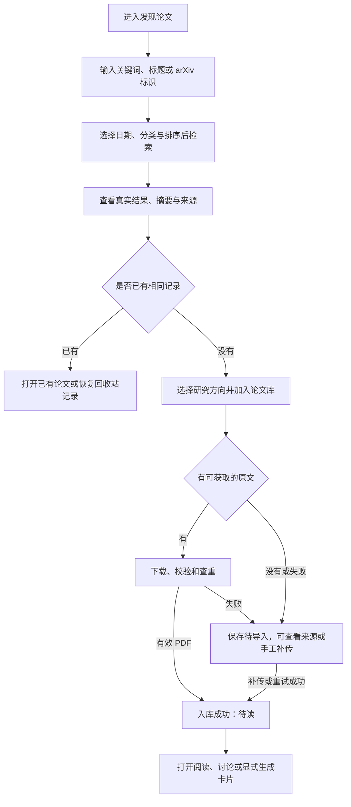
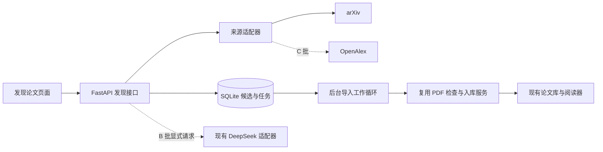

# 论文联网检索与导入方案

版本：0.1｜日期：2026-10-15｜基于应用 0.4.2｜状态：方案，尚未开发

【本次更新】用户已确认新增范围为“联网找新论文并导入”。本方案增加 F11“发现论文”，衔接现有上传、研究方向、阅读、讨论与卡片；F07 的库内检索、跨论文问答和自动新文献监测仍按各自范围安排。

## 1. 目标与交付边界

为个人科研用户提供“查找公开论文 → 筛选摘要 → 获取原文 → 加入论文库 → 阅读讨论”的完整流程，减少在搜索网站、下载目录和论文管理系统之间切换。

继续使用现有网页、FastAPI、SQLite 和本地文件存储。价值先用找论文和导入所需操作数、导入成功率及重复记录数量评估，不增加收费或团队权限系统。

| 批次 | 交付范围 | 建议版本 |
| --- | --- | --- |
| A：首版 | arXiv 检索、结果详情、日期与分类筛选、已入库识别、待导入列表、单篇 PDF 导入、手工补传及失败重试 | 0.5.0 |
| B：AI 辅助 | 中文意图转英文检索词、基于摘要的中文简介与研究方向建议，用户显式触发 | 后续小版本 |
| C：覆盖扩展 | OpenAlex 接入、DOI 定位、跨来源合并与排序、小批量导入 | 后续小版本 |

以上为建议发布划分；本轮只提交文档，不增加应用版本或创建发布标签。第一版不包含自动下载全部结果、付费全文获取、自动监测推送或自动生成创新结论。

## 2. 数据源选择

**首版使用 arXiv 官方 API。** 当前使用场景集中在智能体、记忆和个性化对话等研究，适合先验证这一来源的检索与原文导入。API 提供题名、作者、摘要、分类、标识及原文链接，可按相关性和日期排序；返回 Atom，需要单独解析适配。[arXiv API 手册](https://info.arxiv.org/help/api/user-manual.html)

**第二个来源使用 OpenAlex。** 用于补充综合学科和期刊、会议记录。按其当前规则，基础查询可以不带密钥，但正式使用建议配置免费 API 密钥，并处理预算与限流；游标翻页有密钥要求。[OpenAlex 鉴权文档](https://help.openalex.org/api/authentication/)、[检索文档](https://help.openalex.org/api/searching/)

arXiv 首版不承诺覆盖所有期刊、会议或中文数据库。搜索框明确标注当前来源；DOI 输入在综合来源上线后支持，首版识别后提示打开 DOI 原始页面，不把“来源不支持”显示为“没有这篇论文”。不以搜索网页抓取作为首版依赖。

## 3. 入口与页面

侧边导航增加“发现论文”，与“全部论文”分开。保留现有论文库搜索框的含义，阅读器顶部不增加联网搜索控件。

```text
┌──────────┬────────────────────────────────────────────────┐
│ 全部论文 │ 发现论文                         来源：arXiv   │
│ 阅读看板 │ [关键词、论文标题或 arXiv ID             ][检索]│
│ 发现论文 │ [年份/日期] [学科分类] [排序] [隐藏已入库]      │
│ 收藏夹   │ [搜索结果] [待导入] [导入任务]                  │
│ ……       ├────────────────────────────────────────────────┤
│          │ 原始标题 · 作者 · 首次发布日期 · 来源          │
│          │ 摘要片段……                       [展开摘要]    │
│          │ v2 · 已入库/可获取原文/需自行获取              │
│          │ [加入论文库] [保存待导入] [查看来源]            │
│          ├────────────────────────────────────────────────┤
│          │ 结果列表……                           [加载更多]│
└──────────┴────────────────────────────────────────────────┘
```

结果采用便于比较的纵向列表，原始标题始终保留。详情在可关闭侧栏中展示完整摘要、作者、日期、来源、版本和获取入口；公式复用现有 `MathText` 渲染。窄屏详情使用单独面板，返回列表后恢复查询和位置。

## 4. 用户流程



导入成功不等于已读。打开原文时继续沿用现有阅读状态规则；完整卡片仍在用户明确操作或已有自动已读规则满足时生成，搜索和下载不触发全文模型分析。

## 5. 核心功能与交互

### 5.1 检索与筛选

- 支持英文关键词、完整或部分标题、作者字段，以及 arXiv ID／官方摘要链接。输入首尾空白归一，查询上限 500 字符；只有链接而非 arXiv 来源时说明当前支持范围，不直接抓取任意网页。
- 首版中文关键词按原文检索，并提示可使用英文术语；B 批增加“AI 生成检索词”，由用户核对后检索，不声称首版已有跨语言语义搜索。
- 日期支持最近 7 天、30 天、一年与自定义范围，默认按首次发布日期过滤；更新时间单独展示。范围倒置时在输入处提示，保留其他条件。
- 支持来源分类、相关性与最新发布排序。一个来源不提供的排序不显示为可用。每次返回 20 条，可继续加载，单次查询最多展示 200 条，超过后提示缩小范围。
- 搜索按钮显式触发请求，不在每次输入时联网。切换条件后重新检索，取消旧请求并忽略晚到结果。缓存有效期建议 15 分钟，显示获取时间并提供刷新；待导入和已入库状态每次按本地数据重新计算。
- 原始来源计数、去重后已加载数量分别呈现，不把外部总数当成本地去重后的精确总数。

### 5.2 结果与摘要

必须显示原题、作者、来源链接、首次发布日期、更新时间、版本，以及摘要是否可用。元数据缺失时显示“来源未提供”，不生成作者、会议、DOI 或实验成绩。

“可获取原文”表示来源提供了下载候选链接，下载校验完成前不保证一定成功。无摘要仍可查看来源和保存候选；无 PDF 时不显示可立即阅读。论文预印本与正式发表信息分别标注。

B 批的中文简介最多说明“研究问题、核心方法、可能相关性”，每项建议不超过 80 字，明确标为“仅根据摘要生成”；不能充当已有“已确认阅读卡片”，不填写摘要未报告的实验结果。

### 5.3 保存待导入

保存元数据、来源标识、选定研究方向和保存时间，不下载全文、不调用模型。重复保存返回同一候选条目。移出待导入只取消保存标记，保留必要任务关联，不删除已入库论文；正在执行的导入需在任务中单独取消。

**当前 `papers` 要求文件哈希、文件大小和页数，不能直接塞入没有 PDF 的条目。** 候选条目独立存储和展示，不计入论文库篇数、已读统计或阅读看板。手工补传成功后关联论文，并保留来源信息。

### 5.4 加入论文库

点击“加入论文库”时，可选已有研究方向，默认不分类；不根据当前搜索词自动创建分类。首版一次导入一篇，允许不同操作排队，系统同时下载最多一份文件。

执行顺序为：解析受支持的来源标识 → 服务端重新取得来源记录 → 下载到临时文件 → PDF 检查 → 文件哈希与文献标识查重 → 事务入库 → 返回现有论文详情。

继续执行现有 50 MiB、300 页、容量、损坏／加密文件、页来源准备和私有文件访问规则。新论文可用来源元数据填写标题、作者、年份和 DOI，并保留来源快照供编辑核对。已有论文的人工标题、方向、笔记、讨论和卡片不被外部元数据覆盖。

无原文、下载超时、来源拒绝访问或校验失败时，保留待导入条目，提供“查看来源”“上传本地 PDF”“重试”；不会留下假成功的论文记录。

### 5.5 查重与版本

| 依据 | 处理 |
| --- | --- |
| 同空间、同文件 SHA-256 | 返回已有论文；并发导入仍只创建一条 |
| 相同 arXiv 基础标识及相同版本 | 提示已入库，优先打开已有记录；缺少版本信息时不猜测 |
| 相同 arXiv 基础标识但版本不同 | 显示版本差异，允许用户选择另存新版；保留旧 PDF、批注和页码关系 |
| DOI 相同但文件不同 | 提示可能是不同版本，由用户选择关联或分别保留，不自动覆盖 |
| 仅标题相似 | 提示“可能重复”，不能直接合并 |
| 已有记录在回收站 | 提供恢复入口，不偷偷创建同一文件的另一条记录 |

跨来源归并在 C 批实现：优先使用来源标识与规范化 DOI，标题／作者相似度只用于提示。预印本和正式版的关系应保留，不能因 DOI 相同就替换用户当前阅读文件。

## 6. 状态、错误与文案

| 状态 | 页面表现与下一步 |
| --- | --- |
| 初始／空输入 | 显示示例和输入说明；禁用检索按钮 |
| 检索中 | 显示来源和等待状态，可取消；保留已输入条件 |
| 无匹配 | “当前来源没有找到匹配论文”，可修改关键词、日期或分类 |
| 服务超时／限流 | “来源暂时无法响应，请稍后重试”；有缓存时显示缓存及时间，不伪装成实时结果 |
| 待下载／下载中／检查中 | 显示真实阶段；只有长度已知时展示下载百分比，否则展示已下载大小 |
| 入库成功 | “已加入论文库”，提供“打开阅读”；等待中的重复点击返回同一任务 |
| 已入库／回收站 | “打开已有论文”或“恢复已有论文”，不重复下载 |
| 无 PDF／失败 | 保留候选和条件，说明原因，提供来源、补传与重试 |
| 取消 | 临时文件清理，保留候选；取消后晚到结果不得入库 |
| 登录失效 | 停止新增写入，保留当前查询；重新登录后查询任务结果，避免盲目重复导入 |

文案沿用简洁、学术且可操作的风格；技术错误和地址诊断放在详情，不挤占结果列表。无 DOI、作者、摘要或下载链接均为合法缺失状态。

## 7. 实现结构



- 前端建议新增 `discovery/DiscoveryPage.tsx`、`SearchForm.tsx`、`DiscoveryResult.tsx`、`CandidateList.tsx`、`ImportTaskList.tsx`。翻译和公式展示复用现有组件，不修改阅读器布局。
- 后端建议新增 `discovery_api.py`、`discovery_service.py`、`literature_providers/arxiv.py`、`paper_import_worker.py`。适配器统一 `search`、`get_record`、`resolve_pdf` 返回结构，搜索语法与来源字段映射留在适配器内部。
- 抽出共享 `pdf_ingest.py`，将当前上传端点中的检查、查重、容量、分类和页来源准备供本地上传与网络导入共同调用；不通过服务内部 HTTP 再调用自己。
- 导入任务独立于 AI 卡片任务：现有 `generation_tasks.paper_id` 必填，而且论文此时尚未创建，不能用虚拟论文绕过约束，也不能因下载失败占住 AI 预算。采用 SQLite 持久任务及同一应用内的独立工作循环，无需新数据库或 Redis。
- 下载读取分块数据，建议连接超时 8 秒、单篇总时限 120 秒；检索单次时限 20 秒。可恢复网络错误最多自动重试两次，遵守来源要求；403、格式错误、超限等直接报告。部署前按真实网络情况复核这些应用默认值。
- arXiv API 全局保持单连接，连续请求间隔至少 3 秒；重试与分页也计入同一限流器。[arXiv API 使用限制](https://info.arxiv.org/help/api/tou.html)
- 首版下载来源限定已实现的官方域名与路径，服务端只接受来源类型和论文标识。来源返回的链接仍视为外部输入；每次连接与重定向都检查目标地址，拒绝本机、内网和非 HTTP(S) 地址，限制重定向次数，并复用现有地址校验思路。
- 取消、重启恢复和入库采用租约及执行代次检查；文件登记和任务成功必须一致。正式登记前再次检查取消状态、重复记录、权限与剩余容量。重启后的旧执行结果不得覆盖新任务状态。

## 8. 数据与 API 草案

| 实体 | 核心字段与约束 |
| --- | --- |
| `literature_candidates` | 空间、用户、来源、来源记录标识、arXiv 基础标识／版本、DOI、标题、作者、摘要、日期、来源链接、元数据快照、选定方向、保存时间；同用户同来源记录重复保存幂等 |
| `paper_external_identifiers` | 空间、论文、标识类型、规范化值、版本、来源快照；同论文标识去重；允许同一文献关联不同 PDF 版本，不把 DOI 设为全空间强制唯一 |
| `paper_import_tasks` | 空间、用户、请求标识、候选条目、输入快照、状态、阶段、下载大小、执行代次／租约、尝试次数、原重试任务（可空）、结果论文、错误码、起止时间；同用户请求标识唯一，内容不同的重放返回冲突 |

任务状态固定为排队中、执行中、等待重试、成功、失败、已取消；执行阶段分别记录解析来源、下载、检查和登记。成功后取消只返回“已入库”与论文入口，不回滚论文。失败或取消后的显式重试用新的请求标识创建任务并关联原任务，同一重试请求重放仍返回原结果。

候选标题上限 500 字符、作者最多 100 人且单名最多 200 字符、摘要最多保存 20,000 字符、DOI 上限 200 字符、来源链接上限 2,048 字符；超长外部字段标记截断，不将截断后的标识用于精确查重。新论文入库时必须通过现有字段校验。

| 接口草案，统一前缀 `/api/v1` | 用途 |
| --- | --- |
| `GET /discovery/providers` | 来源状态、能力与可用筛选项，不返回密钥 |
| `GET /discovery/search` | 查询及来源分页；返回规范化结果、获取时间、来源计数和下一页标识 |
| `POST /discovery/candidates`、`GET /discovery/candidates` | 幂等保存与列出待导入条目 |
| `DELETE /discovery/candidates/{id}` | 移出待导入，不删除已入库论文 |
| `POST /paper-imports` | 用来源标识、方向和请求标识创建任务，返回 202 |
| `GET /paper-imports`、`GET /paper-imports/{id}` | 显示进行中及近期任务、逐项结果 |
| `POST /paper-imports/{id}/cancel` | 取消尚未登记的导入 |
| `POST /paper-imports/{id}/retry` | 幂等创建失败／取消任务的重试；已成功则返回已有论文 |
| 现有 `POST /papers` 增加可选候选标识 | 手工补传后在同一业务事务中关联候选；旧上传请求继续可用 |

搜索结果和来源分页标识不携带授权能力；保存、导入与补传时重新验证当前用户、空间、来源标识和分类。未来多来源检索各自维护分页状态，不能把一个来源的相关性分数当作全局统一得分。

## 9. B 批 AI 辅助规则

用户输入“多轮对话中的长期记忆如何更新”后，可显式生成如 `long-term memory`、`conversational agents`、`memory update` 等检索词，看到改写结果后修改并检索。示例仅演示交互，实际关键词需要模型生成和用户核对。

默认沿用已有 DeepSeek，不另填模型密钥。只发送本次问题或显式选择的公开摘要，不自动发送库内论文、阅读记录、笔记或聊天历史。扩展词不得擅自增加年份、研究结论或排除条件，结构校验失败时回到手工检索。

摘要解读一次只处理用户选中的一条结果，显示模型、依据和用量；研究方向建议逐项采纳，新分类仍须用户创建或确认。另建无论文依赖的 AI 请求记录，复用模型适配、月度预算及调用记录，规划独立的短文本输入与输出上限；不能直接复用必须绑定论文的卡片任务。

AI 返回内容不作为作者、DOI、论文地址或可下载链接的权威来源。模型不可用、预算不足或用户取消时，基础联网检索与导入继续可用。

## 10. 开发顺序与验收

| 顺序 | 工作与完成标准 |
| --- | --- |
| 1 | 验证本机访问 arXiv 查询和样本 PDF，记录延迟、限流及失败类型；核对来源适配接口与样本，不先改正式库 |
| 2 | 新迁移、来源适配、查询参数与缓存；完成精确标识、日期、分页、缺失字段及取消晚到结果测试 |
| 3 | 发现页面、详情与待导入列表；验证查询保持、空状态、键盘操作、窄屏和公式摘要 |
| 4 | 抽取共享 PDF 入库服务，完成持久导入、补传、查重、版本提示、取消和重启恢复；回归原上传流程 |
| 5 | 独立验收库验证真实检索到原文阅读的完整流程，检查原有论文、批注、卡片和聊天未受影响 |
| 6 | 备份正式数据、演练迁移、构建发布；按规范同步应用版本、中文提交和中文说明标签，预计使用 `v0.5.0`，通过验收后才创建 |

首版验收至少包含：

1. 固定记录 10 组真实检索样本：完整标题、主题词、作者、精确 arXiv ID、带版本链接、日期边界及无结果条件。已知标识应返回对应论文，主题结果按预期相关性人工核对，不承诺穷尽全部文献。
2. 成功导入后题名、作者、日期、方向及来源可核对，PDF 可阅读，页数与哈希有效，状态为待读；首次打开后仍能保存进度、批注、讨论和卡片。
3. 同一任务重试、双击、并发、不同来源同文件均无重复论文；版本不同不覆盖旧文件，回收站记录提示恢复。
4. 限流、403、超时、断流、损坏文件、伪 PDF、超限、无原文等情况保留可操作的候选记录，错误不会显示成入库成功。
5. 取消下载、进程重启、取消与登记竞争以及手工补传并发均有确定结果，旧执行不能晚到入库。
6. 跨用户条目、任务或分类不可访问；恶意 URL、内网重定向及伪造来源标识不能让服务访问私有地址。
7. 外部元数据不覆盖已有人工内容；未执行 AI 操作时没有模型调用，保存候选和导入也不会自动生成完整卡片。

本轮仅完成方案与文档关联，未新增接口、迁移或页面；真实来源连通性及端到端导入留到开发验收记录，不以文档调研代替运行验证。
