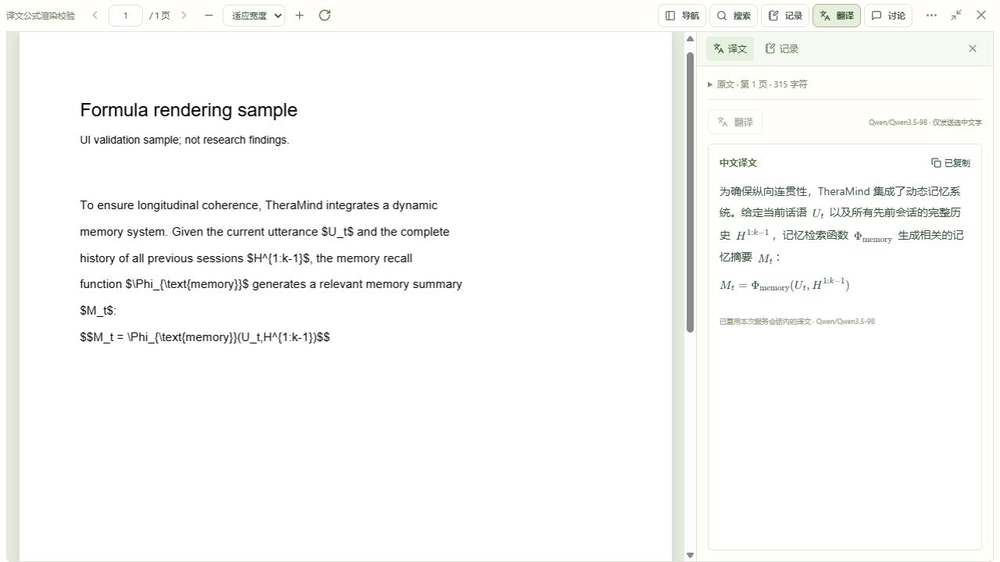

# 译文公式渲染开发与验收

2026-10-14｜应用 0.4.2｜Git 标签 `v0.4.2`

划词译文中的 LaTeX 现在显示为可阅读的数学公式。用户给出的 `U_t`、`H^{1:k-1}`、`\Phi_{\text{memory}}`、`M_t` 与中文叙述一起排版，支持上下标、希腊字母、分数和根号。

## 使用与范围

- 在论文中选中文字并点击“翻译”，公式随译文显示在右侧栏，无需新增模型配置。
- 行内分隔符支持 `$...$`、`\(...\)`；独立公式支持 `$$...$$`、`\[...\]`。译文的普通文字和换行保留。
- 不补写模型遗漏的公式边界；不支持或格式错误的公式保留原始文字，不影响相邻译文。普通金额、转义美元符号及未闭合分隔符保留原文。
- “复制译文”与权限不足时的手动复制框均保留完整原始 LaTeX，便于粘贴到笔记。
- 公式容器限制在侧栏宽度内，超过可用宽度时可横向滚动；短行内公式不会出现多余的小滚动条。

本轮仅改译文展示，不对原 PDF、笔记、聊天回答或卡片新增公式渲染。仍使用现有独立免密钥 Qwen 服务，只发送所选文字；翻译接口、提示词、缓存、取消和字符上限保持现有行为。

## 实现

`MathText.tsx` 在普通文本中识别四种公式分隔符，普通文本交给 React 转义，仅将 KaTeX 生成的公式标记插入页面。每个公式独立渲染，失败时回退原文；宏不在公式之间共享。依据 [KaTeX API](https://katex.org/docs/api) 与[安全选项](https://katex.org/docs/options)，使用 HTML 与 MathML 输出，禁用可信输入，限制宏展开次数和尺寸，避免模型内容添加外部图片、链接或自定义 HTML。

`SelectionTranslation.tsx` 使用该组件显示译文；`reader.css` 为正文与标题分别设置布局，并限制公式宽度。KaTeX 0.19.0 锁定在依赖文件中，样式与字体通过 Vite 打包到本地，无外部字体或 CDN 请求。后端业务代码只同步应用版本，无数据库迁移。

## 验收

- 前端完整回归：19 个文件、115 项通过；新增用户示例、四种分隔符、金额与错误回退、HTML 安全、递归宏限制、宏隔离及原始 LaTeX 复制检查。
- TypeScript、独立构建和本机生产构建通过。本轮后端翻译业务未改变，未重复完整后端测试。
- 独立数据目录 `.test-data/translation-math-browser` 使用合成 PDF，与正式库隔离，后台卡片工作循环关闭。实际选取 315 字符并调用已部署 Qwen 一次，返回四个行内公式及一个独立公式，全部渲染成功；后续读取复用缓存，未调用 DeepSeek。
- 实际复制结果保留全部公式分隔符与 LaTeX。大小窗及全页面显示通过；280 像素侧栏中短公式无多余滚动条。390 × 844 窄屏页面宽度保持 390，侧栏底边 843，五个公式仍保留；临时视口已恢复。浏览器无资源错误，预览来自真实译文。

## 本机发布与版本关联

发布前活动 AI 任务为 0，完整备份在 `.test-data/translation-math-before`。通过 `start.ps1 -Port 8000 -Rebuild` 构建并启动新版，健康接口及前端版本文件均为 0.4.2，入口、阅读模块与本地公式字体返回 200；旧版阅读模块仍可加载。

迁移保持 `0006_discussions`，18 类业务表记录数量与备份一致，三篇原文文件内容一致，外键检查通过。测试论文、数据、模型密钥、备份和依赖继续排除在 Git 外。源码、测试、截图与本文件关联中文提交及带中文说明的 `v0.4.2` 标签；本轮提交保存在本地。
