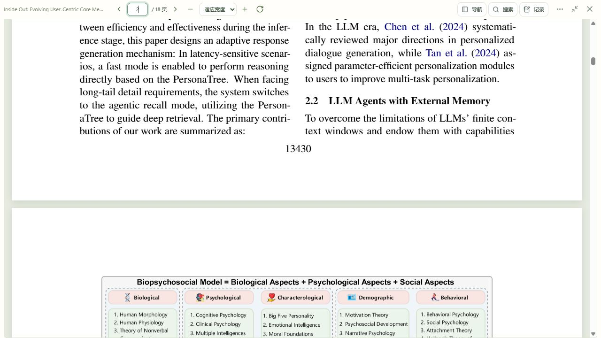

# 连续滚动阅读开发与验收

2026-10-13｜应用 0.3.6｜Git 标签 `v0.3.6`

## 阅读行为

原文所有页面上下连续排列，滚轮和触屏滚动可以直接跨页。顶部保持紧凑工具栏；上一页、下一页、页码输入、目录、缩略图、搜索和笔记引用都在同一份连续文档中定位。

滚动跨过视野上部的阅读线时，同步工具栏页码、本页笔记归属和自动保存队列。再次打开恢复已保存页。现有位置字段保存到页码，重新打开从该页页首继续；本轮没有新增页内偏移字段或数据库迁移。

缩放、旋转、展开侧栏及切换大小窗时保留页内相对位置。页码输入确认后失焦不会再跳回页首。阅读器暂时隐藏在论文信息或卡片后面时保留原布局。

截图来自独立验收库的实际 PDF，展示第 2 页与第 3 页在同一滚动区域衔接。

## 实现

- `reader/PdfDocument.tsx`：单一滚动容器、全部页面占位、可视范围及相邻页按需渲染、页码同步和统一定位。远离视野的画布卸载，拖选所在页临时保留。
- `reader/continuousLayout.ts`：按每页边界、用户单位及旋转计算布局，支持混合尺寸；二分查找阅读位置对应页。
- `reader/PdfPage.tsx`：渲染单页画布、文字层和高亮，不再创建独立滚动容器；搜索及高亮坐标加上该页在文档中的偏移。
- `reader/ReaderWorkspace.tsx`：区分滚动更新与显式跳转，复用原位置保存队列；按渲染窗口加载各页高亮，记录面板继续显示当前页高亮。
- `reader/reader.css`：连续页间距、占位及页内提示，保留精简阅读布局。

高亮仍按单页绑定来源坐标；跨页摘录提示分开添加，浏览器原生复制文字仍可使用。无文字层页面继续支持页码笔记；本轮不增加 OCR 或模型调用。

## 验证

- 前端 **86 项检查通过**，TypeScript 与独立、正式生产构建通过。
- 新增检查覆盖混合页尺寸、旋转与用户单位、页边界、百页论文的按需渲染、滚动跨页、远页恢复、同页再次定位、侧栏宽度变化、隐藏阅读器、搜索及高亮坐标偏移、拖选页保留。
- 单独验证长文变短时浏览器先截断滚动范围的情况，旋转后仍留在原页；验证滚动后的自动位置保存、页码输入失焦保护及短末页滚到底时的页码归属。
- 实际 18 页论文：滚轮从第 2 页进入第 3 页，工具栏同步；新笔记正确归属第 3 页，数据库确认自动保存；搜索 `PersonaTree` 定位到第 1 页正文并显示命中标记。
- 实际 280 页合成样本：跳转第 250 页、滚轮进入第 251 页；连续旋转后仍为第 250 页。只渲染视野附近的画布，未一次创建 280 张画布。
- 390 × 844 手机布局：页面总宽 390，阅读区域可滚动宽度等于可见宽度；滚动从第 250 页连续进入第 253 页。临时窗口尺寸已恢复。
- 实际检查页码输入后滚动再展开记录，页内比例保持约 0.775，避免失焦重新定位到页首。

## 发布与恢复

发布前完整备份在 `.test-data/continuous-reader-before`，含 SQLite 在线备份、原文及本机加密资料。正式库继续使用 `0005_task_order`，本轮后端仅更新应用版本。

刷新 `http://127.0.0.1:8000` 后使用连续阅读。旧前端资源继续保留供已有页面加载。发布提交关联带中文说明的 `v0.3.6` 标签，可通过 `git show v0.3.6 --stat` 查看；验收数据库、论文原文、密钥和备份不提交到 Git。
